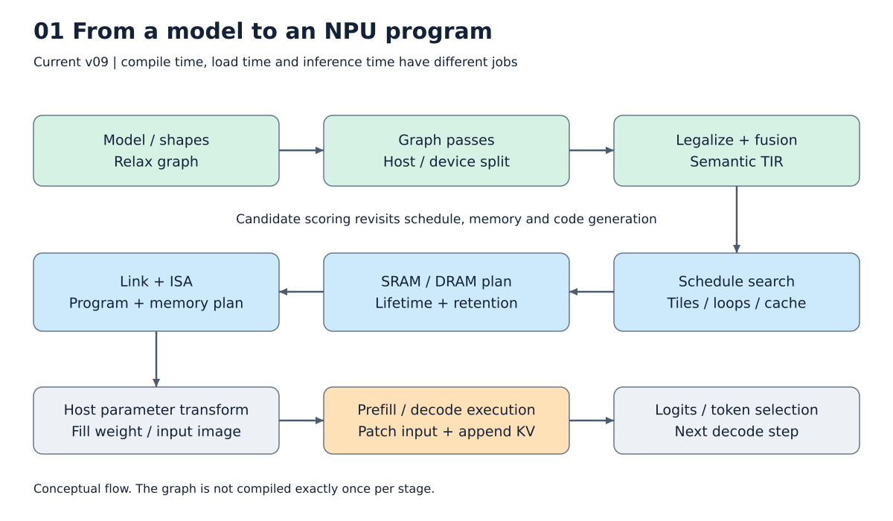
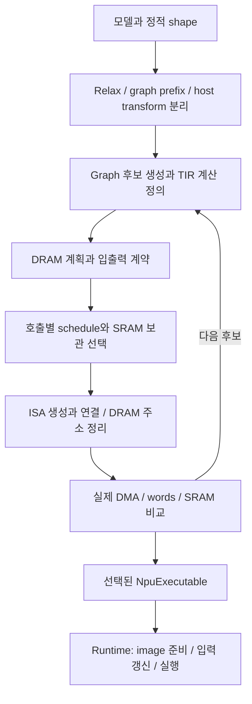

# 1. 모델을 NPU 실행 프로그램으로 바꾸는 전체 구조

[목차](../README.md) · 다음: [모델과 Relax](02_model_relax.md)

우리 compiler의 입력은 **tensor 계산을 표현한 TVM Relax 모듈**이다. 결과는 주소가
확정된 NPU 명령과, 그 주소에 어떤 배열을 넣고 꺼낼지 알려주는 메모리 계획이다.
Checkpoint 파일 자체를 명령으로 바꾸는 것은 아니다. 먼저 checkpoint에서 배열을
읽고 모델 구조와 결합하며, 실행할 shape를 정해야 한다.



그림: 모델에서 명령과 실행 결과까지. 자세한 조건은 아래 설명을 따른다.

## Compile, load, run은 서로 다른 작업이다

| 시점 | 수행하는 일 | Llama 예 |
|---|---|---|
| Compile | 계산, shape, dtype을 보고 graph·schedule·주소·명령을 결정 | prompt 길이 S와 decode capacity C에 대한 프로그램 생성 |
| Load/prepare | weight 변환을 실행하고 정해진 DRAM 주소에 배열을 배치 | W transpose, 필요 시 quantization, memory image 초기화 |
| Run | 입력을 갱신하고 이미 만든 명령 실행 | 현재 embedding·cos/sin·mask로 다음 logits 계산 |

Weight가 함수 parameter라면 값만 바꿔 같은 프로그램을 재사용할 수 있다. 반대로
weight를 Constant로 묶어 constant folding까지 했다면, 그 프로그램이 다른 weight에도
그대로 유효하다고 할 수 없다. 정적 shape가 달라지면 보통 다른 프로그램이 필요하다.

## 계산을 세 수준에서 본다


Relax에는 `matmul → add → SiLU`의 연결 관계가 보인다. TIR에는 `C[i,j]`를
만들기 위해 어떤 `A[i,k]`, `B[k,j]`를 읽는지 보인다. Schedule은 이 계산을
64×64 장치에 맞춰 분할하고 SRAM 복사를 배치한다. Codegen은 그 결과를
주소 설정, LOAD, matrix/vector 연산, SAVE, DMA 명령으로 바꾼다.

**LegalizeOps 뒤에도 Relax는 남는다.** 전체 호출 순서는 Relax가 유지하고,
각 호출의 실제 원소 계산이 TIR PrimFunc로 정의된다. 하나의 IRModule에 두 종류의
함수가 함께 존재한다.

## 메모리는 세 층으로 구분한다

```text
DRAM / global image       weight, 입력, 최종 출력, persistent KV cache
          ↕ GLOAD / GSTORE
SRAM                     지금 계산할 입력 조각, 임시값, 보관할 중간 tensor
          ↕ LOAD / SAVE
Matrix / vector unit     실제 연산, matrix FP32 accumulator
```

기본 SRAM 용량은 8 MiB다. Matrix unit의 기본 조각은 64×64이며, vector 물리 폭은
256 lanes로 정의되어 있다. 현재 v09의 논리 VLEN은 최대 65535를 사용한다.
이 긴 vector의 실제 장치 지원 여부는 [실행 계약](../reference/execution_contract.md)의
미확인 사항으로 남긴다. C-model의 성공이 RTL 구조 검증을 대신하지 않는다.

## Llama 한 층에서 계산하는 것

입력은 `X[S,3072]`다. S는 이번에 처리할 token 위치의 수이고 decode에서는 1이다.

| 계산 | 결과 shape | 의미 |
|---|---|---|
| RMSNorm(X) | [S,3072] | token별 hidden vector 정규화 |
| Q projection | [S,3072] → [24,S,128] | query 24 heads |
| K/V projection 각각 | [S,1024] → KV 8 heads | query 3개가 KV head 1개 공유 |
| Attention | [24,S,128] | QKᵀ, scale, mask, softmax, PV |
| O projection + residual | [S,3072] | head 결과를 합쳐 입력과 더함 |
| RMSNorm | [S,3072] | MLP 입력 정규화 |
| Gate / up projection | 각각 [S,8192] | 두 갈래의 선형 변환 |
| SiLU(gate) × up | [S,8192] | gate로 up 값을 조절 |
| Down projection + residual | [S,3072] | 다음 층의 입력 |

이 층이 28번 반복되며 마지막 norm과 LM head가 vocabulary logits를 만든다.
Generation 경로는 prefill의 마지막 hidden 행만 최종 norm/LM head에 넘긴다.
전체 위치 logits를 반환하는 API와 구분해야 한다.

## 전체 pipeline은 한 번 지나가는 직선이 아니다



후보 비교를 위해 scheduling과 codegen이 여러 번 실행된다. 최종 결과는 한 entry당
하나의 프로그램이다. 후보 개수와 최종 실행 프로그램 개수는 같은 숫자가 아니다.
Prefill/decode를 함께 만들 때는 공유 parameter ABI가 맞는 모듈 하나를 선택한다.

## TVM이 담당하는 부분과 NPU backend의 책임

TVM은 graph pass, TE/TIR 표현, loop 변환, buffer compaction, 정적 storage 계획,
USMP 충돌 분석을 제공한다. NPU backend는 장치의 수치 계약, 후보 생성·선택,
커널 사이 SRAM 유지, ISA 인코딩, 실행 image를 정의한다. DLight를 호출하지 않고도
표준 `tir.Schedule` API를 사용할 수 있다. DLight는 규칙 모음이지 SRAM 수명 관리의
다른 이름이 아니다.

MetaSchedule은 선택형 기능 두 곳에 사용한다. `JSONDatabase`에는 선택된 schedule의
trace를 저장하고 다음 build에서 다시 적용한다. `ReplayFunc`는 같은 NPU 후보 공간에서
설정을 추첨하는 비교용 탐색이다. 기본 탐색은 예상 DMA 순서의 `space`이며, 어느
경로든 실제 SRAM 배치와 명령 생성으로 비용을 확인한다. 학습형 비용 모델이나
장치 latency 측정을 도입한 것은 아니다. 자세한 조건은 [6장](06_matmul_schedule.md)에 있다.

현재 결과물인 `NpuExecutable`에는 `words`, `plan`, 낮춰진 `module`, 입력 signature가
있다. `export_bundle`은 이를 IR, JSON, little-endian binary로 내보낸다. 일반 TVM
`relax.build`가 만드는 runtime Module과 출력 형태가 달라 별도의 build 진입점을 쓴다.

**이 장을 읽은 뒤:** “모델을 compile한다”는 말 안에 graph 선택, schedule, 주소 배치,
명령 생성이 들어 있음을 구분할 수 있어야 한다. 모델 실행과 compile은 별도다.

구현 연결: [공개 build](../../npu_compiler/npu_target.py),
[전체 후보 선택](../../npu_compiler/npu_build.py), [Llama 모델](../../npu_compiler/nn_models/llama.py).
