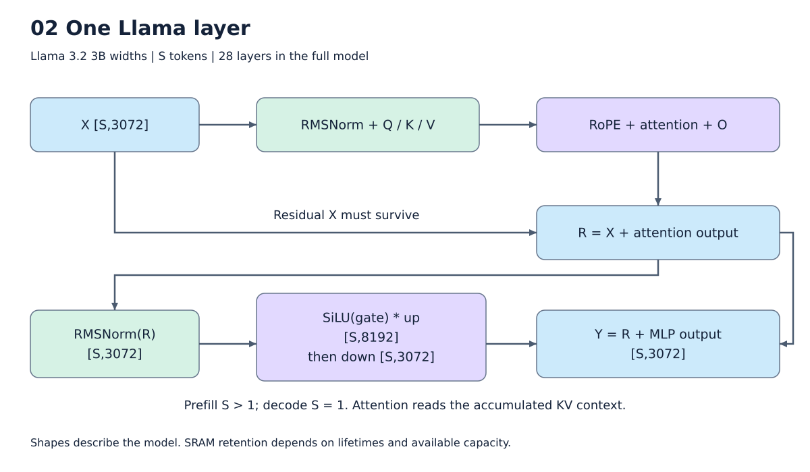

# 2. 모델과 parameter를 Relax로 표현하기

[목차](../README.md) · 이전: [전체 구조](01_overview.md) · 다음: [그래프와 host](03_graph_host.md)

Compiler가 보는 것은 Python의 `for layer in layers` 자체가 아니라, export 결과인
계산 그래프다. 현재 `nn_models/llama.py`는 TVM `relax.frontend.nn`으로 layer를
정의하고 정적 입력 명세를 통해 Relax IRModule을 만든다. `assets/`는 checkpoint의
배열·설정을 읽으며 schedule을 결정하지 않는다.



그림: 실제 Llama 한 layer의 계산과 residual. 자세한 조건은 아래 설명을 따른다.

## Shape를 먼저 읽는다

`X[M,K] @ B[K,N] = Y[M,N]`에서 M은 독립적인 입력 행, K는 더할 축, N은 출력 열이다.
Llama gate projection은 `X[S,3072] @ B[3072,8192]`이다. Decode에서는 S=1,
64-token prefill에서는 S=64다. weight 크기는 같지만 X 크기와 재사용 방식이 달라진다.

PyTorch 계열 checkpoint의 Linear weight는 보통 `[N,K]`다. 계산에는 `[K,N]`을
사용하므로 모델 그래프에 transpose가 나타난다. 이것은 매 실행마다 transpose해야
한다는 뜻이 아니다. 다음 장에서 parameter-only 계산을 host로 옮긴다.

## 끝까지 따라갈 작은 예제

```text
X      [64,128]   FP16, 실행마다 바뀌는 입력
weight [64,128]   FP16, 모델 parameter
bias   [64]       FP16, 모델 parameter

B = transpose(weight)        [128,64]
P = X @ B                    [64,64]
A = P + bias                 [64,64]
Y = SiLU(A)                  [64,64]
```

Bias는 각 행에 반복 적용한다. 실제 Llama projection에는 bias가 없지만, 이 작은
예제는 broadcast와 fusion을 설명하기 위해 bias를 포함한다. Llama 수식과 혼동하지 않는다.
[실제 입력 IR](../examples/pipeline/01_authored_relax.py)에서 네 연산을 찾아볼 수 있다.

간략한 Relax 표현은 다음과 같다. 실제 dump의 임시 변수 이름은 달라도 의미는 같다.

```python
def prefill(x, weight, bias):
    # num_input = 1: 실행 입력은 x, 나머지는 모델 parameter
    with dataflow():
        b = permute_dims(weight, [1, 0])
        p = matmul(x, b)
        a = add(p, bias)
        y = silu(a)
    return y
```

`num_input=1`은 원래 함수의 인자가 실제로 하나뿐이라는 뜻이 아니다. 실행 입력과
모델 parameter의 경계를 알려주는 attribute다. Lifting 뒤 device 함수에도 변환된
parameter를 전달하는 ABI가 남는다. Host가 그 배열들을 DRAM image에 넣는다.

## Relax를 읽는 데 필요한 최소 용어

| 표현 | 역할 | 위 예제에서의 의미 |
|---|---|---|
| `IRModule` | 이름 있는 함수들의 집합 | prefill, host transform, 나중의 TIR 함수들 |
| `relax.Function` | tensor 계산의 호출 관계 | transpose → matmul → add → SiLU |
| `TensorStructInfo` | shape와 dtype 정보 | x는 [64,128] FP16 |
| `Var`와 binding | 값에 이름 부여 | p는 matmul의 결과 |
| `DataflowBlock` | 순수 tensor 계산 영역 | 내부 연결을 분석하고 변환할 범위 |
| `BlockBuilder` | 타입·shape 정보를 가진 Relax 구성 도구 | 작은 예제의 그래프 작성 |
| `GlobalVar` | 모듈 안 다른 함수 참조 | 나중의 matmul PrimFunc 호출 |

Dataflow는 하드웨어 실행의 동시성을 약속하지 않는다. 순수한 데이터 의존성을
표현하여 분석하기 쉬운 형태를 만드는 것이다. 실제 실행 순서와 storage 재사용은
후속 단계가 결정한다.

## 실제 Llama의 입력과 출력

Host가 token ID로 embedding을 읽고 위치에 맞는 cos/sin, mask를 준비한다.
Prefill의 device 입력은 token ID가 아니라 보통 다음 tensor들이다.

```text
input_embeds [S,3072]
cos / sin   [S,1,128]
mask        [1,S,S]
parameters  packed tuple
```

Cache를 반환하는 prefill은 logits 외에 K/V를 반환한다. Decode는 embedding 한 행과
capacity C의 cache를 입력으로 받는다. 모델 exporter의 packed parameter tuple은
“호출 인자 하나에 여러 배열이 들어 있다”는 ABI 표현이지 weight가 한 배열로
물리적으로 합쳐졌다는 뜻은 아니다.

28층을 export하면 호출 그래프에는 모든 층의 계산이 나타난다. 같은 shape의 계산은
schedule 판단을 공유할 수 있지만, layer마다 다른 weight 주소와 residual 관계는
최종 프로그램에 반영되어야 한다.

실제 폭의 [1-layer authored Relax](../examples/llama_ir/01_authored_relax.py)와
[설정·parameter 목록](../examples/llama_ir/summary.json)을 함께 남겼다. Hidden/MLP/head/RoPE
설정은 실제 checkpoint와 같고, 읽기 쉽도록 layer 수만 28→1로 줄였다. S=7, C=9이며
이 IR 예제 자체는 weight를 읽거나 NPU 실행을 한 결과가 아니다.

## 두 frontend 경로를 혼동하지 않는다

본문은 authored `nn_models` 경로를 기준으로 한다. 별도로 HF 모델을 가져오는 경로도
있고 [HF importer](../../npu_compiler/nn_models/hf.py)가 지원 subset과 정밀도를 검사한다.
HF의 FP32 구간을 FP16으로 내리는 옵션은 원래 정밀도 보존을 뜻하지 않는다.
임의의 동적 Python control flow나 모든 Hugging Face 모델을 자동 지원하는 compiler는 아니다.

실행 예제는 [재현 안내](../examples/README.md), 소스는
[Llama frontend](../../npu_compiler/nn_models/llama.py),
[checkpoint reader](../../npu_compiler/assets/llama.py)를 참고한다.
