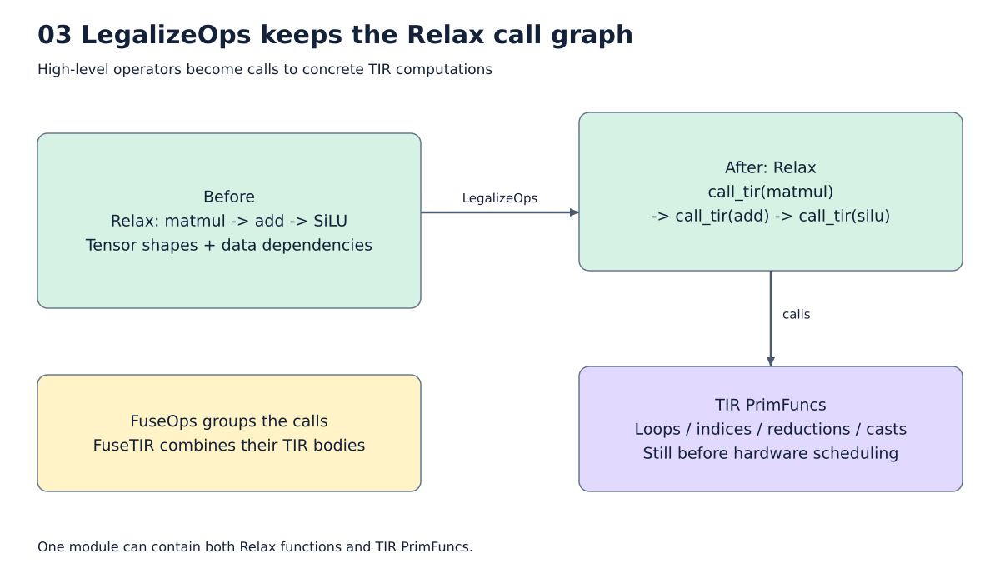

# 4. LegalizeOps, TIR, 계산의 수치 의미

[목차](../README.md) · 이전: [그래프와 host](03_graph_host.md) · 다음: [Fusion](05_fusion.md)

LegalizeOps는 고수준 Relax 연산을 원소 단위 계산으로 정의한다. **이 단계는 계산
방법을 명시하지만 아직 SRAM 주소나 64×64 실행 순서를 모두 정하지는 않는다.**



그림: Legalize 이후 Relax와 TIR의 관계. 자세한 조건은 아래 설명을 따른다.

## Relax와 TIR은 함께 남는다

```text
Relax 함수:         p = call_tir(matmul, x, B)
                    a = call_tir(add, p, bias)
                    y = call_tir(silu, a)

TIR PrimFunc들:     matmul의 loop / add의 loop / silu의 loop
```

`call_tir`는 TIR 함수를 호출하고 어떤 shape/dtype의 결과가 나오는지 알려준다.
그래프의 연결 관계를 지우는 명령이 아니다. 이 때문에 LegalizeOps 이후에도 Relax의
FuseOps를 수행할 수 있다. [실제 unfused IR](../examples/pipeline/03_unfused_semantic_tir.py)에서
Relax 함수와 여러 `@T.prim_func`가 함께 있는 것을 확인한다.

여기서 TIR은 TVM의 **Tensor IR**이다. 다른 compiler가 TIR이라는 약자를 쓰더라도
표현·연산·변환 규칙이 같은 IR이라는 뜻은 아니다. 우리 dump는 TVM Script 문법이다.

## Matmul의 정의를 읽기

계산 의미를 간략히 쓰면 다음과 같다.

```text
for i in M:
    for j in N:
        C32[i,j] = 0
        for k in K:
            C32[i,j] += fp32(A[i,k]) * fp32(B[k,j])
        Y[i,j] = fp16(C32[i,j])
```

`i,j`는 결과 위치를 고르는 spatial 축이다. `k`는 같은 결과에 여러 값을 더하는
reduction 축이다. TIR에서 `T.axis.remap("SSR", ...)`의 S/S/R이 이 구분이다.
`T.init()`은 reduction의 초기값을 정한다. `T.reads/T.writes`는 block의 접근 영역을
표현하여 schedule이 이동·분할의 합법성을 분석하는 데 사용한다.

Buffer는 shape/dtype/scope를 가진 배열 표현이다. TIR의 FP32 C32가 반드시 FP32
SRAM 배열로 materialize된다는 뜻은 아니다. Tensorize 뒤에는 장치 accumulator가
이 상태를 맡을 수 있다. 물리 저장 여부는 후속 lowering까지 읽어야 한다.

## TE는 무엇을 하는가?

TE의 `placeholder`, `compute`, `reduce_axis`는 “이 원소의 값은 어떤 수식인가”를
선언하는 API다. `bb.call_te`는 그 정의에서 TIR PrimFunc를 만들고 Relax 호출을 연결한다.
`matmul_te`는 실행기나 손으로 쓴 ISA 생성기가 아니다.

NPU는 `LegalizeOps(custom_legalize_map)`이라는 표준 확장 지점에 matmul, sum, mean,
RMSNorm, softmax 등의 정의를 등록한다. 기본 lowering과 다른 dtype/저장 경계가
필요한 연산만 바꾸며, 나머지는 TVM의 기존 legalization을 사용한다.
Split의 지원되는 view 변환도 이 확장에 포함된다.

## FP16 저장과 FP32 누산을 구분한다

입력과 출력이 FP16이어도, matmul의 많은 곱을 FP16으로 계속 더하면 오차가 커질 수 있다.
현재 정책은 FP16 입력을 곱하여 FP32로 누산하고 완료된 결과를 FP16으로 저장하는 것이다.
실제 장치가 K=64 단위 부분합을 만드는 순서도 reference에 반영한다.

```text
K = 128인 출력 타일

0..63의 곱 합계     → FP32 accumulator 시작
64..127의 곱 합계   → 같은 FP32 accumulator에 더함
전체 K 완료        → FP16 SAVE
```

중간에 FP16으로 저장했다가 다시 누산하면 반올림 위치가 달라진다. 현재 schedule은
이렇게 accumulator 연결을 끊는 후보를 거절한다. “SRAM에 공간이 충분하다”만으로
그 schedule이 실행 가능한 것은 아니다.

CPU reference는 표준 `split`과 `rfactor`로 64개 부분합 grouping을 표현한다.
Constant folding도 같은 기준을 적용한다. 단순 flat-K CPU loop와 모든 입력에서
bit-exact하다고 약속하지 않는다. 부동소수점 덧셈의 결합 순서가 다르기 때문이다.

## Fusion이 수치 의미를 어디까지 바꾸는가?

현재 fusion은 주로 계산을 함께 배치하고 중간 DRAM 이동을 줄인다. 예를 들어:

```text
matmul 결과 FP16 → add 결과 FP16 → SiLU 결과 FP16
```

이라는 저장 정밀도는 하나의 커널로 합쳐도 기본적으로 유지한다. FP16 buffer를
DRAM 대신 SRAM에 둔다고 dtype이 자동으로 FP32가 되는 것은 아니다.

중간 FP16 반올림을 생략하면 수학적 기준에 더 가까워지는 경우도 있다. 그러나 다른
결과를 만드는 변환이므로 현재의 데이터 이동 최적화와는 별도의 정밀도 정책이 필요하다.
현재 compiler는 오차 예산을 받아 FP16/FP32 경계를 자동 탐색하지 않는다.

## Reduction과 norm의 예외

Softmax는 max를 빼고 exp, FP32 sum, FP16 저장, 나눗셈을 한다. RMSNorm은 FP16
제곱의 overflow를 피하기 위해 입력을 먼저 absmax로 축소한다. 이 변환은 target의
명시적 근사이며 HF FP32 계산과 동일하다는 뜻은 아니다. 세부 식은 [연산 장](07_operators.md)에 둔다.
일반 sum/mean 역시 결과를 FP16으로 저장하는 구간이 있어, 큰 합계의 overflow가
자동으로 해결되는 것은 아니다.

## Semantic TIR에서 확인할 것

1. 입력/출력 shape와 dtype이 의도와 맞는가?
2. 어떤 축을 더하고, 초기값은 무엇인가?
3. FP32 → FP16 cast가 어디에 있는가?
4. 아직 global buffer로 보이는 값이 무엇인가?
5. Schedule 이후에도 같은 계산 의미가 보존되는가?

이 파일에는 아직 최종 DMA량이 없다. DMA량은 캐시 위치, 보관 선택, 실제 주소와
후단 명령 정리까지 적용한 뒤 판단한다.

구현 연결: [legalize map](../../npu_compiler/npu_legalize.py),
[부분합 reference](../../npu_compiler/npu_numeric.py),
[누산 상태 검사](../../npu_compiler/npu_accumulator.py).

같은 변환을 실제 Llama 폭에서도 확인하려면 [한 layer의 semantic TIR](../examples/llama_ir/03_semantic_tir.py)을 본다.
작은 예제와 동일하게 Relax 함수와 여러 PrimFunc가 한 모듈에 있다. 전체 28-layer 출력 검증은
[실험 E6](11_experiments.md)에 별도로 기록했다.
