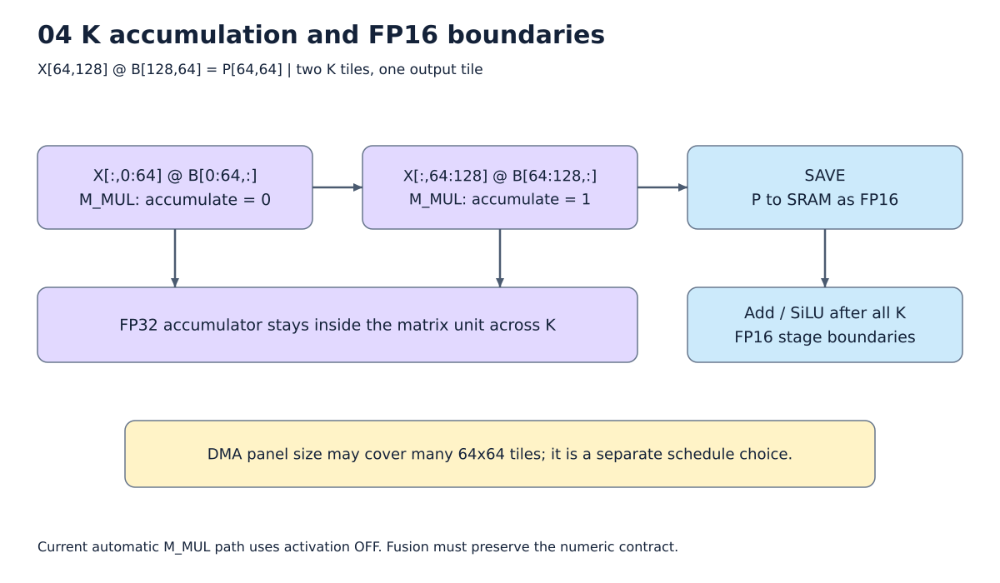

# 6. Matmul을 장치에 배치하는 scheduling

[목차](../README.md) · 이전: [Fusion](05_fusion.md) · 다음: [다른 연산](07_operators.md)

Semantic TIR은 계산을 정의하고, schedule은 **같은 계산을 어떤 조각·순서·저장
위치로 실행할지** 정한다. 작은 예제와 실제 Llama 크기를 함께 보자.



그림: K=128의 누산과 저장 경계. 자세한 조건은 아래 설명을 따른다.

## 64×64 장치로 K=128을 계산하기

`X[64,128] @ B[128,64]`의 출력은 64×64 타일 하나다.

```text
X[:,0:64]   × B[0:64,:]    → FP32 accumulator 시작
X[:,64:128] × B[64:128,:]   → 같은 accumulator에 누적
전체 K 완료                → 출력 64×64를 FP16으로 SAVE
```

여기서 accumulate bit는 두 번째 matrix 명령부터 켜진다. Activation을 적용한다면
해당 출력 타일의 마지막 K 이후여야 한다. 현재 자동 경로는 activation OFF다.

M/N이 더 크면 출력 타일도 여러 개다. 현재 장치·수치 계약에서는 출력 타일 하나의
K 누적을 끊지 않는 것이 중요하다. 그래서 스케줄의 K 반복이 출력 타일 반복 안에
있다. 이것이 모든 하드웨어에서 K가 항상 최내측이어야 한다는 일반 법칙은 아니다.

## SRAM에 올리는 panel은 matrix tile보다 클 수 있다

Panel은 여러 64×64 계산에서 재사용할 입력 영역이다. 예를 들어 B의 여러 열 타일을
한 번에 올리면 여러 matrix 명령이 같은 SRAM 배열의 다른 위치를 사용한다.
전체 weight를 한 번에 올린다는 뜻은 아니다.

Llama gate weight `[3072,8192]`는 FP16으로 48 MiB다. 8 MiB SRAM에 들어가지 않는다.
`X[64,3072]`는 384 KiB이므로 X를 유지하고 W의 열 묶음을 바꾸는 방식이 유리할 수 있다.
반면 S=3072이면 X도 18 MiB다. 이때는 X와 W를 모두 부분적으로 올리는 후보가 필요하다.
현재 parameterized space는 양쪽의 복사 위치를 독립적으로 선택한다.

같은 X/W 크기라도 DMA는 달라진다. W를 사용할 때마다 다시 읽는지, 여러 X 행에서
재사용하는지에 따라 반복 전송 횟수가 다르기 때문이다. SRAM을 가득 채우는 것만이
목표도 아니다. 앞 커널의 출력을 유지할 공간과 임시값 공간이 함께 필요하다.

## 표준 Schedule API가 바꾸는 것을 한 번에 이해하기

| API | 실제 변화 | 그 자체로 하지 않는 일 |
|---|---|---|
| `split` | loop 하나를 바깥/안쪽 loop로 분할 | SRAM 복사 생성 |
| `reorder` | 의존성이 허용하는 loop 순서 변경 | DMA 비용 자동 최소화 |
| `cache_read` | 입력을 새 cache buffer에 복사하는 stage 생성 | 복사의 적절한 반복 위치 결정 |
| `compute_at` | 생산 계산을 소비 loop의 특정 위치 안으로 이동 | ISA 명령으로 남기기 |
| `cache_write` | 출력 계산이 cache를 쓰고 원래 출력으로 복사하도록 구성 | 최종 출력 ABI 제거 |
| `reverse_compute_at` | 소비 계산을 생산 loop의 특정 위치로 이동 | 무조건 in-place 실행 |
| `set_scope` | 기존 buffer의 storage scope 변경 | 기존 buffer와 별개 복사 stage 추가 |
| `tensorize` | 일치하는 계산 조각을 등록한 장치 intrinsic으로 치환 | 임의 수식의 자동 ISA 구현 |

## compute_at을 작은 예제로 보기

원래 계산이 다음과 같다고 하자.

```text
B = A + 1
C = B * 2
```

변환 전에는 B 전체를 만든 뒤 C 전체를 만든다. C의 행 loop를 2행 단위로 나눈 뒤
B에 `compute_at`을 적용하면:

```text
for 행 묶음 in [0:2, 2:4]:
    이 묶음에서 필요한 B를 계산
    그 B를 사용해 C를 계산
```

이 된다. B 전체를 오래 저장할 필요가 줄어든다. `compute_at`은 **IR을 바꾸는 명령**이라
결과 TIR에 그 이름이 남지 않는다. 대신 loop 안으로 이동한 B block을 볼 수 있다.

[변환 전](../examples/schedule_api/01_before.py),
[compute_at 뒤](../examples/schedule_api/02_compute_at.py),
[적용한 API trace](../examples/schedule_api/02_compute_at.trace.txt)를 함께 읽는다.
이 교육 예제는 4×4 FP32 CPU 계산이며 NPU tile 크기가 2라는 뜻이 아니다.

## reverse_compute_at은 어느 쪽을 옮기는가?

B를 만드는 loop를 기준으로 C를 끌어오면 다음처럼 된다.

```text
for B의 행 묶음:
    B 묶음 생성
    방금 생성한 B를 사용하는 C 묶음 계산
```

Compute_at은 생산자를 소비 위치에 맞추고, reverse_compute_at은 소비자를 생산 위치에
맞춘다. Matmul의 뒤쪽 add/SiLU나 SRAM 출력의 복사 stage를 생산 타일 근처에 배치할 때
이 구분이 필요하다. [실제 reverse_compute_at 결과](../examples/schedule_api/03_reverse_compute_at.py)를 본다.

## cache_read와 buffer compaction

`cache_read`만 추가하면 입력 전체를 복사하는 buffer가 생길 수 있다.
복사 stage를 `compute_at`으로 특정 행 묶음 안에 넣으면 그때 필요한 영역이 좁아진다.
`CompactBufferAllocation`은 그 접근 범위를 보고 실제 allocation을 줄인다.

```text
cache_read             : SRAM 복사 buffer 추가
compute_at             : 필요한 행마다 복사하도록 이동
CompactBufferAllocation: 그 범위에 맞춰 buffer 크기 축소
```

[cache_read](../examples/schedule_api/04_cache_read.py) →
[compute_at 적용](../examples/schedule_api/05_cache_read_compute_at.py) →
[compaction 결과](../examples/schedule_api/08_cache_read_compacted.py)를 비교한다.
`set_scope` 예제와 `cache_write` 예제도 같은 폴더에 있다.

## Tensorize와 실제 ISA 사이

64×64 계산과 등록한 `TensorIntrin`의 수식·dtype·scope가 맞으면 `tensorize`가
`npu_gemm_acc` 같은 호출로 바꾼다. 이는 최종 ISA opcode 자체가 아니다.
Codegen은 그 호출을 descriptor 설정, 입력 LOAD, MAC bit를 가진 M_MUL로 펼친다.
`npu_fill_zero`도 항상 SRAM zero-fill을 뜻하지 않는다. 새로운 누산을 시작한다는
상태로 해석하여 첫 matrix 명령의 MAC=0으로 구현할 수 있다.

## 현재 탐색 공간

M panel, N panel, K chunk, M/N 바깥·안쪽 순서, X/W cache의 loop 위치를 조합한다.
Tile 배수인 factor를 만들고 unit loop로 인한 동등 후보를 합친다. 같은 축의 연속 loop도
실제 64단위 순회와 복사 주기가 같으면 합친다. M/N panel이나 K group 경계마다 복사하는
경우에는 경계에 따라 복사 주기가 달라지므로 별도 후보로 유지한다.
이미 SRAM에 있는 입력은 불필요한 복사 선택지를 줄인다.

후보 목록을 만든 뒤 현재 가용 SRAM을 반영한다. Tile에 맞게 정렬된 rank-2 FP16의
직접 입력 buffer는 matmul 시 두 cache가 동시에 필요하므로, 그 두 크기의 합만으로
용량을 초과하면 schedule 생성 전에 제외할 수 있다. 이 계산에 임시 출력이나
추정 scratch를 더해서 거절하지 않는다. Padding·computed producer 등 이 조건을
확인하지 못하는 경우에는 추정 크기로 검사 순서만 바꾸고 후보를 제거하지 않는다.
남은 후보는 실제 schedule, buffer compaction, SRAM 배치, 명령 생성으로 검증한다.

과거 A/B/C 계열의 기준 schedule도 비교용 incumbent로 남아 있다. 네 가지 고정 규칙만
고르는 상태는 아니다. 다만 전 공간을 끝까지 검사하지도 않는다. 기본 성공 후보 8개,
기본 probe words 100000, 시도 64회 등의 예산으로 제한한다. 실제 words 한도는
`max(설정값, 기준 후보 words × 성공 후보 목표 수)`로 늘릴 수 있다. 기준이 없다면
첫 합법 후보의 words를 사용한다. Words 때문에 끝내기 전에는 목표 수와 전체 시도
한도가 허용하는 범위에서 적어도 두 합법 후보를 비교한다. 64회는 기존 기준 탐색과
확장 탐색 각각에 적용된다. 예산 내 합법 후보를 찾지 못한 것과 장치에서 원리상
불가능한 것은 구분한다.

SRAM을 오래 보관하는 중간값이 있으면 그 공간을 제외한 용량으로 다시 schedule을
고른다. 이 부분이 다음 [메모리 장](08_memory.md)과 연결된다.

### 전체 모델의 탐색을 확대할 때 읽어야 하는 기록

Graph의 120초 제한과 위 schedule 한도는 별개다. 256-token 전체 prefill 실행기는
graph 시간 제한을 없애고 `schedule_space_trials=16`, `schedule_max_attempts=128`,
`schedule_probe_word_budget=1000000000`으로 설정한다. 이는 현재 구현이 생성하는
graph 후보의 비교를 완료하면서 matmul당 추가 탐색도 넓히기 위한 실험 설정이다.
일반 build의 기본 설정을 전부 이 값으로 바꾼 것은 아니다.

`legal_budget`는 성공 후보 목표에 도달했다는 뜻이고 `attempt_budget`는 실패까지
포함한 시도 수를 다 썼다는 뜻이다. `exhausted`는 해당 목록의 끝까지 갔다는 뜻이다.
Graph의 시간 종료가 없었다는 사실과 모든 schedule 후보를 확인했다는 사실을
구분한다. 실행기는 최종 선택된 커널뿐 아니라 탈락한 graph와 fusion 영역의
탐색 진단도 보존한다. 같은 recipe의 재사용 횟수를 새 후보 검사 횟수로 세지 않는다.

이 전체 모델 실험은 기본 `space` 전략으로 수행하고, 과거 DB의 승자를 즉시
재생해 탐색을 건너뛰지 않도록 persistent DB를 사용하지 않는다. Build 안에서의
동일 계산 재사용은 유지한다. ReplayFunc의 여러 seed를 비교하는 실험과는 별개다.

### MetaSchedule 기록 재사용: 09-29에 추가한 선택 기능

동일한 계산을 다음 build에서도 처음부터 탐색하지 않도록 TVM의 `JSONDatabase`,
`Workload`, `TuningRecord`, `tir.Schedule.trace`를 연결했다. 기본값은 꺼짐이다.
현재 대상은 `schedule_search="space"` 또는 실험용 `"meta_schedule"`로 선택한 FP16
matmul과 지원되는 matmul epilogue다.
Attention 전체, 일반 vector, W8A8의 schedule 저장은 이번 범위에 포함하지 않는다.

```text
첫 build:
  같은 조건의 기록이 있는지 조회
  → 없으면 기존의 제한된 후보 탐색
  → 가장 좋았던 schedule의 trace 하나 저장

다음 build:
  같은 조건의 기록 조회
  → trace를 새로운 TVM Schedule에 재적용
  → buffer compaction과 NPU lowering을 다시 수행
  → SRAM 배치와 accumulator/codegen 제약 재검증
  → 최종 호출 주소로 명령 생성
```

Trace는 `split`, `reorder`, `cache_read`, `compute_at`, `tensorize` 등을 수행한 기록이다.
Weight 값이나 최종 DRAM 주소가 들어간 실행 프로그램을 저장하는 것은 아니다.
`LowerInitBlock`, `CompactBufferAllocation`, NPU accumulator 처리처럼 Schedule 밖의
변환은 trace에 포함되지 않으므로 재사용 시에도 동일한 공통 lowering을 수행한다.
기록 재적용이나 SRAM/codegen 검사가 실패하면 원래 탐색으로 돌아가고
`database_rejection`에 이유를 남긴다. 깨진 JSON 파일 자체의 로드 오류는 숨기지 않는다.

재사용 조건에는 다음 항목이 들어간다.

- 연산 구조, shape, dtype, 입력·출력의 SRAM/DRAM scope와 알 수 없는 IR 속성.
- 실제 가용 SRAM, tile, scratch 위치·개수, SRAM 배치 정책, 수치 정책.
- Compiler 소스·TVM·ISA·native library의 버전 식별값. 버전마다 DB 디렉터리를 분리한다.
- `global_symbol`, `op_pattern` 같은 함수 이름·fusion 분류는 schedule 동일성에서 제외한다.
  전체 그래프의 추가 탐색 시간과 memory beam 폭도 커널 recipe의 조건에서 제외한다.
- 탐색 전략·seed·성공 후보 수·시도 수·words 예산은 **DB 실행 호환성 조건에서 제외**한다.
  오래 튜닝한 결과를 다른 탐색 설정의 빠른 build에서도 재사용할 수 있다.

DB 사용에는 두 모드가 있다. 기본 `reuse`는 기록을 검증해서 바로 적용한다.
`tune`은 기록을 검증한 뒤 그 결과를 기준으로 추가 탐색한다. 기존 기록보다
DMA/words/SRAM 순서의 비용이 좋아질 때만 새 trace를 추가하며, 다음 build에서는
최신 개선 기록을 선택한다. JSONDatabase에는 이전 trace가 이력으로 남는다.
잘못된 기록을 재생하다 실패한 경우에는 다시 탐색해 교체할 수 있다.
Build 안의 기존 recipe cache는 탐색 설정도 구분하여 다른 튜닝 요청을 건너뛰지 않는다.

따라서 같은 matmul이 반복돼도 SRAM 입력 여부나 작업 공간이 다르면 별도 기록이 된다.
검증용 3회 반복 matmul에서는 계산 종류는 하나였지만 메모리 조건별 기록은 5개였다.

`meta_schedule.relax_integration.extract_tasks`도 선택형 경로에서 호출한다.
동일한 TIR 계산을 하나로 묶고 호출 횟수를 `weight`로 기록하며,
`plan.compilation["meta_schedule"]["task_inventories"]`에서 확인할 수 있다.
이 정보는 현재 **작업 목록과 반복 횟수의 진단**이다. 아직 MetaSchedule의 TaskScheduler로
탐색 순서를 정하지 않으며, 이 목록을 이유로 서로 다른 SRAM 조건을 합치지도 않는다.

#### 기존 비용 기준을 유지하는 이유

현재 NPU 선택 기준은 DMA bytes → ISA words → SRAM peak다. TVM의 기본 튜닝 DB는
`run_secs`를 기준으로 좋은 기록을 고르므로, DMA bytes를 실행시간인 것처럼 저장하지 않는다.
이번 기록은 `run_secs=None`인 **이미 선택된 recipe**이며 조건마다 최신 승자를 사용한다.
표준 `GetTopK`/`query_schedule`/`MetaScheduleApplyDatabase`의 latency 순위 조회에는 사용하지
않는다. NPU adapter가 정확히 일치하는 workload의 trace를 찾아 재검증한다.
이 DB 기능은 MetaSchedule의 저장·재생 기능을 활용한다. 아래의 선택형 탐색과
구분하며, 어느 쪽도 EvolutionarySearch나 학습형 CostModel을 도입한 것은 아니다.

#### 작은 예제에서 확인한 결과

한 번의 묶음 검사에서 반복 matmul, fused matmul+SiLU+multiply, padding이 필요한 matmul을
기존 경로 / 첫 저장 / 새 context에서 DB 재사용 경로로 비교했다. 후보 탐색 함수가
재사용 경로에서 호출되면 즉시 실패하도록 검사했다. Native/Python 명령도 비교했다.

| 예제 | 기존 build | 첫 저장 build | DB 재사용 build | 새 schedule 후보 TIR 생성 |
|---|---:|---:|---:|---|
| 64×64 matmul 3회, 커널 사이 SRAM 보관 포함 | 0.419 s | 0.499 s | 0.307 s | 8 → 0 |
| M=64, K=128, N=64, SiLU+multiply fusion | 0.343 s | 0.383 s | 0.264 s | 3 → 0 |
| M=7, K=128, N=64, padding | 0.369 s | 0.422 s | 0.164 s | 7 → 0 |

시간에는 context/DB 준비가 포함된다. 각각 한 번 측정했으므로 일반적인 성능 배율은 아니다.
세 경로의 명령이 같았고, 기존/재사용 경로의 C-model 출력은 비트 단위로 같았다.
실제 C-model DMA counters와 명령 통계도 일치했다. 재사용 시 후보 **탐색**이 0회인 것이며,
trace 재생·lowering·검증까지 없어진다는 뜻은 아니다.

위 최초 저장 기능 검사 예산은 기존 후보 1개, 확장 후보 2개, 각 시도 최대 8회였다. 전체 모델, 실제 폭의
Llama matmul, 긴 prefill, 양자화, 여러 프로세스의 동시 DB 쓰기는 검증하지 않았다.
DB 디렉터리는 한 번에 한 writer만 사용한다. 기존 전체 Llama 결과는 이전 source hash의
기록으로 유지하며 이번 변경 뒤의 전체 모델 검증으로 확대하지 않는다.

근거: [실행 결과와 source hash](../evidence/current/meta_schedule_reuse.json),
[통합 검사](../../tests/test_meta_schedule.py), [TVM 연결 코드](../../npu_compiler/npu_meta_schedule.py).
실제 사용법은 [12장](12_operations_limits.md)에 있다.

### MetaSchedule로 직접 탐색하기: ReplayFunc 비교

기록을 재사용하는 것과 새로운 schedule을 찾는 것은 다른 기능이다. 두 번째 기능을
비교하기 위해 `schedule_search="meta_schedule"`를 추가했다. 기본값은 기존 `"space"`다.
둘 다 같은 NPU 규칙과 같은 후보 목록을 사용하고, **후보를 검사하는 순서**를 바꾼다.

```text
공통: M/N panel, K chunk, loop 순서, X/W 복사 위치의 후보 목록
  │
  ├─ space: 예상 DRAM 전송량이 작은 후보부터 검사
  │
  └─ meta_schedule: TVM ReplayFunc가 ScheduleFn을 다시 실행
       → sample_categorical로 후보 번호 선택
       → 그 설정으로 NPU용 split/cache_read/compute_at/tensorize 수행
  │
  └─ 공통 평가: buffer compaction → 실제 SRAM 배치 → NPU 명령 생성
       → DMA bytes, ISA words, SRAM peak 순으로 비교
       → 기존 기준 schedule보다 좋으면 교체
```

- `TuneContext`: 한 TIR 작업의 target, 탐색 공간, 탐색 전략, 난수 seed를 묶는다.
- `ScheduleFn`: TVM이 후보를 요청할 때 실행할 함수다. 기존 NPU schedule 규칙을
  재사용하므로 accumulator, tile, padding 계약을 새로 구현하지 않는다.
- `sample_categorical`: 후보 번호를 확률에 따라 선택하고 선택 결과를 trace에 남긴다.
  현재는 중복 정리와 증명 가능한 SRAM 초과 제거를 거친 목록에서 동일 확률로 뽑는다.
- `ReplayFunc`: 매번 위 함수를 다시 호출한다. 선택한 설정에 따라 Python에서 서로 다른
  cache/loop 처리를 하므로, 기존 trace의 숫자만 바꾸는 방식 대신 이 전략을 사용했다.

따라서 TVM의 **실제 탐색 API를 연결한 것**은 맞지만, 표준 GPU schedule을 NPU에 그대로
적용하거나 과거 측정에서 좋은 후보를 학습하는 구성은 아니다. 실행시간이 없으므로
DMA를 `run_secs`로 속여 넣지도 않는다. ReplayFunc에는 시도 완료를 알리고,
기존 NPU 비용 평가기가 최종 승자를 고른다. Fusion 선택과 커널 사이 메모리 계획은
이 바깥 단계에 그대로 있다.

최대 시도 수는 유한한 양수여야 한다. 실패, SRAM 초과, 중복 추첨도 시도를 소비하며,
중복은 schedule을 다시 만들지 않는다. TVM의 자동 postprocessor 목록은 비워서
그 내부에서 제한 없이 재시도하는 것을 피하고 공통 NPU 검증 경로에서 거절한다.
성공 후보 수와 커널 크기에 맞춰 조정한 누적 probe words도 제한한다. Words는 후보
명령을 만든 뒤 확인하므로 실제 누적값이 한도를 넘을 수 있다. 기준 schedule 탐색의 예산은
확장 탐색과 별도이며, 이미 찾은 실행 가능한 기준을 유지한다.

실제 Llama 3.2 3B의 decode, 64-token prefill, 512-token prefill에서 네 커널을 비교했다.
이번 예산·seed에서는 두 방식의 최종 명령이 모두 같았다. 특히 512-token down은 기존
확장 탐색의 첫 16개가 모두 SRAM 초과였고, ReplayFunc는 합법 후보를 찾았지만
기준 schedule보다 전송량이 많았다. 이것은 모든 탐색이 충분했다는 결과도,
MetaSchedule 자체가 항상 불리하다는 결과도 아니다.

비교 조건·시간·출력 검증은 [실험 E8](11_experiments.md#e8-metaschedule로-탐색하면-llama-커널이-더-좋아지는가)에 모았다.
기본값은 `space`로 유지한다. E8에서 드러난 후보 순서·중복·예산 문제를 보완한 뒤
512-token down을 다시 비교한 결과는 [실험 E9](11_experiments.md#e9-긴-입력의-탐색과-튜닝-결과-재사용-개선)에 있다.
E8의 후보 개수와 고정 words 제한은 개선 전 기록이며 현재 동작과 구분한다.

### 탐색 설정의 숫자는 무엇을 뜻하는가?

| 설정 | 의미 |
|---|---|
| m_panel / n_panel | 바깥에서 묶는 출력 행/열 수. 그 안은 다시 64 단위로 나눔 |
| k_chunk | K를 묶는 크기. 그 안에서도 64개씩 matrix 명령 실행 |
| outer_order | M panel과 N panel 중 무엇을 먼저 반복하는지 |
| inner_order | panel 내부의 M/N tile 순서 |
| a_at / b_at | X/W 복사 stage를 어느 loop에 넣을지. 그 안에서 반복 사용하는 영역을 SRAM에 올림 |

Factor는 padding한 축 길이의 64배수 약수에서 만든다. 예를 들어 N=256이면
64/128/256이 panel 후보가 된다. K chunk가 64라도 `a_at`이 더 바깥이면 X의 K 전체가
SRAM에 있을 수 있다. **K chunk 숫자만 보고 DMA 크기를 판단하면 안 된다.**

새 작은 예제의 실제 선택은 `m_panel=64, n_panel=64, k_chunk=64`, M→N 순서,
`a_at=b_at=m_panel`이다. X와 W는 각각 16 KiB이며, SRAM 복사는 K loop 바깥이다.
따라서 K=0..63과 64..127의 두 matrix 명령이 같은 SRAM 배열의 다른 부분을 읽는다.
[실제 scheduled TIR](../examples/pipeline/07_scheduled_fused_matmul_add_silu.py)에서
입력 복사 block이 두 번의 K 반복 밖에 있는지 확인할 수 있다.

### 실제 폭 Llama MLP의 보존된 선택

M=64의 [기존 최종 개선 비교](../evidence/current/refinement.json)에서 선택한 방식이다.
이 값들은 실제 폭 MLP의 정적 compile 기록이다. 전체 모델 출력 검증은 11장에 있다.

| Projection | 계산 | 선택한 입력 배치 |
|---|---|---|
| gate / up | [64,3072]×[3072,8192] | X [64,3072] 384 KiB 유지, W [3072,64] 384 KiB씩 교체 |
| down | [64,8192]×[8192,3072] | W [8192,256] 4 MiB 유지, 그 안의 출력 64열 타일 4개 계산. H 입력은 앞 커널에서 보관 |

Gate의 각 출력 타일은 K 방향 matrix 명령 3072/64=48개를 사용한다. 출력 열 타일은
8192/64=128개이므로 총 6144개 matrix 명령이다. Weight는 128개 panel로 나누어
읽으므로 전체 48 MiB가 한꺼번에 SRAM에 올라가는 일이 없다.
Down도 12개 weight panel×4개 출력 tile×128개 K tile=6144개다.
64×64 출력마다 FP32 누산을 끝낸 뒤 H 또는 최종 출력의 해당 영역에 저장한다.

### 긴 prefill에서 X와 W가 모두 큰 경우

다음은 S=3072일 때 비용 차이를 이해하기 위한 **설명용 계산이며 새 compile 측정이 아니다**.
X는 18 MiB, gate W는 48 MiB다. X를 64행씩, W를 256열씩 묶으면 각각 384 KiB와
1.5 MiB로 잘라 올릴 수 있다. 나머지 SRAM은 출력·임시값·앞 커널의 보관값에 필요하다.

```text
X panel을 바깥에 유지:
    48개 X panel마다 W 전체를 여러 열 panel로 나누어 순회
    X 18 MiB + W (48 MiB × 48회) 전송

W panel을 바깥에 유지:
    32개 W panel마다 X 전체를 여러 행 panel로 나누어 순회
    W 48 MiB + X (18 MiB × 32회) 전송
```

두 경우의 원래 tensor 크기는 같지만 재읽는 횟수가 다르다. 실제 탐색은 더 큰
panel과 다른 cache 위치도 검사하며, 앞 커널의 SRAM 입력을 쓸 수 있으면 그 부분의
DRAM 읽기도 제외한다. 그래프 전체의 tile streaming까지 지원하는 것은 아니므로
이 산술 예를 현재 장문 전체 모델의 최적 실행 결과라고 해석하지 않는다.

구현: [후보 공간](../../npu_compiler/npu_schedule_space.py),
[후보 검사](../../npu_compiler/npu_schedule.py), [Schedule 변환](../../npu_compiler/npu_intrin.py).
