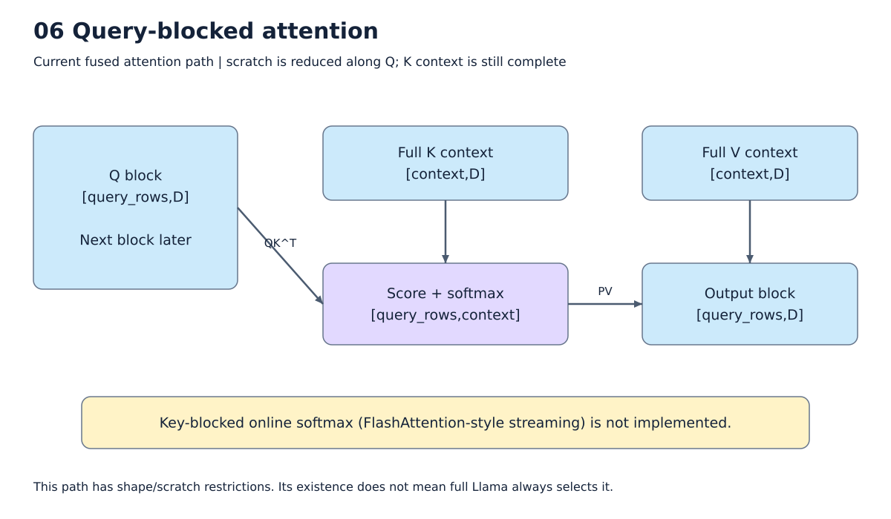
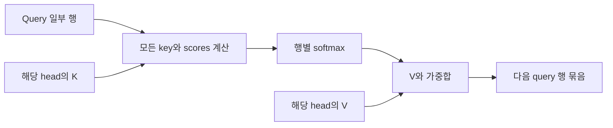

# 7. Vector, 정규화, RoPE와 attention

[목차](../README.md) · 이전: [Matmul schedule](06_matmul_schedule.md) · 다음: [메모리](08_memory.md)

Llama는 matmul만으로 동작하지 않는다. Residual add, SiLU, scale, mask, norm,
RoPE는 vector 계산이며, softmax와 RMSNorm에는 여러 값을 모으는 reduction도 있다.
이 장은 한 연산이 어떤 계산·임시값으로 펼쳐지는지 설명한다.



그림: 현재 query-blocked attention의 범위. 자세한 조건은 아래 설명을 따른다.

## 원소별 계산은 SRAM 주소와 길이를 받아 실행한다

`Y[i]=X[i]+R[i]`는 각 위치가 독립적이다. Codegen은 길이와 입력·출력 descriptor를
설정하고 `LOAD X → LOAD R → ADD → SAVE Y`를 생성한다. 여기서 LOAD/SAVE는
SRAM과 연산장치 사이의 이동이다. 이미 SRAM에 있는 X를 다시 DRAM에서 읽을 이유는 없다.

SiLU는 `x/(1+exp(-x))`다. 현재 기본 경로는 다음 vector 단계로 구성한다.

```text
t1 = -x
t2 = exp(t1)
t3 = 1 + t2
t4 = 1 / t3
y  = x * t4
```

중간 결과는 기본 FP16 vector 경로에서 SRAM 임시 공간에 저장된다. 따라서 SiLU 하나가
ISA 하나라고 세면 안 된다. 임시 공간은 표현식과 처리 길이에 맞춰 확보하고 재사용한다.
커널을 fusion해도 이 vector 명령들이 자동으로 matmul activation bit로 바뀌지는 않는다.

## 물리 256 lanes와 논리 VLEN

현재 v09 규약은 물리 폭 256과 논리 길이 최대 65535를 구분한다. 예를 들어 VLEN=1000이면
장치 내부에서 256+256+256+232로 처리한다는 전제다. Compiler가 배열을 1024로 늘려
항상 padding해야 한다는 뜻은 아니다. 다만 C-model은 길이 전체를 C++ 배열에 보관하며,
실제 256-lane 버퍼·제어의 구현을 증명하지 않는다. 실제 장치가 명령 길이 256만
지원한다면 공통 vector lowering과 긴 reduction 처리를 바꿔야 한다.

길이 1024의 명령 하나는 길이 256의 명령 하나와 같은 계산 비용이 아니다.
현재 DMA/words 비용 모델에는 lane 활용률이나 연산별 cycle이 직접 포함되지 않는다.
이 문제는 [남은 이슈](12_operations_limits.md)에 둔다.

## Generic vector scheduling

먼저 전체 tensor와 임시값을 SRAM에 놓아보고, 부족하면 여러 행씩 나눈다.
`compute_at`과 buffer compaction으로 각 행 묶음의 작업 공간을 줄인다.
SiLU가 입력을 sigmoid와 마지막 곱셈에서 두 번 읽더라도, 같은 묶음의 cache를
공유하여 불필요한 DRAM 재적재를 피한다.

09-29부터는 행 수를 무조건 절반으로 줄이지 않는다. `cache_write`의 복사 영역이
직사각형이므로, 각 차원의 약수와 뒤쪽 행 수의 곱으로 **빈틈 없이 나뉘는 크기**를
구하고 큰 것부터 SRAM에 맞는지 확인한다. 예를 들어 출력의 행 축이 `[3,2,16]`이면
전체는 96행이고 후보는 `96,32,16,8,4,2,1`이다. 48행은 차원 경계를 걸쳐 두 층의
64행짜리 직사각형을 만들기 때문에 제외한다. 이전에는 이 경우 계산하지 않은 부분까지
write-back하여 다른 행을 덮어쓸 수 있었다.

생산자를 `compute_at`으로 옮겼을 때 계산 횟수가 늘어나는지도 TVM의 반복 범위 분석으로
검사한다. 예를 들어 28개 layer의 K를 합칠 때, 한 layer의 출력 행을 위해 28개 layer를
모두 다시 준비하는 배치는 거절한다. 판정은 layer 이름이나 Llama 전용 규칙을 사용하지
않는다. 분리된 커널로 돌아간 뒤에도 SRAM 보관과 후단 최적화는 적용할 수 있다.

이 방식은 matmul의 여러 후보를 실제 비용으로 비교하는 탐색보다 단순하다.
공간에 들어가는 큰 행 묶음을 찾는 성격이 강하다. 최근에는 연속된 원소별 축을
표준 fuse/split으로 합쳐 짧은 vector 명령을 줄였다. Broadcast, 비연속 stride,
겹치는 입출력, 임시 공간 한도를 검사한다. 행별 reduction은 축을 합치면 결과 의미가
달라지므로 같은 방식으로 합치지 않는다.

Matmul의 후보 목표 수와 generic vector의 축소 규칙은 서로 다르다. 예를 들어
전체 모델의 256-token KV 출력 concat은 K/V 각각 14 MiB를 합쳐야 한다.
이 과정에서는 M/N/K panel 16개를 비교하는 것이 아니라, 결과의 행 구간을 줄여
실제 buffer compaction과 SRAM 배치가 가능한지 확인한다. 전체 출력은 DRAM에
남으며 작업용 SRAM만 나누어 쓴다. [출력 shape](10_runtime_llama.md#256-token-prefill만-실행할-때도-kv-출력은-남는다)를 함께 본다.

## Softmax의 전체 과정

한 행 `[2,1,0]`을 예로 든다.

| 단계 | 값의 예 | 장치 계산 |
|---|---|---|
| 최댓값 | 2 | reduce-max |
| 최댓값 빼기 | [0,-1,-2] | broadcast + subtract |
| exp | [1,0.3679,0.1353] | vector exp |
| 합계 | 약 1.5032 | FP32 reduce-sum |
| 나누기 | [0.6652,0.2447,0.0900] | vector divide |

최댓값을 빼면 실수 수학에서 결과는 같고 exp의 큰 양수 입력을 피한다.
입력·exp 결과·저장된 합계·출력은 FP16이며 합산 내부가 FP32다.
“FP32 reduction”은 softmax 전체가 FP32라는 뜻이 아니다.

현재 마지막 축 길이는 1..65504여야 한다. 유한 logits에 대해 exp(x-max)≤1이므로
저장할 합계를 FP16 범위 안에 두려는 제한이다. 행 수를 나누는 것과 행 하나의
reduction 길이를 나누는 것은 다르다. 임의로 긴 softmax는 현재 계약의 범위 밖이다.

## RMSNorm은 왜 일반 수식과 조금 다른가?

원래 수식은 `y = x / sqrt(mean(x²)+eps) * weight`다. X의 원소가 1000이면 제곱은
1000000으로 FP16 저장 범위를 넘는다. 합산만 FP32로 바꿔도 그 전에 저장한 제곱값의
overflow는 복구할 수 없다.

현재 NPU용 TE 정의는 먼저 입력을 줄인다.

```text
a = max(absmax(x), sqrt(eps))
u = x / a
z = u / sqrt(width)
s = sum(z*z)                      # FP32 sum, 이후 FP16 저장
inv = 1 / sqrt(s + (sqrt(eps)/a)²)
y = u * inv * weight
```

실수 수학에서는 원래 식과 같다. |u|≤1이고 sum(z²)도 크게 자라지 않는다.
하지만 FP16 중간 반올림 때문에 실제 결과는 별도의 target 근사다. 더 작은 값의
정밀도 손실까지 없어지는 만능 수식은 아니다. 마지막 축·1차원 weight·epsilon 범위
등 지원 조건을 검사한다. 이 알고리즘은 LegalizeOps에서 정의하며 schedule이 임의로
발명하는 변환이 아니다.

## RoPE: 위치마다 다른 회전을 적용한다

Head dimension 128을 앞/뒤 절반으로 나누어 짝 `(a,b)`를 만든다.

```text
새 a = a*cos - b*sin
새 b = b*cos + a*sin
```

Host가 position과 모델의 RoPE 설정으로 cos/sin을 준비한다. NPU는 곱셈·덧셈·부호 반전과
원소 재배치를 수행한다. Q/K에 적용하며 V에는 적용하지 않는다. 현재 default, linear,
llama3 설정의 지원 필드를 검사하며 알 수 없는 설정을 조용히 근사하지 않는다.

Reshape는 view가 될 수 있지만 transpose/concat/repeat가 모두 view인 것은 아니다.
실제 복사 여부는 lowering과 layout을 봐야 한다. GQA repeat를 broadcast matmul로
바꾸는 후보도 있지만 모든 모델 실행에서 선택된다고 보장하지 않는다.

## Attention을 연결해서 읽기

Prefill에서 head 하나의 계산은 다음과 같다.

```text
Q[S,128] × Kᵀ[128,S] → scores[S,S]
scores / sqrt(128) + mask
softmax(각 행)        → P[S,S]
P[S,S] × V[S,128]    → output[S,128]
```

한 행은 query token 하나가 각 key를 얼마나 참고할지 나타낸다. Causal mask는 미래
위치가 기여하지 않게 만든다. Mask를 더한다고 QK의 해당 곱셈까지 자동으로 생략하는
삼각형 전용 schedule이 되는 것은 아니다.

24 Q heads는 8 KV heads를 세 개씩 공유한다. Persistent cache는 KV head 수로
저장하며, Q head 수만큼 cache 자체를 영구 복제해야 하는 것은 아니다.

## Full-attention fusion의 query 분할

`QKᵀ → scale → mask → softmax → PV`를 합치면 query 일부 행만 계산하고 score를
SRAM에서 소비할 수 있다. S=3072일 때 24-head score 전체는 FP16 432 MiB다.
Head 하나의 query 64행 score는 384 KiB다.



384 KiB만 있으면 전체 kernel이 들어간다는 뜻은 아니다. K/V, mask, 확률, 출력과
임시값도 필요하다. 현재는 query 행 묶음을 크게 시작해서 실패하면 줄인다.
큰 묶음은 K/V를 반복해서 읽는 횟수를 줄인다. Mask는 여러 head가 공유하므로
query 묶음 바깥에서 한 번 가져오는 배치를 사용한다.

이 schedule은 query 한 행에 대한 key scores 전체를 다룬다. Key까지 나누어
진행 중 최댓값·합계·출력을 보정하는 online softmax/FlashAttention 방식은 없다.
Full pattern의 정적 rank-3 FP16·64배수 조건을 만족하지 못하면 작은 score fusion
또는 분리된 matmul 경로를 사용한다. Decode의 query 길이 1은 full pattern 조건을
그대로 만족하지 않는다. 구현된 후보와 실제 선택된 후보는 별개다.

구현: [연산 수치 정의](../../npu_compiler/npu_legalize.py),
[vector codegen](../../npu_compiler/tir_codegen_v09.py),
[attention schedule](../../npu_compiler/npu_intrin.py), [pattern 조건](../../npu_compiler/tvm_pipeline.py).
