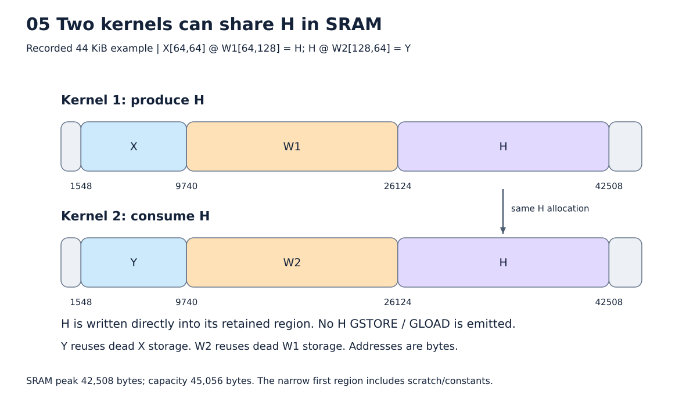

# 8. DRAM과 SRAM을 함께 계획하기

[목차](../README.md) · 이전: [연산](07_operators.md) · 다음: [ISA](09_isa.md)

목표는 중간값을 언제까지 보관해야 하는지 알아내고, 그동안 필요한 다른 작업 공간과
충돌하지 않게 배치하는 것이다. **커널을 합치지 않아도 SRAM만으로 연결할 수 있다.**



그림: 실제 두 커널이 SRAM의 H를 공유하는 배치. 자세한 조건은 아래 설명을 따른다.

## 세 가지 계획의 역할

| 계획 | 분석하는 범위 | 도구와 책임 |
|---|---|---|
| 기본 DRAM storage | Relax 함수의 tensor 수명과 재사용 | TVM StaticPlanBlockMemory + backend의 flat base 주소 |
| 커널 내부 SRAM | Scheduled TIR의 임시 buffer 수명·충돌 | TVM USMP 분석/배치 + 장치 상태의 보수적 보호 |
| 커널 사이 보관 | 생산부터 마지막 소비 호출까지 | NPU의 whole-tensor 보관 탐색과 호출별 schedule |

하나가 나머지를 자동으로 해결하지 않는다. USMP를 호출했다고 persistent KV cache나
전체 그래프의 보관 정책이 자동 생성되는 것은 아니다.

## 기본 DRAM 배치는 표준 TVM 결과에서 시작한다

View 정리 뒤 `ToNonDataflow → RemovePurityChecking → CallTIRRewrite →
StaticPlanBlockMemory`를 실행한다. CallTIRRewrite는 결과 allocation과 TIR 호출을
명시적으로 만들고, StaticPlanBlockMemory는 함께 살아 있지 않은 tensor들이 storage
pool을 공유할 수 있게 한다. Backend는 각 pool을 flat image의 실제 위치에 놓는다.

Parameter와 상수는 먼저 배치한다. 각 tensor의 주소는 `pool base + offset`이다.
기본 plan 주소 단위는 2 bytes지만 dtype 크기·DMA cell 정렬은 별도로 반영한다.
Tuple 출력도 leaf마다 shape/dtype/byte offset을 기록한다.

## 수명은 생성부터 마지막 사용까지다

```text
G = gate(X)
S = SiLU(G)
U = up(X)
H = S * U
Y = down(H)
```

G는 SiLU가 끝나면 더 이상 필요하지 않다. S는 multiply가 끝날 때까지 필요하다.
G가 차지한 공간에 U를 쓸 수 있는 이유는 같은 배열로 변환해서가 아니라 **G의 옛 값이
더 이상 관찰되지 않기 때문**이다. 크기가 다른 buffer라면 들어갈 크기와 정렬을 확인한다.

이 순서는 최신 실제 폭 MLP 측정의 순서다. 과거 문서의 up→gate 순서를 현재 결과에
그대로 적용하지 않는다. M=64에서 G/S/U/H는 각각 1 MiB다.

| 계산 중 | 동시에 필요한 주요 값 | 완료 후 보관할 값 |
|---|---|---|
| gate | G 출력 + 작업 공간 | G |
| SiLU | G, S + 임시값 | S |
| up | S, U + 작업 공간 | S, U |
| multiply | S, U, H | H |
| down | H + 출력 작업 공간 | 외부 출력 계약에 따른 Y |

표는 값의 관계를 설명한다. 실제 peak에는 weight 조각, scratch, 정렬, 주소 사이
빈 공간도 들어간다. 살아 있는 tensor 크기의 합과 최고 주소는 같지 않을 수 있다.

## USMP가 하는 일

USMP는 Unified Static Memory Planning이다. 여기서는 TIR의 allocation 접근을
분석해 동시에 사용될 수 있는 buffer 사이의 충돌 관계를 얻고, greedy 배치 후보와
기본 순차 배치를 비교한다. 주소는 실행 전에 정해진다. Runtime GC가 아니다.

분석용 복사본에 LowerMatchBuffer/LowerOpaqueBlock 등을 적용하여 분석하기 쉬운
표현으로 만들고, 결과 byte offset을 실제 buffer identity에 연결한다. Constants와
표현식 scratch는 별도다. 지연된 accumulator 상태나 opaque 호출 때문에 사용이
끝났다고 단정할 수 없는 buffer는 고정해 조기 재사용을 막는다.

## 커널 사이 SRAM 보관과 schedule을 함께 고른다

실제 읽기·쓰기 byte 범위와 값의 버전을 분석해 보관 가능한 FP16 중간값을 찾는다.
같은 DRAM pool이 나중에 다른 값으로 재사용되므로 주소만 같다고 같은 데이터로
취급하지 않는다. 최종 출력·입력·상수, 모호한 alias, in-place 갱신 등은 보호한다.

각 호출에서 “DRAM으로 전달”과 “마지막 소비까지 SRAM에 보관”을 비교한다. SRAM에
보관할 공간을 예약한 뒤 남은 작업 공간으로 schedule을 다시 선택한다. 입력과 출력의
SRAM 위치는 schedule 전에 알려주므로 불필요한 cache stage를 생략할 수 있다.
기본 beam width는 4이며 all-DRAM 진행도 비교한다. 이것은 네 가지 matmul 규칙과
다른 숫자다. 부분적인 그래프 선택들을 몇 개 유지할지 정하는 한도다.

Fusion과 schedule의 탐색 예산을 늘리는 실험에서도 이 메모리 과정은 생략하지 않는다.
같은 matmul이라도 앞 커널의 SRAM 값을 입력으로 받는 경우와 DRAM에서 읽는 경우는
다른 실행 조건이다. 보관할 값 때문에 가용 SRAM이 달라지는 경우도 마찬가지다.
반복 layer의 계산 구조가 같아도 이 조건이 다르면 별도 recipe가 필요하다. 반대로
같은 조건이라면 build 안의 recipe/trial cache로 재사용하므로 매 layer마다 같은
후보 TIR을 처음부터 만들 필요는 없다.

현재 기본 beam 폭 4를 유지한 비교는 그 범위 안에서 얻은 결과다. Graph 시간 제한을
없앴다고 메모리 보관의 모든 조합이나 tensor 일부만 남기는 정책까지 탐색한 것은 아니다.

현재는 tensor 전체를 보관한다. 일부 tile만 남기기, 중간 퇴거, 호출 순서 변경은 없다.
보관하지 못하면 DRAM 경로를 사용할 수 있으므로 큰 activation이 곧 컴파일 불가를
뜻하지 않는다. 개별 연산 자체의 지원 shape·reduction 한도는 별도다.

## 두 matmul 예제의 실제 주소

```text
X[64,64] @ W1[64,128] → H[64,128]
H[64,128] @ W2[128,64] → Y[64,64]
```

SRAM 44 KiB에서 기록된 최종 배치는 다음과 같다. 단위는 bytes다.

| 값 | SRAM 시작 주소 | 크기 | 이후 재사용 |
|---|---:|---:|---|
| X | 1548 | 8192 | 두 번째 커널의 Y 작업 공간 |
| W1 | 9740 | 16384 | 두 번째 커널의 W2 |
| H | 26124 | 16384 | 두 번째 커널까지 유지 |

전체 peak는 42508 bytes다. 낮은 주소에는 상수와 scratch도 있으므로 시작이 0이 아니다.
H를 DRAM으로 저장하지 않고 다음 matmul이 이 위치를 직접 읽는다.

## 임시 출력 타일을 없애고 H에 바로 쓴다

H는 행마다 128개 FP16 원소, 즉 row stride 256 bytes다. 첫 64열과 다음 64열을
각각 matrix 결과로 만든다. 두 번째 열 타일의 시작은 H+128 bytes다. **H+8192가 아니다.**
두 타일은 각 행의 왼쪽/오른쪽 절반이므로 row stride를 유지해야 한다.

이전에는 별도 64×64 출력 buffer에 SAVE하고 H로 복사했다. 현재는 H의 부분 영역을
가리키는 view와 stride를 사용해 직접 SAVE한다. FP32 누산이 끝난 최종 저장 위치를
바꾸는 것으로, K 중간 partial sum을 H에 내리는 것이 아니다.

절약한 8 KiB를 더 큰 W panel에 사용할 수 있어 전체 peak가 그대로인 경우도 있다.
실제 이 예제는 peak 42508 bytes가 같고 words가 85→77로 감소했다. 결과는 bit-exact다.
[첫 커널](../examples/two_matmuls_recorded/scheduled_0000.py)과
[두 번째 커널](../examples/two_matmuls_recorded/scheduled_0001.py)에서 확인한다.

## 보관 후에도 남은 DRAM 예약 제거

처음에는 DRAM 전달이 가능한 기본 배치를 만들기 때문에 H의 DRAM 공간도 있다.
SRAM-only 전달이 확정된 뒤 그 pool 전체가 아무 곳에서도 사용되지 않으면 제거한다.
다른 tensor가 같은 pool을 나중에 쓰면 유지한다. 사용 중인 pool 내부를 다시 쪼개는
새 allocator는 아니다.

남은 pool들의 주소를 줄이고 DMA 주소, 입력·출력·상수 metadata, image 크기,
KV append의 주소 계산 기준을 함께 맞춘다. 두 matmul 예제는 image가
65548→49164 bytes로 줄었다. DMA 49164 bytes와 최종 image 49164 bytes가 같아진 것은
이 예제의 우연이며 두 지표는 원래 다른 양이다.

명령 생성 뒤 남아 있는 SRAM 사본으로 읽기를 생략하는 `npu_residency`도 있다.
이는 schedule 전에 보관 공간을 예약해 저장까지 제거하는 `npu_memory_search`와 다르다.
후단 forwarding만 성공했다고 생산자의 GSTORE가 항상 없어지는 것은 아니다.

## Residual과 KV는 어떻게 다른가?

Residual도 중간값이면 마지막 add까지 보관 후보가 된다. 64×3072 FP16이 384 KiB라는
사실만으로 반드시 보관됐다고 말할 수 없다. 사이의 모든 작업 공간과 비용을 봐야 한다.
KV cache는 다음 프로그램 호출에도 필요하고 ABI 입력/출력으로 관찰되므로 DRAM 상태를
유지한다. `kv`라는 이름을 찾아 예외 처리하는 것이 아니라 외부 가시성 계약으로 보호한다.

현재 빈 구간 재사용과 보관 영역 이동은 있지만 모든 조각화를 해결하는 전역 allocator는
아니다. 남은 낭비가 실제 프로그램 비용에 큰지 확인한 뒤 추가 개선을 검토한다.

구현: [DRAM](../../npu_compiler/npu_memplan.py), [USMP](../../npu_compiler/npu_sram.py),
[보관 탐색](../../npu_compiler/npu_memory_search.py), [출력 직접 저장](../../npu_compiler/npu_accumulator.py).
