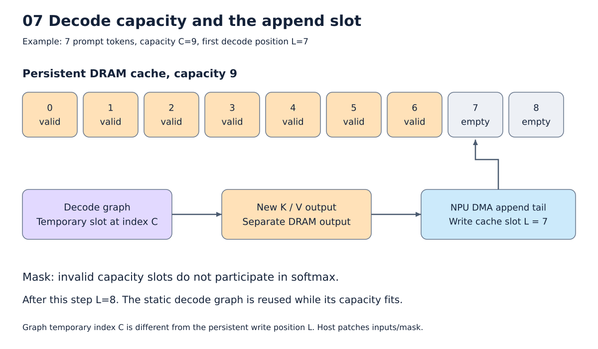

# 10. Runtime과 실제 Llama의 prefill/decode

[목차](../README.md) · 이전: [ISA](09_isa.md) · 다음: [실험](11_experiments.md)

Compiler가 만든 프로그램을 실행하려면 입력·weight를 계획된 주소에 넣고, 결과를
정해진 dtype/shape로 읽어야 한다. Runtime은 이 일을 하며, generation에서는
선택된 token과 KV cache를 다음 호출로 이어준다.



그림: Decode의 capacity와 KV를 추가하는 위치. 자세한 조건은 아래 설명을 따른다.

## Runtime 준비 단계

1. Checkpoint에서 weight와 embedding table을 읽는다.
2. 컴파일 결과에 포함된 host transform을 TVM LLVM VM으로 실행한다.
3. 변환된 signature와 순서에 맞춰 parameter 배열을 연결한다.
4. Plan의 주소에 입력·parameter·상수를 넣어 DRAM image를 만든다.
5. Program과 image를 C-model에 넘기고 output tree의 주소로 결과를 읽는다.

Parameter transform cache는 host IR, dtype/shape, 모든 weight 내용에 기반한다.
파일명만 같다고 재사용하지 않는다. Lock, atomic commit, checksum을 사용한다.
이 준비 작업의 비용을 token마다 실행하는 NPU 계산 비용과 구분한다.

## Prefill 프로그램과 decode 프로그램

Prefill은 prompt S개 token을 한 번에 처리한다. Decode는 새 token 하나와 과거
cache를 입력으로 다음 logits를 만든다. 기본은 S에 대한 prefill 하나와 capacity C에
대한 decode 하나다. 이것은 graph 후보 수나 layer 수와 다른 개수다.

```text
host: prompt token → embedding, cos/sin, causal mask
NPU:  28 layers → 마지막 hidden의 norm/LM head → logits + K/V
host: argmax → 첫 생성 token

반복:
host: 그 token의 embedding, 현재 position의 cos/sin, valid-length mask
NPU:  decode + cache append
host: logits의 argmax → 다음 token
```

Greedy argmax는 현재 host에서 한다. 마지막으로 예측한 token이 이미 NPU 입력으로
처리된 것은 아니다. 생성 token 수와 decode 실행 횟수가 한 번 차이 나는 이유다.

### 256-token prefill만 실행할 때도 KV 출력은 남는다

`prefill_cache`는 마지막 token 위치의 logits뿐 아니라 모든 layer의 K/V를 반환한다.
Decode를 이번 실험에서 실행하지 않더라도 이 함수의 출력 계약은 유지한다.
28-layer, S=256, KV heads=8, head dimension=128이면:

| 출력 | Shape | FP16 크기 |
|---|---|---:|
| K | [28,8,128,256] | 14 MiB |
| V | [28,8,256,128] | 14 MiB |
| 마지막 logits | [1,128256] | 250.5 KiB |

각 layer가 만든 K/V를 최종 출력 배열로 모으는 concat도 실제 컴파일 대상이다.
전체 출력이 8 MiB SRAM보다 크므로 출력 크기와 작업용 SRAM 크기를 구분해야 한다.
Generic schedule이 부분 복사로 나눌 수 있으면 최종 DRAM 출력은 더 커도 된다.
이번 실험은 이 부분을 생략한 단일 layer나 MLP만의 성능 측정이 아니다.

## 과거 검증된 세 token을 따라가기

기록의 prompt는 `Hello, NPU compiler!`이고 tokenizer 결과는 7 tokens다.
Capacity는 9, 생성 개수는 3이다. 아래는 실제 [검증 기록](../evidence/current/llama_validation.json)에
해당하며 이번 문서 작성에서 전체 모델을 다시 실행하지 않았다.

| 단계 | NPU에 넣는 것 | 계산 후 cache의 유효 길이 | 예측한 다음 token |
|---|---|---:|---:|
| Prefill | prompt 7 tokens | 7 | 358 (` I`) |
| Decode 1 | token 358, position 7 | 8 | 2846 (`'m`) |
| Decode 2 | token 2846, position 8 | 9 | 4560 (` trying`) |

최종 문자열은 ` I'm trying`이다. 마지막 4560은 아직 입력으로 처리하지 않았으므로
이 시점 cache에는 그 token의 K/V가 없다.

## 고정 shape와 유효 길이는 다르다

Persistent cache의 shape는 다음과 같다.

```text
K [28,8,128,C]
V [28,8,C,128]
```

Decode는 기존 C개 슬롯과 현재 K/V 하나를 논리적으로 연결하여 C+1 길이로 attention을
계산한다. 현재 token이 attention에서 놓이는 임시 위치는 C다. Persistent cache에
기록하는 위치는 첫 빈 슬롯 L이다.

예를 들어 C=9, L=7이면:

```text
attention 입력: [과거 0..6 | 빈 7,8 | 현재 token 9]
mask:           [0 ... 0  | 큰 음수 | 0]
cache 갱신:     현재 K/V를 persistent 슬롯 7에 기록
```

큰 음수는 FP16 -65504를 사용한다. 의미상 제외할 슬롯도 shape와 명령에는 남아
있다. Mask는 기여를 막으며 계산 자체의 동적 생략을 뜻하지 않는다.

## KV append는 누가 실행하는가?

Prefill→decode 초기화에서는 host가 prefill K/V를 capacity-sized 배열의 앞부분에
복사한다. 기본 DecodeSession의 각 step에서는 새 K/V가 별도 DRAM 출력으로 생기고,
program 끝에 붙인 DMA tail이 이를 cache의 올바른 위치로 옮긴다.

Host는 실행 전에 position으로 DMA 주소를 정한다. 실제 전송은 NPU/C-model 명령이
한다. “매 step NPU가 cache 마지막 슬롯에 저장하면 CPU가 다시 옮긴다”는 설명과 다르다.
다만 별도 DRAM 출력과 append 이동은 실제로 남으며 최종 슬롯 직접 저장은 미구현이다.

`npu.cache_append` metadata는 cache parameter, 반환 output index, time axis를
지정한다. Cache 이름을 추측하거나 모델 layer 수를 codegen에 하드코딩하지 않는다.

## 어떤 것이 재사용되고 어떤 것은 바뀌는가?

| 대상 | Step 사이의 동작 |
|---|---|
| 기본 decode 계산 명령 | 재사용 |
| KV append 명령의 주소 | position에 맞춰 변경 |
| embedding, cos/sin, mask | host가 새 값으로 patch |
| DRAM weight | 초기 image 이후 host가 다시 쓰지 않을 수 있음 |
| SRAM의 weight 조각 | 실행 중 NPU가 DRAM에서 다시 가져옴 |
| Persistent DRAM cache | 다음 호출로 이어짐 |
| C-model 내부 SRAM | 호출 사이의 지속성을 전제하지 않음 |

기록에서 step별 작은 입력 patch는 6676 bytes다. 새 K/V 데이터 자체는 114688 bytes다.
하지만 append의 DMA는 458752 bytes로 더 크다. Layout과 정렬·이동 명령 때문에
논리 데이터 크기와 실제 전송량은 같지 않다.
Decode base는 7310801 words, append 포함 실행 stream은 7324697 words다.
두 번째 decode에서는 program suffix patch가 55568 bytes다.

## Persistent transport가 실제로 뜻하는 것

현재 adapter는 이전 실행의 최종 global image 파일을 다음 입력 파일로 이어 쓰고,
바뀐 host 입력과 program suffix만 patch한다. 따라서 host weight rewrite를 줄일 수 있다.
그러나 C-model subprocess는 호출마다 전체 image를 읽고 쓰며 새로 실행된다.
이는 지속적인 simulator process나 실제 장치의 zero-copy runtime이 아니다.

Compiler의 DMA 통계, host patch bytes, simulator file I/O를 한 표에서 더해
“NPU bandwidth”로 보고하지 않는다. 측정 층이 다르다.

## Bucket과 layer 반복

여러 capacity를 미리 컴파일하고 유효 길이가 커질 때 큰 bucket으로 바꿀 수 있다.
작은 context의 낭비를 줄이는 대신 컴파일 프로그램 수, 초기 image, cache 전환 복사가
늘어난다. 매 step 새 compiler를 실행하는 방식과는 다르다.

28층은 최종 stream에 필요한 계산을 모두 포함한다. 같은 layer 구조의 schedule·비용
검사를 재사용해도 실행 명령 자체를 한 층만 수행하는 것은 아니다. `main` backend의
host layer loop 재사용과는 [구조 차이](../main/README.md)가 있다.

구현: [generation](../../npu_compiler/npu_generate.py),
[cache append](../../npu_compiler/npu_cache.py), [C-model transport](../../npu_compiler/v09_runtime.py).
