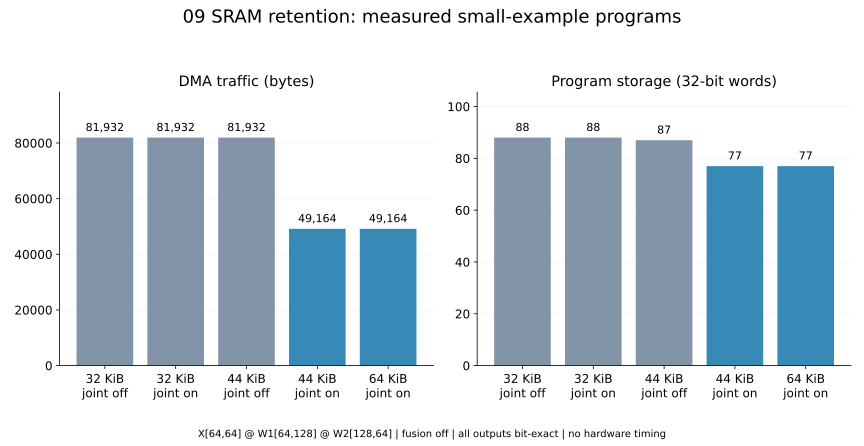
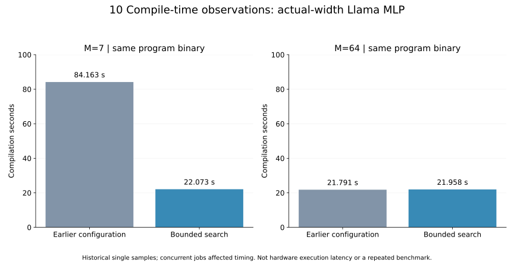

# 11. 기능·컴파일·메모리·출력 검증 실험

[목차](../README.md) · 이전: [Runtime](10_runtime_llama.md) · 다음: [사용법과 한계](12_operations_limits.md)

이 장은 **현재 무엇이 동작하며 어떤 비용이 달라졌는지**를 근거와 함께 설명한다.
실험 목적은 모든 숫자를 하나의 성능 점수로 합치는 것이 아니다. 컴파일 시간,
장치가 요청한 전송량, 명령 크기, 저장 공간, 수치 결과를 따로 측정한다.

## 근거의 세 수준

| 표시 | 의미 | 이 문서의 예 |
|---|---|---|
| 새 실행 검증 | 이번 문서 작업에서 현재 소스로 작은 입력을 실제 실행 | E1 pipeline, E2 SRAM 용량 비교 |
| 보존된 실행 검증 | 기존 실행 로그·JSON·source hash를 그대로 보존 | E3 두 matmul 전후, E6 전체 Llama, E7 회귀 검사 |
| 정적 분석/기존 단일 측정 | 명령·배치 분석 또는 한 번의 compile wall time | 실제 폭 MLP, compile 개선 비교 |

이번 작은 예제와 기존 최종 검증의 compiler source SHA-256은
`44694fc6104159862ae86a423d1391c6cce181c774f9e46eaf5ab3ff5f2e1a05`다.
문서·예제 runner와 compiler 구현의 provenance는 구분한다.
중간 개선 단계의 기록은 source hash가 다르며 현재 소스의 새로운 benchmark로 바꾸지 않았다.

## E1. Fusion이 DMA 외의 비용을 줄일 수도 있는가?

입력: `SiLU(X[64,128] @ W[64,128].T + bias[64])`, seed 914, FP16.
현재 public build로 fusion off/auto를 각각 컴파일하고 같은 값으로 C-model을 실행했다.
두 구성 모두 현재 SRAM 전달 기능을 사용한다.

| 설정 | 커널 수 | DMA bytes | ISA words | SRAM peak bytes | DRAM image bytes |
|---|---:|---:|---:|---:|---:|
| off | 3 | 41100 | 2812 | 50700 | 41100 |
| auto | 1 | 41100 | 1577 | 42508 | 41100 |

Fusion 전후 FP16 비트가 같고, 동일 수치 grouping을 적용한 LLVM 출력과 최대 절대차는
이번 입력에서 0이다. C-model DMA counters도 정적 명령 해독과 일치했다.
전송량은 같아도 명령과 작업 공간이 줄어드는 사례다. 모든 fusion의 이득을 대표하지 않는다.
근거: [새 summary](../examples/pipeline/stage_summary.json), 실제 IR·입출력은 같은 폴더.

## E2. SRAM을 늘리면 언제 중간 DRAM 왕복이 사라지는가?

입력: `X[64,64] @ W1[64,128] @ W2[128,64]`, seed 928, fusion off.
보관 탐색 옵션과 SRAM 용량만 바꾸어 5개 구성을 실제 실행했다.

| SRAM 용량 | Whole-tensor 보관 탐색 | DMA bytes | Words | 실제 SRAM peak | DRAM image |
|---:|---|---:|---:|---:|---:|
| 32 KiB | off | 81932 | 88 | 26124 | 65548 |
| 32 KiB | on | 81932 | 88 | 26124 | 65548 |
| 44 KiB | off | 81932 | 87 | 34316 | 65548 |
| 44 KiB | on | 49164 | 77 | 42508 | 49164 |
| 64 KiB | on | 49164 | 77 | 42508 | 49164 |

모든 구성은 같은 FP16 출력이며 DMA counters가 일치했다. 32 KiB에서는 보관 옵션을
켜도 선택 결과가 같고, 44 KiB에서는 H 16 KiB의 저장·재읽기 합계 32768 bytes가
사라진다. 64 KiB로 늘려도 이 예제에는 추가 이득이 없다. “SRAM을 최대한 채우기”보다
실제 재사용과 작업 공간의 관계가 중요하다는 사례다.

보관 탐색 off에도 기존 후단 residency/peephole은 유지한다. 따라서 이 비교를
모든 메모리 최적화를 켜고 끈 실험이라고 부르지 않는다.
근거: [새 용량 실험](../examples/memory/measurements.json).



## E3. 직접 SRAM 출력과 미사용 DRAM 제거의 효과

보존된 44 KiB 두 matmul 비교는 이미 SRAM 보관을 사용하는 상태에서
pointwise 결합·출력 직접 저장·미사용 DRAM 제거를 비활성화/활성화한 실험이다.

| 항목 | 개선 전 | 개선 후 |
|---|---:|---:|
| ISA words | 85 | 77 |
| DMA bytes | 49164 | 49164 |
| SRAM peak bytes | 42508 | 42508 |
| DRAM image bytes | 65548 | 49164 |

두 출력은 bit-exact다. DMA와 SRAM peak가 그대로여도 명령과 image가 감소했다.
앞선 E2의 보관 off/on과 다른 비교이므로 87→77과 85→77을 섞지 않는다.
근거: [전후 원본](../evidence/current/refinement.json),
[기록된 최종 bundle](../examples/two_matmuls_recorded/program.json).

## E4. 실제 Llama 폭의 MLP는 어떤 선택을 했는가?

M=64, hidden=3072, intermediate=8192인 실제 폭 MLP의 정적 컴파일 기록이다.
전체 모델이나 checkpoint 출력 검증이 아니다. 이 실험에는 `executed=false`가 명시되어 있다.

| 항목 | 개선 전 | 개선 후 |
|---|---:|---:|
| 선택 커널 수 | 5 | 5 |
| ISA words | 143404 | 140594 |
| DMA bytes | 152174604 | 152174604 |
| SRAM peak bytes | 7446540 | 7446540 |
| DRAM image bytes | 154927116 | 151781388 |

중간 G/S/U/H의 SRAM 전달과 DRAM pool 정리가 적용된다. 서로 다른 중간값이 같은
기본 DRAM pool을 재사용하므로 제거량은 4 MiB가 아니라 3 MiB다.
선택된 실행은 gate → SiLU → up → multiply → down이다.

과거에 fused epilogue 명령이 매우 길었던 문제를 줄였어도 최종 선택이 반드시
fusion으로 바뀌지는 않는다. 커널 수만 보지 않고 최종 프로그램의 비용을 확인한다.
근거: [전후 기록](../evidence/current/refinement.json),
[최종 MLP 진단](../evidence/current/mlp64.json).

## E5. 컴파일 속도 개선은 코드 품질을 바꿨는가?

다음은 기존에 기록한 **단일 wall-clock 관측값**이다. 일부 측정 중 다른 검증도 실행됐다.
반복 평균이나 하드웨어 inference latency가 아니다.

| 실제 폭 MLP | 이전 | 이후 | 명령 결과 |
|---|---:|---:|---|
| M=7, 중복 실패 검사·시도 제한 개선 | 84.163 s | 22.073 s | 143883 words, binary hash 동일 |
| M=64, 무제한 시도 → 64회 시도 제한 | 21.791 s | 21.958 s | 140594 words, binary hash 동일 |

M=7의 TIR trial 생성은 347→112회였다. M=64는 두 경우 모두 47회이므로 제한이
실제로 작동하지 않았다. 모든 입력에서 일정 배율로 빨라진다는 결론은 낼 수 없다.
주요 개선은 invalid accumulator schedule을 native/Python에서 두 번 검사하지 않기,
동일 entry/region 비용 재사용, 실패도 포함하는 탐색 한도다.
근거: [compile 비교 JSON](../evidence/current/compile_comparison.json).

전체 build의 기본 120초는 최초 합법 모듈 이후 추가 탐색 예산이다. 아래 전체 검증의
948.993초를 cold compile 시간으로 사용할 수 없다. 기존 첫 entry를 backend/IR 동일성
확인 후 재사용한 검증이며 `fresh_full_build_seconds=null`이다.



## E6. 전체 Llama 3.2 3B의 출력 검증

FP16, 28 layers, prompt 7 tokens, capacity 9, greedy 생성 3 tokens의 보존 기록이다.

| 실행 | HF와 같은 argmax | Logits cosine | 최대 절대차 |
|---|---:|---:|---:|
| prefill | 358 | 0.9999977148 | 0.03515625 |
| decode position 7 | 2846 | 0.9999958473 | 0.02343750 |
| decode position 8 | 4560 | 0.9999929546 | 0.03906250 |

판정은 유한한 logits, token 일치, cosine≥0.999다. 최대 절대차는 기록했지만 별도
통과 threshold로 사용하지 않았다. 한 prompt의 짧은 greedy 생성이므로 긴 문맥의
품질, 다양한 prompt, quantized generation까지 검증됐다고 확대하지 않는다.

| 기본 entry | Words | DMA bytes | SRAM peak bytes | DRAM image bytes |
|---|---:|---:|---:|---:|
| prefill_cache | 8582352 | 6457527556 | 8374292 | 6429587576 |
| decode base | 7310801 | 6438980676 | 7342100 | 6427349032 |

Decode 실제 실행에는 append tail이 추가된다. Base 통계와 tail 포함 counters를
혼합하지 않는다. Graph 탐색은 시간 한도에 도달해 unfused 기준을 선택했다.
“모든 후보 중 전역 최적”이라는 의미는 없다.
근거: [출력 검증](../evidence/current/llama_validation.json),
[선택 기록](../evidence/current/llama_selection.json), [완료 범위](../evidence/current/completion.json).

## E7. 기능 검증은 어떤 축을 확인했는가?

기존 최종 gate는 17개 검사 묶음, 실패/skip 없이 완료됐다. 개별 test assertion은
묶음 안에 여러 개 들어 있다. “17개 shape만 테스트했다”는 뜻은 아니다.

| 검증 축 | 대표 검사 묶음 | 확인할 의미 |
|---|---|---|
| 표준 pipeline와 ABI | architecture_contracts, compiler_contracts, npu_target | entry, output tree, 미지원 입력 거절 |
| Schedule·메모리 | schedule_memory, sram_lifetime, npu_memplan | 보관, 주소, 수명 충돌, fallback |
| Fusion·수치·확장 | pipeline_extensions, optimization_contracts, priority_contracts | 후보 지원 조건과 결과 |
| 명령 생성 | native_codegen, npu_link | Python/native 계약과 연결 |
| 회귀 개선 | compiler_refinement, compile_speed, completion_contracts | 출력 직접 저장·정리·cache·예산 |
| Frontend·생성 | nn_hf, nn_decode | 모델 의미와 cached decode |
| 부록 기능 | npu_quantize | 작은 양자화 kernel/model |

근거: [실제 exit/status/시간](../evidence/current/regression_validation.json),
[묶음별 원본 로그](../evidence/current/gate_logs/).
이번 문서 작업에서는 전체 gate를 재실행하지 않았으며 E1/E2와 문서 검사를 새로 수행했다.

## E8. MetaSchedule로 탐색하면 Llama 커널이 더 좋아지는가?

2026-09-29에 선택형 `ReplayFunc` 탐색을 실제 연결해서 비교했다. **이번 네 커널에서는
기존 탐색과 최종 명령이 모두 같았다.** 기본 탐색을 교체하지 않고 비교 가능한 옵션으로
남겼다. 아래 결과는 새로운 source hash의 기록이며, E6의 전체 모델 검증을 갱신하지 않는다.

### 모델과 비교 조건

Llama 3.2 3B frontend에서 layer 하나의 graph를 내보내고 해당 PrimFunc를 추출했다.
Hidden=3072, intermediate=8192는 실제 모델 크기다. Layer 0의 checkpoint weight와
실제 post-attention norm weight를 사용했다. 입력 activation은 seed=929의 난수에서
만들었다. Down 입력은 실제 gate/up weight로 계산한 SiLU(gate)×up이다.
전체 attention부터 실행한 layer 출력이나 token 생성 결과는 아니다.

커널 입력·출력은 DRAM에 두고 residency는 껐다. 두 방식의 fusion 경계를 동일하게
고정했으며, fusion 탐색이나 커널 사이 SRAM 보관의 우열을 비교하지 않았다.

| 조건 | 기존 `space` | 실험 `meta_schedule` |
|---|---|---|
| 후보 목록 | 같은 정규화된 NPU schedule 공간 | 왼쪽과 동일 |
| 검사 순서 | 예상 DMA가 작은 순서 | TVM ReplayFunc의 균등 추첨, seed=0 |
| 기준 schedule | 기존 규칙의 첫 합법 후보 1개 확보 | 같은 규칙·예산으로 독립 확보 |
| 추가 탐색 | 최대 16회 시도, 합법 후보 최대 4개 | 왼쪽과 동일 |
| 추가 probe words | 250,000에 도달하면 종료 | 왼쪽과 동일 |
| 최종 평가 | 실제 생성한 명령의 DMA → words → SRAM | 왼쪽과 동일 |
| 프로세스 시간 한도 | 한 커널의 두 방식 컴파일+검증 합계 90초 | 공통 worker 한도 |

두 컴파일은 별도 compilation context를 사용했고 DB 재사용은 껐다. 한 worker 안에서
기존 방식을 먼저 실행했으므로 순서 효과를 제거한 반복 benchmark는 아니다.
TVM `extract_tasks`로 원래 한-layer entry의 작업 목록도 기록했다.
Decode는 41종/50회 호출, unfused prefill은 40종/52회, fused prefill은 21종/23회였다.
이 수는 graph의 작업 목록이며 이번에 모두 schedule/codegen한 수가 아니다.

### 최종 결과

표의 shape는 `X[M,K] × W[K,N] → Y[M,N]` 순서다. 시간은 단일 관측값이며
MetaSchedule 열에는 각 worker의 최초 초기화가 포함된다.

| 실제 Llama 계산 | M / K / N | 기존 compile | MetaSchedule compile | 최종 DMA bytes: 두 방식 동일 | ISA words: 두 방식 동일 |
|---|---|---:|---:|---:|---:|
| Decode gate projection | 1 / 3072 / 8192 | 4.963 s | 9.845 s | 50,354,188 | 47,313 |
| Prefill gate+SiLU+multiply | 64 / 3072 / 8192 | 5.282 s | 9.994 s | 52,822,028 | 54,942 |
| Prefill down projection | 64 / 8192 / 3072 | 4.731 s | 9.545 s | 51,773,452 | 46,651 |
| Prefill down projection | 512 / 8192 / 3072 | 5.132 s | 11.092 s | 112,197,644 | 372,637 |

SRAM peak도 각각 899,084 / 933,900 / 2,203,660 / 5,349,388 bytes로 같았다.
최종 binary hash까지 같으므로 비용만 우연히 같은 다른 프로그램은 아니다.
네 worker의 전체 시간 합계는 89.70초다. 별도의 작은 회귀 검사·초기화 측정 시간은
이 합계에 포함하지 않는다.

최초 `TuneContext` 생성만 따로 측정하니 5.107초, 같은 프로세스에서 두 번째 생성은
0.000172초였다. `pre_tuning`/`post_tuning`은 각각 1밀리초 미만이었다.
따라서 위 표로 “Llama의 모든 커널에서 MetaSchedule이 5초씩 더 걸린다”거나
“전체 컴파일이 두 배 느려진다”고 결론 낼 수 없다. 초기화가 끝난 상태의 전체 compile은
반복 측정하지 않았으므로, 단순히 5초를 빼서 새 실측값으로 제시하지도 않는다.

### 왜 더 좋은 결과가 없었는가?

첫 세 커널의 후보는 각각 1,433개다. 기존은 4회 검사로 합법 후보 4개를,
MetaSchedule은 5회 검사로 합법 후보 4개와 SRAM 초과 후보 1개를 확인했다.
둘 다 `A=64행 보관` 기준 schedule을 유지했다.

이 세 경우에는 기존 최종 결과도 각 입력 tensor를 한 번 읽고 출력을 한 번 쓰는
전송량에 도달했다. 예를 들어 64-token down은 다음과 같다.

```text
H 읽기:    64 × 8192 × 2 =  1,048,576 bytes
W 읽기:  8192 × 3072 × 2 = 50,331,648 bytes
Y 쓰기:    64 × 3072 × 2 =    393,216 bytes
상수 읽기:                         12 bytes
합계:                         51,773,452 bytes
```

같은 dense 연산·입출력 경계에서는 tensor I/O를 이보다 줄일 수 없었다. 명령 수나
배치에는 개선 가능성이 남지만 이번에 검사한 후보가 더 좋지는 않았다.
이는 출력이 SRAM에 남는 전체 graph의 전송량 하한을 뜻하지 않는다.

512-token down은 다른 상황이다. H만 8 MiB라 SRAM 8 MiB에 H 전체와 작업 공간을
같이 둘 수 없다. 최종 선택은 `A=256행 보관`으로, H를 두 번에 나눠 처리하면서
W를 두 번 읽는다. `H 8 MiB + W 48 MiB × 2 + Y 3 MiB + 상수 12 bytes`가
표의 112,197,644 bytes다.

이 경우 후보 공간은 22,236개였고, 두 방식 모두 탐색을 충분히 완료하지 못했다.

- 기존 확장 탐색: 첫 16개가 모두 SRAM 초과라 추가 합법 후보 없이 종료했다.
- MetaSchedule: 첫 후보는 SRAM 초과, 두 번째는 합법이었다. 하지만 이 후보는
  probe DMA 187,695,104 bytes, 422,354 words로 기준보다 불리했다.
  후보 하나에서 words 예산을 넘어 종료했다.
- 공통 기준 탐색에서 이미 확보한 `A=256`이 있어 컴파일은 성공했다.
  **확장 후보를 못 찾은 것과 모델을 컴파일할 수 없는 것은 다르다.**

따라서 큰 입력에서 MetaSchedule의 잠재적 우열은 아직 결론 내릴 수 없다.
대신 예상 DMA만으로 정렬하면 SRAM에 들어가지 않는 후보가 앞부분을 차지한다는
기존 탐색기의 약점과, 고정 words 예산이 큰 커널에서 너무 일찍 끝난다는 점을 확인했다.
이를 고치기 전에 무작정 전체 layer·전체 모델의 탐색 시간을 늘릴 필요는 없다.

### 출력은 어떻게 확인했는가?

실제 checkpoint weight와 위 activation으로 C-model을 실행하고 NumPy FP32 계산 후
정해진 FP16 저장 경계를 적용한 reference와 비교했다. 사전에 정한 허용치는
`rtol=0.02, atol=0.005`이며 NaN/Inf 없이 모두 통과했다.
최대 절대차는 순서대로 0.000007629 / 0.000122070 / 0.000030518 / 0.000030518이다.
실제 DMA counters와 생성한 명령 통계도 일치했다.

동일한 최종 명령을 두 번 실행하지 않도록 binary hash가 같으면 C-model 실행을
공유했다. 각 커널에서 실제 실행한 프로그램은 하나이며, JSON에 두 번째 방식의
`executed=false, same_program_as="space"`를 남겼다. 서로 다른 프로그램을 각각
실행해 우연히 출력이 같았다고 주장하는 것은 아니다.

작은 회귀 검사 5개도 통과했다. 여기서는 기준 schedule을 강제로 제외해
MetaSchedule이 만든 trace 자체가 선택·저장·재생되는 경우를 별도로 확인했다.
고정 seed 재현, 시도 제한, 재생 중 재탐색 없음, native/Python 명령 일치,
C-model 출력과 workload 조건 분리를 확인했다.

현재 결론은 **기본 탐색은 유지하고 ReplayFunc는 선택형 비교 기능으로 둔다**이다.
다음 실험에서는 안전하게 판정 가능한 SRAM 부적합 후보 처리와 큰 커널의 탐색 예산을
먼저 검토한다. EvolutionarySearch, 학습형 CostModel, 실장치 latency 측정,
여러 seed·긴 context의 전체 생성은 이번 검증 범위에 포함하지 않는다.

근거: [후보별 비용·시간·source hash·출력 오차](../evidence/current/llama_meta_schedule_search.json),
[재현 실행기](../examples/compare_llama_search.py), [회귀 검사](../../tests/test_meta_schedule.py).

## E9. 긴 입력의 탐색과 튜닝 결과 재사용 개선

E8에서 512-token down의 추가 탐색이 충분하지 않았던 문제를 세 부분으로 보완했다.

1. 같은 축을 연속 loop로 나누는 표현이 달라도 실제 tile 순회와 복사 주기가 같으면
   후보 하나로 합친다. 예를 들어 N을 `24 × 2`번 반복하는 것과 `48`번 반복하는 것이
   같고 복사 위치까지 같으면 같은 후보다. 중간 경계에서 복사하면 별도 후보다.
2. 정렬된 rank-2 FP16 직접 입력에 한해, 두 입력 cache의 동시 필요 공간만으로
   SRAM 용량을 넘으면 사전에 제외한다. Padding이나 computed producer는 이 증명을
   적용하지 않는다. 남은 후보도 실제 TIR compaction·SRAM 배치로 다시 검사한다.
3. 큰 커널의 probe words 한도를 기준 후보 크기와 성공 후보 목표 수에 맞춰 조정한다.
   시도 횟수 제한은 유지하고, 실패도 시도에 포함한다.

그 결과 이 shape의 후보는 22,236개에서 5,034개로 줄었다. 5,034개 중 1,596개는
입력 cache 공간만으로 SRAM을 초과해 제외했고, 3,438개를 실제 탐색 목록에 남겼다.
이것은 전체 공간을 컴파일한 결과가 아니라 후보 생성·정규화·하한 계산 결과다.

DB도 보완했다. Shape·scope·가용 SRAM·scratch·수치 정책 같은 실행 조건은 엄격하게
비교하면서, 탐색 전략·seed·횟수는 DB 호환성 조건에서 분리했다. `tune` 모드는
저장된 결과를 기준으로 더 탐색하고 실제 비용이 좋아질 때만 기록을 갱신한다.
`reuse` 모드는 저장된 trace를 재생·검증한 뒤 추가 후보를 만들지 않는다.

최종 비교는 E8과 같은 Llama 3.2 3B의 512-token down, 실제 layer-0 checkpoint weight와
같은 seed의 합성 activation을 사용했다. 두 방식은 각각 새 DB에서 독립 튜닝한 뒤,
탐색 전략·seed·횟수·words 설정을 바꾼 새 context에서 기록을 재사용했다.
한 worker의 튜닝 두 번·재사용 두 번·C-model 검증 전체에 90초 제한을 걸었다.
전체 layer나 28-layer 생성은 실행하지 않았다.

| 항목 | 기존 `space` | 개선 `space` | 기존 ReplayFunc | 개선 ReplayFunc |
|---|---:|---:|---:|---:|
| 추가 검사한 후보 수 | 16 | 4 | 2 | 4 |
| 그중 합법 후보 수 | 0 | 4 | 1 | 4 |
| 종료 이유 | 시도 한도 | 합법 후보 목표 달성 | words 한도 | 합법 후보 목표 달성 |
| 첫 compile/tune 관측 시간 | 5.132 s | 10.586 s | 11.092 s | 33.264 s |
| 새 context에서 DB 재사용 | 미측정 | 3.944 s | 미측정 | 4.046 s |

전후 시간은 같은 양의 탐색을 한 비교가 아니다. 개선 후에는 실제로 합법 후보 4개를
평가하고 DB에 trace도 기록했다. 초기 튜닝 비용은 늘었으며 이것을 컴파일 속도 향상으로
표현하지 않는다. 이후 재사용에서는 탐색 후보 생성이 0회였고 기록 재생·lowering·SRAM/
codegen 검증과 최종 명령 생성만 수행했다. 시간은 각각 한 번 측정했고 MetaSchedule은
첫 초기화 비용을 포함한다. 최종 worker 전체 시간은 67.334초로 90초 한도 안에 끝났다.

Words 한도는 250,000 고정에서 `max(250000, 372632 × 4) = 1,490,528`로 조정됐다.
이 값은 최종 program의 종료 명령·상수 준비를 제외한 기준 커널 probe words를 사용한다.
시도 한도 16회는 그대로였으며 이번에는 두 방식 모두 추가 검사 4회로 목표를 채웠다.

**최종 결과는 이전 binary와 동일했다.** 선택된 schedule은 H를 256행씩 보관하는
기준 schedule이고, DMA 112,197,644 bytes, 372,637 words, SRAM peak 5,349,388 bytes다.
여기서 개선된 것은 탐색의 낭비와 기록 재사용이며, 실행 프로그램의 성능 개선은
이번 사례에서 확인되지 않았다. 3,438개를 모두 평가한 것도 아니다.

C-model의 실제 checkpoint weight 계산은 NumPy reference와 `rtol=0.02, atol=0.005`로
비교해 통과했다. 최대 절대차는 0.000030517578125이며 DMA counters도 일치했다.
두 방식과 이전 결과의 binary hash가 같아 현재 C-model 실행은 한 번만 했다.
DB 재사용 역시 같은 binary임을 확인했다. 입력 activation은 합성이므로 전체 Llama
품질이나 token 생성 검증으로 해석하지 않는다.

최종 수정 기준으로 관련 검사 34개도 통과했다.

| 검사 묶음 | 개수 | 추가로 확인한 내용 |
|---|---:|---|
| `test_schedule_memory` | 17 | SRAM 하한의 보수성, K/MN 분할의 동일 명령, 실제 배치·보관·ragged 입력, 작은 words 설정에서도 여러 후보 비교 |
| `test_meta_schedule` | 6 | 저장된 나쁜 schedule의 실제 개선, 재시작 후 최신 기록 선택, 전략·예산 변경 후 재사용, 불리한 튜닝 결과로 덮어쓰지 않음 |
| `test_compile_speed` | 11 | 반복 entry/region/recipe 재사용, 실패 시도 제한, 탐색 중단 시 합법 결과 유지 |

근거: [전후 비교와 최종 실행 기록](../evidence/current/llama_schedule_refinement.json),
[재현 실행기](../examples/compare_llama_search.py). 관련 구현은
[후보 정규화·용량 처리](../../npu_compiler/npu_schedule_space.py),
[선택·예산](../../npu_compiler/npu_schedule.py),
[DB 호환성·기록](../../npu_compiler/npu_meta_schedule.py)에 있다.

## E10. 256-token 전체 prefill의 fusion 탐색

**상태: 09-29 메모리 과다 사용으로 중단. 전체 모델의 새 출력 검증 결과는 없다.**
09-29 변경된 compiler로 실제 28-layer 모델 컴파일을 시작했다. E8/E9의 개별 projection
검사와 다르며, E6의 7-token 과거 기록을 새 결과처럼 사용하지 않는다.
[조건·graph 목록·source identity](../evidence/current/llama_prefill256_full_search_progress.json)를
별도로 보관한다. 원래 실행 조건은 보존하고 중단 상태를 추가했다.

### 무엇을 비교하는가?

Fusion을 끈 전체 prefill과 현재 구현이 생성하는 fusion 구성을 같은 조건으로 비교한다.
분리된 커널에도 SRAM 보관과 직접 출력이 적용되므로, 비교 기준을 일부러 DRAM 왕복이
많게 만들지 않는다. 최종 `(DMA bytes, ISA words, SRAM peak)`가 작아지는 구성이
있는지 확인하는 실험이다. 작은 커널의 개선률을 28배 곱해 전체 결과로 삼지 않는다.

| 항목 | 이번 실행 조건 |
|---|---|
| 모델 | 실제 Llama 3.2 3B, 28 layers, hidden 3072, MLP 8192 |
| 입력 | `Hello, NPU compiler! `를 반복해 tokenizer 결과를 정확히 256 tokens로 자름; token ID 목록 보존 |
| Entry / capacity | `prefill_cache` 하나, capacity 256; decode 컴파일·실행 제외 |
| 출력 | 마지막 위치 logits [1,128256], 전체 K [28,8,128,256], V [28,8,256,128] |
| 수치·메모리 | FP16 저장/FP32 누산, SRAM 8 MiB, joint memory on, beam width 4 |
| Graph 시간 | `graph_search_seconds=None`: 120초 추가 탐색 제한 해제 |
| Matmul 탐색 | `space`, 합법 후보 목표 16개, 실패 포함 최대 128회, words 예산 1,000,000,000 |
| 재사용 | build 안의 recipe·trial·region·entry cache 사용; persistent DB의 이전 winner 재생은 사용하지 않음 |
| 선택 기준 | Prefill 한 entry의 정적 비용; 하드웨어 latency 측정 아님 |

Matmul 탐색 수를 늘려도 모든 가능한 schedule을 평가하는 것은 아니다. 시도 한도,
지원 범위, 후보 소진 등 종료 사유를 기록한다. Vector/attention의 별도 schedule 규칙에
matmul의 목표 16개를 그대로 적용한 것으로 해석하지 않는다. 메모리 beam도 4이므로
모든 보관 조합을 완전 탐색하는 실험은 아니다.

### 확인된 graph 후보의 규모

Graph 변환과 중복 확인까지 완료했다. 원시 조합 최대 27개에서 이 prefill에 동일한
GQA·producer 변환을 제거하면 **3개 attention 구성 × 3개 generic 구성 = 9개**다.
Generic vectors의 영역 종류는 attention off/score/full에서 각각 10/9/9개,
matmul 모드에서는 11/10/10개다. [5장 표](05_fusion.md#실제-256-token-prefill에서는-몇-개가-나오는가)에 정리했다.
아직 비용을 비교해 채택한 fusion 수를 뜻하지 않는다.

### 실행 순서와 확인할 산출물

```text
같은 입력의 HF logits와 28-layer K/V 준비       완료
  ↓
Graph 9개 구성: 기준 1개 완료, 두 번째 구성 검사 중 중단
  ↓
선택된 prefill 명령을 실제 checkpoint로 C-model 실행          미실행
  ↓
HF logits/예측 token, layer별 K/V, DMA counters 비교           미실행
```

K와 V 출력은 각각 14 MiB다. Decode를 실행하지 않아도 이 prefill 함수는 cache를
출력한다. 작은 matmul뿐 아니라 큰 concat과 전체 명령 stream 정리도 compile 시간에
포함된다. 동일 layer 계산은 재사용하지만 보관 공간에 따라 작업 SRAM 조건이 달라지면
새 recipe가 필요할 수 있다. 단계별 inclusive 시간을 모두 더해 총 시간으로 만들지 않는다.

실행기는 `request.json`, `events.jsonl`, `selection.json`, `schedule_searches.json`,
선택된 IR·binary와 재검증용 artifact를 완료 후 남기도록 되어 있다. 이번 실행의
`build/llama_prefill256_full_search_0929/`에는 조건·events·HF reference·중단 기록만 있다.
**최종 selection, binary, compiled.pkl은 저장되지 않았다.** 기준 구성도 메모리 안에서만
완료됐으므로 재사용 가능한 binary가 있는 것으로 해석하지 않는다.
`selection.json`은 graph 처리 여부와 비용, `schedule_searches.json`은 선택되지 않은
커널까지 포함한 recipe별 탐색 범위와 종료 사유를 확인하는 용도다.

검증 통과 조건은 유한 logits, HF와 같은 argmax token, logits cosine ≥ 0.999,
28개 layer의 K/V 각각 유한 값과 cosine ≥ 0.999, DMA counters 일치다.
최대 절대차도 함께 기록한다. HF reference는 준비됐지만 NPU의 통과를 의미하지 않는다.
현재는 **fusion이 유리했는지, 9개 구성이 모두 처리됐는지, 출력이 일치했는지 결론 내리지 않는다.**
재현 방법은 [12장](12_operations_limits.md#전체-llama의-fusion-탐색-시간을-해제해서-비교하기)에 있다.

### 중단 원인과 수정 범위

기준 구성은 약 2,776초에 완료됐고 ISA words는 55,952,912개였다. 두 번째 generic-vector
구성에서는 28개 `transpose → expand_dims`를 concat까지 묶은 K-cache 영역이 문제였다.
마지막 1행 스케줄은 28,672개의 출력 행마다 28개 생산자의 256원소를 준비했다.
생산자 하나의 계산은 원래 262,144회지만 이 배치에서는 7,340,032회가 된다.
이는 유익한 fusion 결과가 아니라 현재 generic 배치가 불필요하게 계산을 반복한 것이다.

Native 생성기는 `DMA stage needs contiguous rows`를 반환했고 Python 경로에서 작은
전송과 복사 명령을 매우 많이 만들었다. 종료 직전 프로세스 RSS는 **91.65 GiB**였다.
사용자 요청에 따라 컴파일과 자동 검증 대기를 종료했다. 예산 부족으로 후보를 덜 본
경우와 구분해야 한다. 이번 실행의 graph 시간 제한은 없었다.

수정은 다음 범위로 제한했다.

1. Generic `compute_at`이 생산자 계산 횟수를 늘리는 것으로 증명되면 명령 생성 전에 거절한다.
2. 행 분할은 직사각형 write-back 영역과 정확히 맞는 크기만 사용한다. 작은 재현에서
   발견한 concat 출력 덮어쓰기 오류도 이 변경으로 수정했다.
3. Native DMA에서 길이 1인 행은 stride를 검사하지 않는다. 다음 원소가 없으므로 stride가
   달라도 유효하며, 기존 Python 처리와 동일한 명령인지 검사한다. 일반적인 strided DMA를
   모두 native로 확장한 것은 아니다.
4. 진행 로그에 커널 이름과 Python fallback 이유를 남긴다. 전체 실험 실행기는 컴파일 중
   Linux 주소 공간 상한을 기본 24 GiB로 설정한다. SRAM 크기나 탐색 시간 제한과 다르며,
   검증 단계에 들어가기 전에 원래 상한으로 복원한다.

분리한 실제 28-layer·256-token K-cache 영역은 수정 후 약 **3.05초**에 명령 생성 전에
거절됐다. 전체 배치와 가능한 직사각형 행 분할을 합쳐 17개를 확인한 결과다. 이 독립 검사 프로세스의 최대 RSS는 약 **167 MiB**였다. 이것을 전체 모델
컴파일의 개선 시간·메모리로 환산하지 않는다. 작은 cache-stack은 C-model 출력이
NumPy transpose/stack과 정확히 일치했다. 상세 근거는
[병목 재현·회귀 검사](../evidence/current/codegen_bottleneck_0929.json)에 보관한다.

전체 256-token 모델은 아직 재컴파일·실행하지 않았다. 기준 구성부터 컸던 명령 stream과
후단 처리 비용, 일반 strided DMA의 Python 경로, 분기별로 필요한 생산자만 계산하는
fusion 스케줄은 남은 항목이다. 현재 수정은 문제가 된 배치를 안전하게 제외하는 것이며,
그 fusion을 효율적으로 실행하는 새 스케줄을 구현한 것은 아니다.

## 다음 실험을 추가할 때 필요한 기록

Source hash, TVM/native/C-model identity, shape/dtype, profile과 fusion/residency 설정,
seed 또는 checkpoint/prompt, 실제 실행 여부, 비교 기준과 tolerance를 함께 남긴다.
같은 입력으로 한 변수를 바꾸며, 큰 context는 예상 compile·memory 비용부터 산정한다.
Hardware timing이 없을 때는 words/DMA 감소까지만 주장한다. Model quality 비교는
작은 kernel의 bit equality와 별도로 다룬다.
