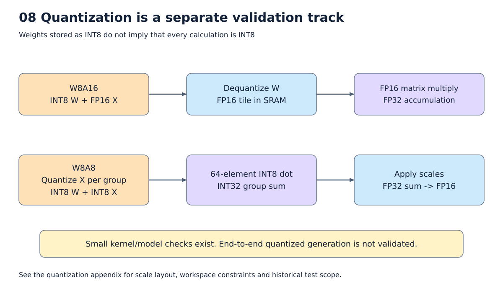

# 13. 후반부: 양자화의 동작과 별도 검증 범위

[목차](../README.md) · 먼저 [FP16 pipeline](01_overview.md)을 읽는다.

W8A16/W8A8 pass와 커널은 구현되어 있다. 그러나 최근 전체 28-layer 연속 생성의
검증은 FP16이다. 양자화 generation까지 완성·검증됐다고 이해하지 않도록 본문과
분리한다. ISA의 INT4 형식 지원도 일반 INT4 모델 compiler 완성을 뜻하지 않는다.



그림: 양자화 경로의 저장 및 연산 dtype. 자세한 조건은 아래 설명을 따른다.

## 정수와 scale로 실수를 근사하기

W[K,N]의 출력 열 j마다 `sW[j]=max(abs(W[:,j]),tiny)/127`을 계산한다.
`Wq=clip(round(W/sW),-127,127)`을 INT8로 저장한다. 반올림은 half-to-even이다.
Scale이 1/127일 때 0.5는 약 64로 저장되고 복원하면 64/127≈0.50394다.
저장량은 줄지만 오차가 생긴다.

Zero-point가 없는 대칭 양자화다. 현재 기본 granularity는 weight per-output-channel,
W8A8 activation per-row다. 임의 group size나 모든 checkpoint quantization 형식을
읽는 포괄적인 양자화 framework는 아니다.

## Pass를 host lifting 전에 적용하는 이유

```text
원래 matmul(x,W)
    ↓ 양자화 rewrite
scale(W), quantize(W), quantized_matmul(x,Wq,scale)
    ↓ LiftTransformParams
host: scale과 Wq 준비
device: 현재 x를 사용한 quantized matmul
```

Weight에만 의존하는 계산을 표준 pass가 host로 옮긴다. 매 token마다 W 전체의 absmax와
양자화를 반복하지 않는다. Parameter 또는 constant에서 온 RHS matmul이 대상이며
runtime QKᵀ/PV를 같은 weight 양자화 pass로 바꾸지 않는다.

## W8A16의 실제 경로

```text
DRAM INT8 W + FP16 device scale
    → SRAM에서 INT8를 FP16으로 변환
    → scale 곱
    → FP16 X × FP16 복원 W
    → FP32 accumulator
    → FP16 결과
```

Scale 계산은 host FP32이며 device에 쓰는 scale을 FP16으로 만든다. 현재 구현은
복원한 FP16 RHS와 기존 FP16 GEMM chain을 사용한다. ISA에 mixed-format matrix
mode가 있다는 사실과 현재 compiler가 그 mode를 선택한다는 사실은 다르다.
Weight 본체 DRAM bytes는 절반으로 줄지만 scale·복원 명령·SRAM FP16 panel이 필요하다.
M panel마다 같은 W를 다시 가져오면 복원도 반복될 수 있다.

## W8A8의 실제 경로

입력 X는 커널 경계에서 FP16이다. 실행 중 각 행의 absmax를 구하고 FP32 activation
scale을 만든다. All-zero 행은 scale=1을 사용한다. VQUANT로 INT8 X를 만든 뒤 계산한다.

```text
각 64개 K 원소:
    INT8 X × INT8 W의 INT32 부분합
    → FP32 sW와 sX 적용
    → FP32 accumulator에 더함
전체 K 완료:
    FP16 결과 저장
```

수학적으로 `Y[m,n]≈sX[m]*sW[n]*sum(Xq[m,k]*Wq[k,n])`다. 실제 수치 기준은
64개 부분합마다 scale을 적용하는 순서까지 포함한다. 전체 K를 INT32로 모두 더한
뒤 scale을 한 번 곱하는 구현과 부동소수점 결과가 항상 같다고 주장하지 않는다.

## 전용 schedule과 메모리

입력 FP16 panel, INT8 panel, per-row scale, K×64 INT8 weight panel, per-column scale,
FP16 output tile과 임시 row가 필요하다. 입력을 INT8로 만들었다고 모든 작업 공간이
절반이 되지 않는다. FP16 X와 INT8 X가 함께 존재하는 구간이 있다.

여러 입력 행을 양자화한 뒤 여러 출력 열 panel에서 재사용한다. Panel 행 수는 SRAM에
맞춰 선택한다. 현재 versioned W8A8 TIR schedule은 K/N 64배수, 정적 양의 rank-2
입력과 K≤65535 등의 조건을 검사한다. 최종 scheduled TIR는 공통 SRAM 배치와
Python/native 명령 생성으로 내려간다. 과거 direct emitter 전체를 현재의 일반 경로로
설명하지 않는다.

## Llama에서 INT8이 되는 범위

| 계산/데이터 | 현재 pass의 범위 |
|---|---|
| Q/K/V/O, gate/up/down, LM head weight matmul | 지원 조건을 만족하면 양자화 대상 |
| Attention QKᵀ와 PV | runtime operand이므로 이 pass의 대상 아님 |
| RMSNorm, softmax, RoPE, residual | 기본 FP16 경로 |
| Projection 입출력 | FP16. W8A8 내부에서 activation을 동적으로 양자화 |
| KV cache | FP16 |

모든 층 사이를 INT8로 계속 전달하는 모델이 아니다. 자동으로 연산별 FP16/W8을
품질 기준에 따라 선택하는 mixed precision 탐색도 없다.

## 현재 검증된 것과 남은 것

[보존된 회귀 로그](../evidence/current/quantization.log)는 W8A16 matmul과
W8A8 `[64,64]@[64,64]`, `[7,128]@[128,192]`의 C-model/reference bit equality,
작은 모델의 cosine 약 0.999998을 기록한다. Runtime×runtime matmul을 양자화하지
않는 검사도 포함한다. 과거 전체 모델 양자화 prefill 기록은
[과거 결과 발췌](../evidence/current/quantization_history.json)에 따로 보존한다.

`run_nn_npu.py --quantize w8a16|w8a8` 경로는 있으나 현재 `run_nn_generate.py`와
`npu_generate.generate`에는 양자화 선택이 연결되어 있지 않다. 재개 시에는
parameter/cache ABI 연결, 현재 소스의 전체 모델 prefill+여러 decode, HF 대비 품질,
compile 시간·ISA·DMA를 함께 검증해야 한다. 작은 kernel의 bit equality는 양자화 전
모델 품질 보존을 뜻하지 않는다.

구현: [양자화 rewrite와 TE](../../npu_compiler/npu_quantize.py),
[전용 schedule](../../npu_compiler/npu_w8a8_schedule.py),
[hardware intrinsic](../../npu_compiler/npu_w8a8_intrin.py).
