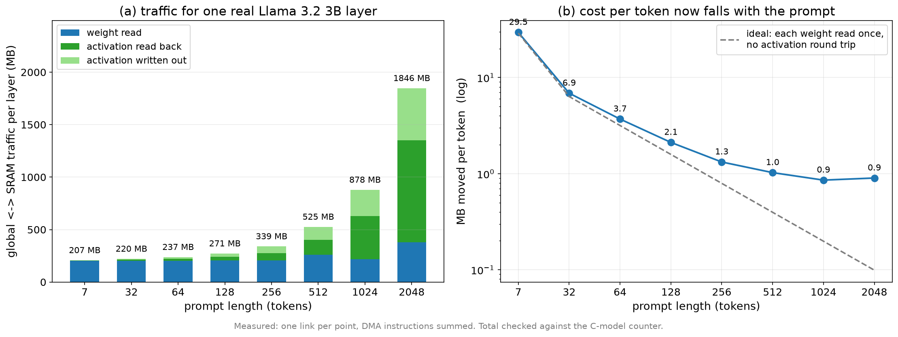
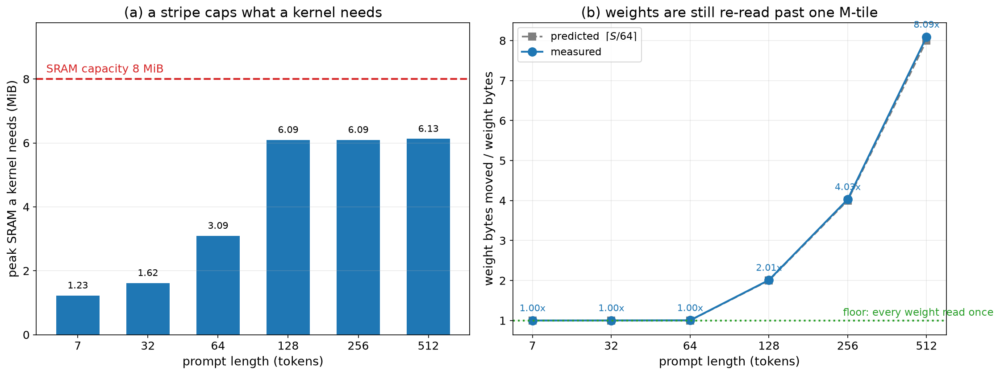

# NPU 컴파일러 — SRAM 메모리 플래닝: 계획 · 구현 · 현황

**2026-09-08 · branch `cmodel-v09`**

이 문서는 **SRAM 메모리 플래닝**만을 다룬다. 컴파일러 전체 구조는
`report_0901.md`에 있고, 여기서는 그 구조의 **어느 자리에** 메모리 플래닝이
들어가는지, **무엇을 어떻게 결정**하는지, **왜 그 결정이 SRAM을 잘 쓰게
만드는지**를 설명한다. 처음 보는 사람이 코드를 열지 않고도 동작을 그릴 수
있도록 쓴다.

---

## 0. 한 장 요약

**문제.** v09의 연산 유닛은 8 MiB SRAM만 읽는다. 전역 메모리(16 GiB)는 DMA로만
닿는다. 그런데 가중치 하나가 이미 SRAM보다 크다(`[3072,3072]` fp16 = 18 MiB).
따라서 컴파일러는 **모든 텐서를 타일 단위로 SRAM에 통과시켜야** 하고, 그
통과 방식이 곧 DMA 트래픽을 정한다.

**결정해야 하는 것.** 커널마다 "SRAM에 **얼마나** 올릴 것인가" 하나다. 많이
올릴수록 재적재가 줄지만 용량을 넘으면 컴파일이 안 된다.

**우리의 답.** 이 결정을 **링커의 피드백 루프**로 만든다.

```
가장 많이 올리는 스케줄로 시도
      │
      ▼
TVM 표준 pass가 버퍼 크기를 확정   (CompactBufferAllocation)
      │
      ▼
실제로 배치해 보고 8 MiB와 비교     (_place_sram)
      │
   넘는가? ──yes──▶ 상주량 절반으로 줄여 재시도 ──┐
      │                                          │
      no                                         └──▶ (바닥: 항상 들어가는 스케줄)
      ▼
확정
```

**어떻게 그 결정에 도달하는가**는 §4.0이 기계 사실부터 여덟 단계로 유도하고,
§4.6이 실제 커널 두 개의 결정을 값까지 그대로 따라간다. 아래는 그 결과다.

**핵심 성질 네 가지.**

| | 무엇 | 왜 중요한가 |
|---|---|---|
| (1) | **추정이 아니라 실측**한다 | 패딩·버퍼 축소·scratch 폭은 스케줄한 뒤에야 알 수 있다 |
| (2) | **최대에서 시작해 내려온다** | 노는 SRAM을 남기지 않는다 (peak이 7.54 MiB에서 평평해지는 이유) |
| (3) | **바닥이 항상 들어간다** | 탐색 실패가 컴파일 실패가 되지 않는다 |
| (4) | **목적함수가 바이트다** | cycle 모델이 없어도 최적해가 정해지고, C-model 카운터로 검증된다 |

**성과 (실 Llama 3.2 3B 1층, 링크 기반 정적 트래픽 측정).**

| seq | 전 | 후 | 토큰당 | SRAM peak |
|---|---|---|---|---|
| 128 | 882 MB | **270.8 MB** | 6.9 → **2.12 MB** | 6.09 MiB |
| 256 | **링크 실패** | **338.7 MB** | — → **1.32** | 6.09 |
| 512 | **링크 실패** | **525.1 MB** | — → **1.03** | 6.13 |
| 1024 | — | **877.7 MB** | **0.86** | 7.10 |
| 2048 | — | **1,846.2 MB** | 0.90 | 7.15 |

프롬프트를 길게 넣는 이유(토큰당 비용 절감)가 **처음으로 실제로 성립하고**,
토큰당 비용이 **1 MB 아래**로 내려간다.

**어텐션 (Loop D2, 2026-09-08 완료).** 점수 행렬이 이제 SRAM을 벗어나지 않는다.
seq 2048에서 어텐션이 **1,057 → 234.9 MB (4.5배)**. 이어서 사슬 안에서 입력을
소비자마다 staging하던 것을 고쳐(§5.6), 전체가 **2,739.5 → 1,846.2 MB (−32.6%)**
가 됐다. cosine은 모든 길이에서 불변.

**FP16 스케줄에서 짜낼 것은 거의 남지 않았다.** 남은 재staging 30%는 전부
"블록·패널이 8 MiB에 안 들어간다"이고, 그 용량을 스케줄로 확보하는 두 방법을
재어 봤으나 **둘 다 0이었다**(§6.4). 다음 지렛대는 양자화다.

**남은 것 (1) — 커널 사이의 상주(Loop C)는 재어 보고 보류했다.** 왕복량은 크지만
회수 가능량이 seq 512에서 2.9%, seq 2048에서 음수다(§6.1). D2로 후보 분포가
바뀐 뒤 다시 쟀는데 결론이 같았다.

**남은 것 (2) — decode를 처음 재 보니 링크조차 되지 않았다.** 지금까지의 측정이
전부 prefill이었다. decode는 **capacity 512에서 링크가 실패**했고(§6.5), 원인은
§5.2가 prefill에서 고친 것과 같은 결함이 M=1 경로에 남아 있던 것이다. 사다리에
칸을 하나 달아 **capacity 2048까지 열었고 prefill word는 불변**이다. 남은 것은
그 경로를 **현실적 capacity의 전체 깊이 게이트로 확인**하는 것이다 — 지금까지
통과한 decode 게이트는 전부 capacity 9였다.

---

## 1. 왜 SRAM이 "컴파일러의" 문제인가

### 1.1 기계가 강제하는 것

| 기계 특성 | 컴파일러에 주는 제약 |
|---|---|
| 연산 유닛이 **SRAM만** 주소 지정 | 커널의 모든 피연산자·중간값은 SRAM에 자리가 있어야 한다 |
| 전역↔SRAM은 **DMA만** | 데이터 이동이 명령으로 드러나므로 **정적으로 셀 수 있다** |
| **직선 프로그램** (분기·루프 없음) | 런타임 판단이 불가능 — 모든 배치가 컴파일 시점 상수 |
| **런타임·할당기 없음** | SRAM 주소도 컴파일러가 직접 준다 |
| 행렬 유닛 64×64, **누산기 1개** | K축이 최내곽으로 고정된다 (→ §4.2에서 탐색 공간이 3개로 줄어드는 근거) |

마지막 줄이 특히 중요하다. **하드웨어가 자유도를 대부분 없애 준다.**

### 1.2 목적함수는 DMA 바이트 하나다

일반적인 스케줄링 최적화는 latency 모델을 필요로 한다. 우리는 없다 — C-model에
timing이 없기 때문이다. 그런데 이 문제에서는 **필요하지 않다**:

- 연산량은 스케줄과 **무관하다**. 같은 matmul은 어떻게 타일링하든 같은 수의
  MAC을 한다.
- 스케줄이 바꾸는 것은 **DMA 바이트 수 하나뿐**이다.
- 그 값은 (M, N, K, 패널 크기)로부터 **닫힌 식**으로 나온다.
- 검증은 C-model의 `dma_cells_loaded` 카운터로 **직접** 된다.

즉 이 결정은 "재기만 하면 최적해가 정해지는" 종류다. 이것이 Timeloop류의
mapspace 탐색이 필요 없는 이유이기도 하다(§4.2).

### 1.3 측정 방법 — 실행하지 않고 트래픽을 센다

`d_compiler/analyze_traffic.py`는 **링크된 프로그램의 DMA 명령이 옮기는
바이트를 직접 합산**한다. 실행이 아니라 링크 한 번이면 되므로 A/B 비교가
빠르고, 근사가 아니다:

- 28층 프로그램에서 이 방식이 센 값과 C-model 자신의 카운터가
  **둘 다 1,619,927,729 cell로 일치** (2026-09-08 재확인. 마스크·어텐션 변경
  전에는 둘 다 1,619,976,421이었다 — 값이 함께 움직이므로 일치가 우연이 아니다)
- weight 총량도 파라미터 바이트 손계산(6,425,843,712 B)과 8 KiB 이내 일치

주소 구간으로 weight / activation / 기타를 분류하고, `plan.kernel_span`으로
**커널 단위 귀속**도 한다. 텐서 단위 귀속은 못 믿는다 — storage pool이
재사용되므로 한 주소가 한 텐서를 가리키지 않는다.

---

## 2. 기존 컴파일러 구조의 어디에 들어가는가

### 2.1 전체 파이프라인 (표준 TVM, 변경 없음)

```
[1] 프론트엔드     Relax IRModule
        │
[2] 그래프 pass    LiftTransformParams / LegalizeOps / FuseTIR …   (전부 TVM 표준)
        │          └─ 추가: FuseOpsByPattern(어텐션 전체 §5.5, 안 되면 점수 사슬 §5.4)
        │
[3] 메모리 계획    CallTIRRewrite → StaticPlanBlockMemory
        │          = 전역(DRAM) 주소.  표준 pass 그대로.
        │
[4] 스케줄         tir.Schedule (타일링 + SRAM staging + tensorize)
        │          ★ SRAM 메모리 플래닝이 사는 자리 ★
        │
[5] codegen        스케줄된 TIR을 걸어가며 v09 word 방출
[6] 링크           커널들을 직선 스트림 하나로 + peephole
```

### 2.2 memory planning은 두 층으로 갈라져 있다

이 구분이 이 문서 전체의 뼈대다.

| | **Allocation (배치)** | **Scheduling (상주 결정)** |
|---|---|---|
| 질문 | 각 텐서의 **주소**는? | SRAM에 **무엇을 얼마나** 둘까? |
| 대상 | 전역 16 GiB | SRAM 8 MiB |
| 제약 | 생존구간이 겹치면 안 됨 | **용량**(빡빡함) |
| 담당 | **TVM `StaticPlanBlockMemory`** (표준) | **우리가 추가** |
| 상태 | 완료 — 손댈 것 없음 | 이 문서의 주제 |

**전역은 이미 풀린 문제다.** 판단 기준이 다르기 때문이다:

- 전역의 기준은 **"겹치지 않게 놓기"** 하나다. 16 GiB에 3B 모델이 6.1 GiB이므로
  용량이 제약이 아니고, 따라서 **무엇을 포기할지 고를 필요가 없다.**
  생존구간이 겹치지 않는 텐서끼리 pool을 공유시키면 끝이고, 그것이
  `StaticPlanBlockMemory`가 하는 일이다(소형 모델 실측 −6.7%,
  `LiftTransformParams`와 결합해 활성 pool 1,599.7 MiB → 0.7 MiB)
- 우리가 더한 것은 **pool마다 평면 버퍼의 기준 주소를 주는 것**뿐이다
  (`npu_memplan`). 기계에 할당기가 없으므로 주소가 상수여야 하기 때문이지,
  배치를 더 잘하려는 것이 아니다

**SRAM은 기준이 하나 더 붙는다.** 용량이 빡빡해서 "겹치지 않게 놓기"만으로는
안 들어가고, **무엇을 얼마나 올릴지 고르는 단계**가 추가된다. 그 선택의 기준이
§4.0이고, 그 단계가 없던 것이 2026-09-01까지의 상태였다 — 그래서 seq 256에서
링크가 실패했다.

### 2.3 추가되는 곳은 정확히 세 군데

기존 코드를 고치지 않고 **끼워 넣는다**:

| # | 추가 위치 | 파일 | 역할 |
|---|---|---|---|
| ① | **링커의 커널 루프** | `npu_link.py` — `_fit_kernel` · `_fit_matmul` · `_fit_attention` | 상주량을 정하는 **피드백 루프** |
| ② | **스케줄 함수의 파라미터** | `npu_intrin.py` — `schedule_*(…, stripe / hold·panel / block)` | ①이 고른 값을 실제 `tir.Schedule` 변환으로 |
| ③ | **그래프 pass** | `tvm_pipeline.py` — `FuseOpsByPattern` | 커널 경계 자체를 바꾼다: 어텐션 점수 사슬(§5.4), 어텐션 전체(§5.5) |

①이 **결정자**, ②가 **실행자**, ③은 결정 대상 자체를 줄이는 전처리다.
항목이 늘어도 자리는 이 셋뿐이다 — 어텐션 블로킹(§5.5)도 세 파일에 하나씩
들어갔다.

**스케줄 함수는 정책을 모른다.** `schedule_matmul_sram(mod, name, tile, hold,
panel)`은 시키는 대로 변환만 한다. 정책은 전부 링커에 있다. 이렇게 나눈 이유는
피드백 루프가 **같은 스케줄 함수를 다른 인자로 여러 번** 부르기 때문이다.

### 2.4 링커 안에서의 실제 흐름

```
compile_program(mod, "prefill")
  │
  ├─ npu_memplan.assign_addresses()      ← [3] 전역 주소 확정
  │
  ├─ 상수 풀 수집 → SRAM 앞쪽에 배치
  │
  └─ for 각 커널 호출:
        recipe = recipes.get(gvar)                 ← 캐시 (같은 커널 37회 호출)
        if recipe is None:
            recipe = _fit_kernel(...)              ← ★ 피드백 루프 ★
        scheduled, scratch_elems, sram_buffers = recipe
        sram_map, sram_top = _place_sram(sram_buffers, sram_start, capacity)
        plan.sram_peak[name] = sram_top            ← 여유 공간 질문의 답
        native.codegen_kernel(scheduled, addresses, sram_map, …)  ← [5]
```

`recipes` 캐시가 중요하다 — 28층 모델은 **커널 종류 32개를 1,206번** 호출하므로
같은 PrimFunc을 37번씩 다시 스케줄하고 있었다. 스케줄은 (PrimFunc, 타일)의 순수
함수이므로 GlobalVar로 캐시했다: **219.0s → 6.3s**.

---

## 3. SRAM 주소 공간은 어떻게 구성되는가

"SRAM에 무엇을 상주시키는가"에 답하려면 먼저 **공간이 어떻게 나뉘어 있는지**를
봐야 한다. 링커가 만드는 배치는 이렇다 (단위: nibble = 0.5 byte, 기계의 SRAM
주소 단위):

```
nibble 0                       ┌──────────────────────────┐
                               │ ① 상수 풀 (fp16 스칼라)   │  프로그램 수명
                               │    n개 × 4 nibble         │  프로그램 시작 시 1회 DMA
n×4                            ├──────────────────────────┤
                               │ ② fp32 리터럴 1.0 (8)     │  VDEQUANT용
scratch_base = align8(n×4+8)   ├──────────────────────────┤
                               │ ③ scratch slot 6개        │  커널 수명
                               │    각 (그 커널의 최장 행)  │  식(expression)을 벡터
                               │                          │  단계로 직렬화할 때 쓰는 임시
sram_start                     ├──────────────────────────┤
                               │ ④ 커널 staging 버퍼       │  커널 수명
                               │    (bump 할당)            │  ★ 결정이 일어나는 곳 ★
sram_top                       ├──────────────────────────┤
                               │    유휴                   │
16,777,216 (= 8 MiB)           └──────────────────────────┘
```

**고정 크기가 아니다.** ①은 모델의 스칼라 리터럴 수로, ③은 **커널마다** 그
커널이 만지는 가장 긴 행으로 정해진다(`_scratch_row`). ④는 커널마다 0에서 다시
bump한다.

원소 하나가 차지하는 nibble: `float16 → 4`, `int8 → 2`, `float32 → 8`.

**여기서 지금의 한계가 그대로 보인다.** ④가 커널마다 리셋되므로 **커널 사이에
살아남는 영역이 없다.** 그래서 커널 하나가 끝나면 결과를 전역에 쓰고, 다음
커널이 그걸 다시 읽는다. 이것이 §6.1의 Loop C가 채워야 할 칸이다 — 설계상
③과 ④ 사이에 **⑤ Resident 영역**이 들어갈 자리다.

---

## 4. 전체 설계 — 결정 변수 하나와 피드백 루프 하나

### 4.0 유도 — 기계 사실에서 결정 기준까지

이 절은 결론이 아니라 **결론에 이르는 순서**다. 아래 여섯 단계를 따라가면
같은 설계가 나온다.

#### 단계 1. 기계가 없애 주는 자유도를 먼저 센다

스케줄링을 "무엇을 정할 수 있나"부터 시작하면 공간이 터진다. 반대로 **기계가
이미 정해 버린 것**부터 지우면 남는 것이 적다.

| 기계 사실 | 지워지는 선택지 |
|---|---|
| 연산 유닛이 SRAM만 주소 지정 | "전역에서 바로 계산"이 없다 — **모든 피연산자가 반드시 SRAM을 통과**한다 |
| 이동은 DMA 명령뿐 | 데이터 이동이 **명령으로 드러난다** → 실행 없이 셀 수 있다 |
| 직선 프로그램 (분기·루프 없음) | 런타임 판단이 없다 — **모든 결정이 컴파일 시점 상수** |
| 행렬 유닛 타일이 **64×64 고정** | 타일 크기는 결정 변수가 **아니다** |
| 누산기가 **1개** | C 타일의 MAC 사슬이 끊기면 안 되므로 **k축이 최내곽으로 고정** |

마지막 줄이 결정적이다. 3중 루프에서 k가 고정되면 남는 것은 **바깥 두 루프의
순서**뿐이다.

#### 단계 2. 남는 자유도는 두 개뿐이고, 사실 하나다

```
(a) 바깥 두 루프 중 어느 것이 밖인가   → 어느 피연산자가 안쪽에서 불변인가
                                        → 그것만 1회 읽고 다른 쪽을 흘려보낸다
(b) 그 불변 피연산자를 얼마나 크게 올릴까 → 패널 / stripe / 행블록
```

(a)는 이산 선택 2개, (b)는 크기 하나다. 그리고 (a)는 **(b)의 특수한 경우로
읽을 수 있다** — "A를 크게 올린다"가 곧 "A가 바깥이다"이기 때문이다. 그래서
결정 변수는 실질적으로 **하나**다(§4.1).

#### 단계 3. 목적함수를 고른다 — 왜 바이트인가

- **연산량은 스케줄과 무관하다.** 같은 matmul은 어떻게 타일링하든 MAC 수가 같다
- 스케줄이 바꾸는 것은 **DMA 바이트 하나뿐**이다
- 그 값은 `(M, N, K, 패널)`로부터 **닫힌 식**으로 나온다
- C-model의 `dma_cells_loaded`로 **검증된다** (28층에서 정적 합산과 카운터가
  둘 다 1,619,927,729 cell)

그러므로 **cycle 모델이 없어도 최적해가 정의된다.** 이것이 "latency 정보 없이
뭘로 정하냐"에 대한 답이고, 동시에 이 설계가 어디까지 유효한지의 경계다 —
겹침(double buffering)이 관건이 되는 순간 바이트로는 부족해진다(§6.3).

#### 단계 4. 제약을 쓴다 — 그리고 제약이 관측 가능한지 묻는다

```
minimize  DMA 바이트(상주 수준)
s.t.      발자국(상주 수준) ≤ 8 MiB
```

목적함수는 닫힌 식이다. **문제는 제약이다** — 발자국을 어떻게 아는가?

#### 단계 5. 제약은 추정하지 않고 잰다

발자국을 스케줄 전에 계산할 수 없다. 세 가지가 스케줄한 뒤에야 정해지기 때문이다:

| 모르는 것 | 언제 정해지나 |
|---|---|
| `pad_einsum`이 만드는 패딩 버퍼 | M이 64의 배수가 아닐 때만 생긴다 |
| `CompactBufferAllocation`이 얼마나 줄이나 | `cache_read`는 생산자 **전체 shape**으로 잡는다 — 실모델에서 18~48 MiB를 요구하던 것을 이 pass가 줄인다 |
| 커널의 scratch 폭 | 커널이 만지는 최장 행 (`_scratch_row`) |

추정식을 쓰면 **안전 여유**를 둬야 한다. 그런데 이 문제에서 여유는 곧 **노는
SRAM**이고, 노는 SRAM은 곧 **회피하지 못한 DMA**다. 즉 여유가 그대로 목적함수의
손해다. 그래서 **스케줄을 실제로 만들고 TIR pass를 다 돌린 뒤 진짜 배치를 잰다**
(§4.4).

#### 단계 6. 탐색 방향은 단조성이 정해 준다

```
상주 수준 ↑  →  트래픽 ↓ (단조)
상주 수준 ↑  →  발자국 ↑ (단조)
```

둘 다 단조이므로 **실현 가능한 것 중 가장 큰 것이 최적**이다. 그래서

- **위에서 아래로 내려온다.** 첫 번째로 들어가는 값이 곧 답이다 — 이진 탐색도,
  전 구간 평가도 필요 없다
- **사다리는 절반씩** 내려간다. 임의의 값이 아니라 축을 **나누는** 값이어야
  하기 때문이다 (나누지 못하면 바깥 루프가 고르지 않게 갈라지고 블록 바인딩이
  affine이 아니게 되어 TVM이 `compute_at`을 거부한다 — §8.1이 그 대가를 치른
  사례다)
- 따라서 최적은 **사다리 안에서의 최적**이다. 사다리를 벗어난 더 큰 값이
  이론상 있을 수 있지만 그것은 스케줄이 불가능한 값이다

#### 단계 7. 실패를 설계에 넣는다

- **사다리 바닥은 어떤 예산에서도 들어가야 한다.** matmul의 바닥은 타일 3개,
  원소별의 바닥은 한 행이다. 그래야 위쪽을 공격적으로 시도해도 **탐색 실패가
  컴파일 실패가 되지 않는다**
- **바닥까지 실패하면 조용히 물러서지 않고 어느 값에서 왜 실패했는지 말한다.**
  조용한 폴백은 seq 512 트래픽의 30%를 일주일 동안 숨긴 적이 있다(§8.1, §8.2)

#### 단계 8. 커널마다 독립인 이유, 그리고 그것이 깨지는 지점

지금 SRAM에는 **커널 사이에 살아남는 상태가 없다**(§3의 ④가 커널마다 리셋).
그래서 커널 하나의 결정이 다른 커널에 영향을 주지 않고, 전체 문제가 **커널별
1차원 문제로 분해**된다. 이것이 링커가 커널을 순서대로 훑으며 각자 결정할 수
있는 이유다.

커널 간 상주(§6.1)를 넣으면 **이 성질이 깨진다** — 상주 집합이 모든 커널의
예산을 동시에 줄이므로 바깥 루프가 하나 더 필요해진다. 그 항목을 재어 보고
접은 이유의 절반이 이 복잡도이고, 나머지 절반은 이득이 음수라는 것이다.

---

### 4.1 결정 변수: "상주 수준"

커널 종류마다 형태는 다르지만 **성격은 하나**다: *SRAM에 얼마나 크게 올릴 것인가.*

| 커널 종류 | 결정 변수 | 값의 사다리 (위 = 상주 많음 = 트래픽 적음) | 바닥 |
|---|---|---|---|
| **matmul** | `(hold, panel)` | `hold`=A 또는 B, `panel` = 축 전체 → 절반 → … (≥ 64) | `hold=None`: 두 피연산자를 64×64 타일 하나씩 |
| **원소별·정규화** | `stripe` (행 수) | `None`(텐서 전체) → `rows` → `rows/2` → … | `stripe=1`: 한 행 |
| **어텐션** (§5.5) | `block` (질의 행 수) | `seq` → `seq/2` → … (≥ 64) | 없음 — 한 타일에서도 안 들어가면 링크 실패 |

세 줄이 다 같은 모양이라는 점이 §4.5의 출발점이다.

**사다리의 바닥은 반드시 어떤 예산에서도 들어간다.** matmul의 바닥은 타일
3개(A·B·C)뿐이고, 원소별의 바닥은 한 행이다. 그래서 **탐색 실패가 컴파일
실패로 이어지지 않는다.** 이 성질이 설계 전체를 안전하게 만든다.

### 4.2 matmul: 후보가 세 개뿐인 이유와 비용식

행렬 유닛은 64×64를 먹고 **누산기가 1개**다. 그러므로 C 타일 하나의 MAC 사슬이
끊기지 않으려면 **k가 최내곽이어야 한다.** 남는 자유도는 **바깥 두 루프의
순서**뿐이고, 그것이 곧 **어느 피연산자가 안쪽에서 불변인가**다.

즉 mapspace가 **자연히 3개로 축소된다** — 탐색이 아니라 **세 식의 비교**로 끝난다.
(M×N×K, 원소 수; fp16이면 ×2 byte)

| 후보 | SRAM 발자국 | A 트래픽 | B 트래픽 |
|---|---|---|---|
| **바닥** (둘 다 `k_o`에 staging) | `2·(2·64²)` | `M·K·⌈N/64⌉` | `K·N·⌈M/64⌉` |
| **Input-Stationary** (`hold="A"`, 패널 `Tm`) | `2·(Tm·K + 64·K + 64²)` | `M·K` **(1회)** | `K·N·⌈M/Tm⌉` |
| **Weight-Stationary** (`hold="B"`, 패널 `Tn`) | `2·(K·Tn + 64·K + 64²)` | `M·K·⌈N/Tn⌉` | `K·N` **(1회)** |

`_matmul_mapping()`이 하는 일 그대로다:

```python
room = budget - (depth*tile + tile*tile) * itemsize   # 스트리밍 피연산자 + 결과 타일을 뺀 나머지
span = room // (depth * itemsize)                     # 상주 피연산자가 쓸 수 있는 폭

now  = rows*depth*ceil_div(cols, tile) + depth*cols*ceil_div(rows, tile)
A안  = rows*depth + depth*cols*ceil_div(rows, panel_for(rows))
B안  = depth*cols + rows*depth*ceil_div(cols, panel_for(cols))
→ 셋 중 최소를 고른다 (개선이 없으면 None = 바닥 유지)
```

**패널은 축을 나누는 값이어야 한다.** `panel_for()`가 전체 extent에서 **절반씩**
내려가는 이유다:

```python
def panel_for(extent):
    panel = extent
    while panel > span and panel % 2 == 0 and panel // 2 >= tile:
        panel //= 2
    return panel if panel <= span else None
```

나누지 못하는 값으로 split하면 바깥 루프가 고르지 않게 갈라지고, 그 아래 블록
바인딩이 affine이 아니게 되어 **TVM이 `compute_at`을 거부**한다. 처음 구현에서
예산으로 계산한 패널을 64의 배수로만 내림했더니 `matmul5`(FFN down, K=8192)가
512행에 대해 384를 받았고, 384가 512를 나누지 못해 그 커널만 **조용히 바닥으로
되돌아가 가중치를 8배 재적재**했다 — seq 512 트래픽의 30%였다. §8.2 참조.

**M이 64의 배수가 아니면 아예 손대지 않는다** (`if rows % tile: return None`).
그 경우 `pad_einsum`이 패딩한 피연산자를 이미 SRAM에 상주시키므로 얻을 게 없다.
seq=7인 **전체 깊이 게이트 4종이 한 word도 바뀌지 않은** 이유가 이것이다.

### 4.3 원소별·정규화: stripe

이 커널들은 구조가 균일하다 — **모든 블록이 출력의 선행 축(행)을 공유하고 마지막
축만 다르다.** 그래서 변환이 하나로 끝난다 (dlight의 정규화 규칙과 같은 형태):

1. 출력을 쓰는 블록(anchor)의 선행 루프들을 `fuse` → 행 루프 하나
2. 그것을 `split(…, [None, stripe])` → 바깥 = stripe 루프
3. 나머지 블록을 그 안으로 `compute_at` (가까운 생산자부터)
4. 파라미터 읽기를 `cache_read` 후 stripe 루프에 `compute_at`
5. `CompactBufferAllocation`이 버퍼를 stripe 크기로 줄인다

출력이 **여러 개**면(RoPE의 `split`) 블록들이 사슬이 아니라 형제다. 그때는
**출력마다 자기 stripe 루프**를 주고, `cache_read(..., consumer_blocks=[block])`로
스테이징을 소비자별로 한정한다 — 공유 캐시는 두 루프에 동시에 있을 수 없다.

### 4.4 피드백 루프 — 왜 "재는" 것이 핵심인가

```python
while True:
    scheduled = _schedule(planned, gvar, prim, tile, stripe)   # ② 스케줄 변환
    elems     = _scratch_row(scheduled)                        # 이 커널의 최장 행
    buffers   = _sram_buffers(scheduled)                       # 실제 할당된 버퍼들
    start     = scratch_base + slot_count * elems * 4
    _, top    = _place_sram(buffers, start)                    # 실제 배치
    if top <= profile.sram_nibbles:
        return scheduled, elems, buffers                       # 확정
    ... stripe //= 2                                           # 상주량을 낮춰 재시도
```

**추정식을 쓰지 않는다.** `_schedule` 안에서 TVM 표준 pass 4개가 돌고 나서야
버퍼 크기가 확정되기 때문이다:

| pass | 하는 일 | 왜 필요한가 |
|---|---|---|
| `LowerInitBlock` | reduction의 init을 가드된 store로 | 이게 되어야 아래 pass들이 돈다 |
| `PlanAndUpdateBufferAllocationLocation` | 버퍼 할당 위치를 안쪽 루프로 이동 | 타일 단위 버퍼가 되는 전제 |
| `ConvertBlocksToOpaque` | 블록 바인딩 제거 | 〃 |
| **`CompactBufferAllocation`** | **버퍼를 실제 접근 영역으로 축소** | `cache_read`는 생산자의 **전체 shape**으로 버퍼를 잡는다 — 이게 없으면 커널당 18~48 MiB |

즉 `pad_einsum`의 패딩, `CompactBufferAllocation`의 축소, 커널의 scratch 폭은
**스케줄하기 전에는 알 수 없다.** 그래서 "스케줄 → 재기 → 안 되면 낮추기"가
추정보다 단순하면서 정확하다.

**첫 시도는 항상 기존과 동일한 스케줄이다.** 그래서 **이미 들어가던 커널은 한
word도 바뀌지 않는다** — 이 성질을 28층 게이트 4종의 word 수 불변으로 매번
확인했다.

### 4.5 이건 휴리스틱인가 탐색인가 — 세 층을 구분해야 한다

"op마다 룰을 손으로 정하는 게 맞나, 규칙 기반으로 탐색해야 하나"는 이 설계에
대한 정당한 질문이다. 답하려면 **성격이 다른 세 층**을 나눠야 한다.

| 층 | 무엇을 정하나 | 지금 방식 | 성격 |
|---|---|---|---|
| **①** | **어느 스케줄 템플릿을 쓸까** | `_is_attention` → `_is_matmul` → 그 외 | **휴리스틱** |
| **②** | 템플릿 안의 파라미터 | stripe / panel / block 사다리 + 실측 | **탐색** (평가가 정확) |
| **③** | matmul의 상주 피연산자 | 닫힌 식 3개 비교 | **정확해** |

**③은 휴리스틱이 아니고, 탐색으로 바꿀 이유도 없다.** 누산기가 1개라 k가
최내곽으로 고정되고(§4.2), 남는 자유도가 후보 **3개**뿐이며, 각각 닫힌 식이
있다. 3원소 공간을 정확히 평가할 수 있으면 그것은 탐색이 아니라 비교다 —
탐색기를 붙이면 같은 답을 더 느리게 낸다.

**②는 이미 탐색이다.** 추정식이 아니라 `CompactBufferAllocation` 이후의 **실제
배치**를 재고 사다리를 내려간다(§4.4). 1차원인 것은 템플릿이 손잡이를 하나만
노출하기 때문이다.

**①이 휴리스틱이고, 지금 템플릿이 4개다** (`schedule_matmul_sram`,
`schedule_generic_sram`, `schedule_generic_striped`, `schedule_attention_blocked`).
룰 리스트는 dlight도 Ethos-U cascader도 쓰는 주류 방식이지만, 비용이 있고
**그 비용이 §5.5에서 실제로 드러났다**:

> 브로드캐스트 피연산자를 "불변인 가장 바깥 루프"에서 staging하는 규칙을
> `schedule_attention_blocked`에 넣어 seq 2048에서 193 MB를 없앴다. 같은 규칙이
> `schedule_generic_striped`에는 **없다** — 그쪽은 조건 없이 stripe 루프에서
> staging한다. **템플릿이 나뉘어 있어서 개선이 한 곳에만 들어갔다.**

#### 네 템플릿은 사실 하나다

`schedule_attention_blocked`를 쓰면서 드러난 것은, 그것이
`schedule_generic_striped`와 **같은 변환**이라는 점이다. 차이는 striped가
리덕션 anchor를 다루지 못했던 것뿐이다. 일반형은 이렇다:

```
1. anchor = 출력을 쓰는 블록
2. anchor의 축을 (공간 바깥 / 공간 안 / 리덕션)으로 분류
3. 공간 바깥 축의 블로킹을 고른다        ← ②의 탐색 파라미터
                                          (stripe·panel·block이 전부 이것이다)
4. 나머지 블록을 블로킹 루프 안으로 compute_at
5. 파라미터마다 "그 축에 불변인 가장 바깥 루프"에서 staging
                                          ← §5.5의 마스크 규칙의 일반형
                                            matmul의 A/B 선택(③)도 이것의 특수 경우다
6. 리덕션 블록마다 타일 + 텐서화
7. 실제 배치를 재고, 넘치면 블로킹을 줄여 반복   ← §4.4의 피드백
```

#### 왜 MetaSchedule/Ansor 같은 본격 탐색이 아닌가

- **하드웨어가 공간을 이미 접었다.** 누산기 1개, 고정 타일, 직선 ISA. 접힌 뒤
  실질 자유도는 1~2차원이다
- **평가가 정확하지만 싸지 않다.** 후보 하나마다 TIR pass 4개 + 배치를 돌려야
  한다. 링크를 8,147s → 127s로 만든 것이 최근 작업인데 되돌릴 이유가 없다
- **지금 병목은 탐색력이 아니라 일반성이다.** 공간을 넓혀도 템플릿이 4개면
  다섯 번째 op 모양에서 막힌다

즉 다음 구조 작업은 탐색기를 붙이는 것이 아니라 **①을 없애는 것**이다(§10.1).

### 4.6 전 과정 추적 — 실제 커널 두 개

위의 기준이 실제로 어떻게 적용되는지, 링커가 내는 값을 그대로 따라간다.
직접 재현할 수 있다: `_fit_kernel`이 부르는 함수들을 순서대로 호출하면 된다.

#### (가) `matmul5` — FFN down, seq 512

`[512, 8192] × [8192, 3072]`. 커널 종류 판정부터 시작한다.

```
[0] 분류      _is_attention → False,  _is_matmul → True     → _fit_matmul
[1] scratch   이 커널이 만지는 최장 행 = 8,192 원소
              → scratch 6 slot × 8192 × 4 nibble = 0.09 MiB
[2] extents   M=512  N=3072  K=8192,   M % 64 = 0
              (M % 64 ≠ 0 이면 여기서 끝 — pad_einsum이 이미 상주시키므로
               얻을 게 없다.  seq=7 게이트가 이 가지로 빠진다)
[3] 예산      8.00 MB
              − 스트리밍 피연산자 K·64 + 결과 타일 64²   (×2 B)
              = 6.99 MB 가 상주 피연산자 몫
              → span = 6.99 MB / (K × 2 B) = 447 행
[4] 후보 비교 (원소 수)
      바닥    M·K·⌈N/64⌉ + K·N·⌈M/64⌉        = 402.7 M     (805 MB)
      A(IS)   M·K + K·N·⌈M/256⌉               =  54.5 M     (109 MB)   panel 256
      B(WS)   K·N + M·K·⌈N/384⌉               =  58.7 M     (117 MB)   panel 384
      → ('A', 256)          A안이 B안보다 7% 싸다
[5] 사다리    panel 256으로 스케줄 → TIR pass 4개 → 실제 배치를 잼
              top 5.10 MiB ≤ 8 MiB    → 첫 시도에서 확정 (절반으로 내려갈 일 없음)
[6] 배치
      @0.09 MiB  matmul_global.sram          [64, 64]         8 KiB   결과 타일
      @0.10 MiB  permute_dims11_global.sram  [8192, 64]    1,024 KiB   흘려보내는 B
      @1.10 MiB  mul5_global.sram            [256, 8192]   4,096 KiB   상주하는 A 패널
```

**읽는 법.** `span 447`이 예산이 허락하는 최대 패널 행 수인데, 447은 512를
나누지 못한다. `panel_for(512)`가 512 → 256으로 **한 번 절반** 내려가 256을
고른다(256 ≤ 447 ✓, 512를 나눔 ✓). 384도 447 이하지만 512를 나누지 못하므로
A안의 후보가 될 수 없다 — B안에서 3072를 나누는 값으로만 쓰인다.

**8 MiB 중 5.10 MiB를 쓰는 대신 696 MB의 DMA를 지웠다.** 이것이 §7.1의
"노는 공간을 트래픽으로 바꾼다"의 구체적인 모습이다.

#### (나) 융합 어텐션 — seq 2048

`H=24, S=2048, HD=128`. 이 커널은 두 matmul을 품고 있으므로 `_is_matmul`도
참이지만, **`_is_attention`을 먼저 묻는다**(§2.3).

```
[0] 분류      _is_attention → True    → _fit_attention
[1] scratch   최장 행 = 2,048 원소 → 0.02 MiB
[2] 사다리    행블록을 seq 전체에서 절반씩 내린다
                Br 2048 →  50.02 MiB   초과
                Br 1024 →  25.52 MiB   초과
                Br  512 →  13.27 MiB   초과
                Br  256 →   7.15 MiB   ≤ 8 MiB   → 확정
[3] 배치 (7.15 MiB)
      @0.02  matmul_intermediate        [1,256,2048]  1,024 KiB   QKᵀ 결과
      @1.02  T_multiply_intermediate    [1,256,2048]  1,024 KiB   × scale
      @2.02  T_add_intermediate         [1,256,2048]  1,024 KiB   + mask
      @3.02  T_softmax_maxelem          [1,256]           0 KiB
      @3.02  T_softmax_exp              [1,256,2048]  1,024 KiB
      @4.02  T_softmax_expsum           [1,256]           0 KiB
      @4.02  T_softmax_norm             [1,256,2048]  1,024 KiB   probs
      @5.02  matmul_intermediate_1      [1,256,128]      64 KiB   출력 타일
      @5.09  permute_dims3 (Q)          [1,256,128]      64 KiB
      @5.15  permute_dims6 (K)          [1,128,2048]    512 KiB
      @5.65  permute_dims5 (V)          [1,2048,128]    512 KiB
      @6.15  mask                       [1,256,2048]  1,024 KiB
```

**여기서 세 가지가 한눈에 보인다.**

1. **`[H,S,S]` 점수 행렬이 없다.** 대신 `[1, 256, 2048]` 조각 다섯 개가 있다 —
   블로킹이 한 일이 이것이다. 통짜였다면 192 MiB다
2. **K와 V가 헤드 하나치만 올라온다**(`[1,128,2048]`, `[1,2048,128]`). 헤드
   루프가 행블록 **안**이므로 헤드마다 갈아 끼운다 → 블록당 1회 = 총 8회
3. **마스크가 `[1,256,2048]`**이다. 헤드 차원이 1이라 행블록 루프 **바깥**에서
   올라오고(§5.5), 그래서 8회만 읽힌다. 헤드 안이었다면 24×8 = 192회였다

**이 배치가 곧 트래픽이다.** Br=256이므로 블록이 8개, K·V가 블록마다 한 번씩:

```
Q + O          2 × 12 MiB           =  24 MiB   (블록 전체에 걸쳐 1회씩)
K + V          2 × 12 MiB × 8 블록  = 192 MiB
mask           2048 × 2048 × 2 B    =   8 MiB
                                       ------
                                       224 MiB = 234.9 MB   ← §5.5의 실측과 일치
```

그리고 **Br=512면 K·V가 4회가 되어 134 MB**가 된다. 그것이 §6.4가 노린
것이고, 재어 보니 필요한 SRAM(약 10.3 MiB)을 확보할 수 없었다.

#### 두 추적이 보여 주는 것

| | `matmul5` | 어텐션 |
|---|---|---|
| 결정 방식 | **닫힌 식 비교** (후보 3개) | **사다리** (측정 4회) |
| 왜 다른가 | 비용식이 있고 후보가 유한 | 발자국을 미리 계산할 수 없음 |
| 공통 | **실제 배치를 재고 8 MiB와 비교** | 〃 |
| 공통 | **최대에서 시작해 내려옴** | 〃 |
| 결과 | 5.10 / 8 MiB 사용 | 7.15 / 8 MiB 사용 |

**둘 다 8 MiB를 최대한 채운다.** 그것이 이 설계가 SRAM을 잘 쓴다는 말의
정확한 의미다 — 남는 공간은 회피하지 못한 DMA이기 때문이다.

---

---

## 5. 구현된 것 — 여섯 개의 변경과 각각의 실측

시간순이다. 여섯 개가 들어갔고, 남은 두 설계 항목(커널 간 상주, 커널 내 SRAM
확보)은 **둘 다 재어 보고 접었다**(§6.1, §6.4).

### 5.1 Loop A — 원소별·정규화 커널의 stripe (2026-09-07, 완료)

**증상.** seq 256에서 `mask_global.sram [24,256,256]`가, 512에서
`rms_norm_global.sram [512,3072]`가 혼자 8 MiB를 넘겨 **링크가 실패**했다.
성능 항목이 아니라 **긴 프롬프트를 컴파일하지 못한다**는 뜻이었다.

**원인.** `schedule_generic_sram`은 커널의 모든 버퍼를 **텐서 전체**로
스테이징했다. matmul은 `compute_at`으로 타일 단위였는데 원소별에는 그 단계가
아예 없었다. 넘치는 커널 8개를 실측하니 **전부 원소별·정규화, matmul은 하나도
없었다.**

**해결.** §4.3의 stripe 스케줄 + §4.4의 피드백 루프.

| 커널 (seq 512) | 전 | stripe 64 |
|---|---|---|
| `silu` `[512,8192]` | 24.09 MiB | **3.00** |
| `npu_rms_norm` `[512,3072]` | 12.04 | **1.51** |
| `add2` `[24,512,512]` | 36.01 | **0.19** |
| `softmax` `[24,512,512]` | 36.05 | **0.19** |

**검증.** `d_compiler/tests/test_long_prompt.py` — 실차원 1층을 seq 64~512로 링크해
C-model에서 돌리고 **float32 numpy**와 대조 (llvm이 아니다: llvm은 fp16으로
누적해 K=3072~8192에서 스스로 드리프트하며 cosine 0.998을 준다).

| seq | 64 | 128 | 256 | 512 |
|---|---|---|---|---|
| cosine | 0.999997 | 0.999996 | 0.999996 | **0.999995** |

28층 게이트 15,285,893 word · token 358 · cosine 0.9999927 **불변**.

### 5.2 Loop B — matmul의 상주 피연산자 선택 (2026-09-07, 완료)

**증상 두 개.**
- **(B)** seq 32 → 64에서 activation 되읽기가 9.0 → 217.6 MB로 **24배** 뛴다.
- **(C)** weight가 `⌈S/64⌉`회 재적재된다 — seq 128에서 2.01×, 512면 8×.

**(B)의 원인이 역설적이다.** seq가 64의 배수가 **아니면** `pad_einsum`이 패딩
버퍼를 만들고 그 버퍼가 SRAM에 상주하므로(`set_scope`) matmul이 제자리에서 읽어
**1회**로 끝난다. 64의 배수면 패딩이 없어 일반 `cache_read` 경로를 타고
**N/64회 재적재**된다. 즉 **패딩이 필요한 경우가 우연히 더 빨랐다.**

**해결.** §4.2의 세 후보 비교 + 패널 피드백.

| seq | 전체 트래픽 | weight | 토큰당 |
|---|---|---|---|
| 64 | 438 → **239 MB** | 204.0 → 204.0 (1회) | 6.8 → **3.7 MB** |
| 128 | 882 → **278** | 408.3 → **205.4** (1회) | 6.9 → **2.2** |
| 256 | 1,789 → **367** | 818.2 → **209.5** (1회) | 7.0 → **1.4** |
| 512 | 3,679 → **638** | 1,642.6 → **272.7** | 7.2 → **1.25** |

**토큰당 비용이 처음으로 프롬프트 길이에 따라 단조 감소한다.** 링크 시간도
함께 줄었다(seq 512에서 56.0s → 10.8s) — 전송이 더 크고 적어졌기 때문.

### 5.3 다중 출력 커널 (2026-09-07, 완료)

seq 1024에서 `split`(RoPE의 앞/뒤 절반)이 **striping 불가**였다 — 독립적인 출력
블록 두 개라 사슬이 아니어서 `compute_at`이 거부된다. 출력마다 자기 stripe
루프를 주니 출력 버퍼는 줄었으나 **입력 스테이징이 `[2048,24,128]` 12 MiB로
그대로** 남았다: 두 블록이 같은 입력을 읽어 공유 캐시가 만들어지고, 그것이 서로
다른 루프에 동시에 있을 수 없기 때문이다.

`cache_read(..., consumer_blocks=[block])`로 소비자를 한정 → 각자 자기가 읽는
절반 `[stripe,24,64]`만 스테이징: **24.00 → 0.05 MiB**. 대가로 두 절반이 각각
strided로 올라와 seq 512 트래픽이 463.5 → 493.9 MB로 6% 늘었지만, **1024·2048이
열린다.**

### 5.4 어텐션 점수 사슬 융합 (2026-09-07, 완료) — Loop D의 1단계

seq 2048에서 트래픽을 **커널 단위**로 분해하니 어텐션이 44%였고, 대부분이
행렬곱이 아니라 **점수 행렬 위의 원소별 패스**였다:

| 커널 | 트래픽 | 비중 |
|---|---|---|
| `softmax` | 604.0 MB | 16.1% |
| `add2` (+mask) | 604.0 | 16.1% |
| `multiply2` (×scale) | 402.7 | 10.7% |
| `matmul2`(QKᵀ) · `matmul3`(PV) | 각 226.5 | 각 6.0% |

`scores[24,2048,2048]`가 201 MB이므로 **세 원소별 커널이 그 텐서를 각각 읽고
쓰며 1,611 MB를 옮긴다.**

**패턴 하나만 융합했다** — `softmax(add(mul(scores, scale), mask))`를
`FuseOpsByPattern` + `FuseTIR`로 한 커널로. 일반 융합(`fuse=True`)은 여전히 꺼져
있고, 이 패턴만 별도 플래그(`fuse_attention`, 기본 켜짐)로 처리한다. Gemma는
스케일을 q에 미리 적용해 곱셈이 없으므로 `softmax(add(x, mask))` 패턴을 하나 더
두고 구체적인 것을 먼저 매칭시킨다.

융합된 커널은 **사슬 형태의 다중 블록**이라 §5.1의 stripe 스케줄이 그대로
처리한다 — 새 스케줄이 필요 없었다.

| seq | 512 | 1024 | 2048 |
|---|---|---|---|
| 융합 전 | 668.2 MB | 1,402 | 3,746 |
| **융합 후** | **605.4** | **1,150** | **2,740** |
| | −9% | −18% | **−27%** |

커널 수도 줄었다: Llama 1,206 → **1,150**(층당 2개), Gemma 1,548 → **1,513**.
전체 깊이 게이트 4종은 **cosine과 token 모두 불변.**

---

### 5.5 Loop D2 — 어텐션 전체 융합과 행블록 블로킹 (2026-09-08, 완료)

§5.4의 융합으로 점수 행렬 위의 패스는 3 → 1이 됐지만 **`scores`는 여전히
materialize**됐다 — seq 2048에서 201 MiB를 쓰고 읽었다. 이번에 그것을 없앴다.

#### 온라인 softmax가 필요 없다 — 이 설계의 핵심

착수 전 우려는 "FlashAttention은 온라인 softmax를 쓰는데, 우리는 **누산기가
1개**라 블록마다 누산기를 비우고 벡터 유닛으로 재조정해야 하고 그러면 MAC
사슬이 끊긴다"였다. **그 문제가 생기지 않는다.**

FlashAttention이 온라인 softmax를 쓰는 이유는 점수 행렬의 **두 축을 다**
쪼개기 때문이고, 그렇게 하는 이유는 GPU SM의 공유 메모리가 ~200 KB이기
때문이다. **우리는 8 MiB다.** 질의 행 블록 하나가 그 행들의 **전체 행**을
담으므로 softmax가 정확하다 — running max도, 누적 출력의 재조정도 없고,
**누산기를 건드리지 않는다.**

| | FlashAttention (GPU) | 우리 (v09) |
|---|---|---|
| 쪼개는 축 | 행·열 **둘 다** | **행만** |
| 이유 | 공유 메모리 ~200 KB | SRAM 8 MiB |
| softmax | 온라인(근사 누적) | **정확** |
| 누산기 | 블록마다 재조정 | **손대지 않음** |

#### 구현 — 세 곳

| 위치 | 추가 |
|---|---|
| `tvm_pipeline.py` | `_attention_patterns()` — `matmul → (scale) → mask → softmax → matmul`. Gemma는 스케일을 q에 미리 넣으므로 변형 2개 |
| `npu_intrin.py` | `schedule_attention_blocked()` — 행 블록 split + 전부 `compute_at` + 두 matmul 텐서화 |
| `npu_link.py` | `_is_attention()`(`_is_matmul`보다 **먼저**: 이 커널에도 `matmul` 블록이 있다), `_fit_attention()` 블록 사다리 |

**변환이 하나로 끝난 이유**: 융합된 커널의 **모든 블록이 `(head, row)`를 앞 두
루프로 공유**하고, matmul만 그 뒤에 리덕션 축을 하나 더 가진다. 그래서 anchor의
행 축을 split하고 나머지를 `compute_at`으로 안에 넣는 것이 전부다 — §5.1의 stripe
변환과 같은 형태다.

**행 블록이 헤드 루프 바깥인 이유**: K·V는 블록마다 다시 읽히므로 블록이 적을수록
좋고(→ 큰 Br), **마스크는 모든 헤드가 공유**하므로 행 블록이 바깥이어야 블록당
1회만 읽힌다. 첫 구현은 모든 피연산자를 헤드 루프에서 staging해 seq 2048에서
**427.8 MB**가 나왔다 — 예측 235 MB와의 **193 MB 차이가 정확히 마스크 항**이었다.
헤드 extent가 1인 피연산자를 행 블록 루프에서 staging하도록 고치니 예측과 실측이
0.1 MB 이내로 일치했다.

#### 게이트 — 타일 정렬일 때만 융합한다

두 matmul이 `(block, seq, head_dim)`으로 64×64 행렬 유닛에 올라가므로 그 extent가
타일 배수여야 한다. 아니면 `pad_einsum`이 블록 **안에서** 패딩해야 하는데
(4×4 어텐션을 64×64로) 낭비가 크고 tensorize가 바인딩을 거부한다.
`FusionPattern`의 `check`로 거르고, 거부되면 §5.4의 점수 사슬 융합이 남는다.

**부수 효과가 회귀 판정을 깨끗하게 만든다**: seq=7은 타일 정렬이 아니므로
**전체 깊이 게이트 4종이 이 pass에 닿지 않는다.** 가정이 아니라 확인했다 —
28층 seq 7이 이 변경을 넣었을 때와 stash했을 때 **둘 다 15,285,445 word**다.

#### 전제조건이었던 마스크

마스크가 `[24, S, S]`, 즉 **같은 causal 마스크의 24벌**이었다. `[1, S, S]`로
바꿨다(decode는 이미 `[1,1,capacity+1]`, HF 프론트엔드는 `[1,1,S,S]`였으므로
prefill만 예외였다).

- 이미지 **−192 MiB**(seq 2048)
- **트래픽은 그 자체로 줄지 않는다** — stripe 스케줄이 `(h,i)`를 한 행 루프로
  묶으므로 헤드마다 같은 행을 다시 staging한다. seq 512·2048에서 word도 총량도
  자릿수까지 동일했다
- 블로킹이 들어와 행 블록이 헤드 바깥에 놓인 **뒤에야** 실현된다. `[24,S,S]`
  그대로였다면 블록형도 seq 2048에서 327 MB에 멈췄을 것이다

#### 실측

| | 어텐션 | | 전체 프로그램 | |
|---|---|---|---|---|
| seq 512 | 75.5 → **13.1 MB** | 5.8× | 605.4 → **542.9 MB** | −10.3% |
| seq 2048 | 1,057.0 → **234.9 MB** | 4.5× | 2,739.5 → **1,917.5 MB** | **−30.0%** |

SRAM peak은 7.54 MiB로 불변이고, 어텐션 커널 자신은 seq 512에서 3.51 MiB
(행 블록 512 = 한 블록), seq 2048에서 7.15 MiB(행 블록 256)를 쓴다. 링크도
빨라졌다(12.5 → 10.3s, 42.9 → 37.0s).

정확성(`test_long_prompt.py`, float32 대비) **모든 길이에서 불변**:

| seq | 64 | 128 | 256 | 512 | 1024 |
|---|---|---|---|---|---|
| cosine | 0.999997 | 0.999996 | 0.999996 | 0.999995 | 0.999994 |

---

### 5.6 입력을 소비자마다 staging하던 것 (2026-09-08, 완료)

§4.5의 주장("템플릿이 나뉘어 있어 개선이 한 곳에만 들어간다")을 검증하려고
**브로드캐스트 규칙을 옮기는 대신 먼저 쟀다** — 커널마다 *실제로 옮긴 바이트*와
*바닥*(서로 다른 입력 + 출력, 모든 바이트 1회)을 비교했다.

나온 것은 예상한 브로드캐스트가 아니었다:

| 커널 (seq 512) | 옮긴 것 | 바닥 | 배수 |
|---|---|---|---|
| `silu` | 25.2 MB | 16.8 | **1.50** |
| `npu_rms_norm` | 28.3 | 18.9 | **1.50** |

정확히 1.50배는 `[S,8192]` 텐서를 2번이면 될 것을 3번 읽는다는 뜻이다. `silu`는
입력을 두 번 읽고(시그모이드, 그리고 곱셈) **소비 블록마다 자기 사본을
staging**하고 있었다. `npu_rms_norm`도 같다(제곱합, 그리고 스케일).

원인은 §5.3에서 `split` 때문에 넣은 `consumer_blocks=[block]`이다. **형제 출력**은
서로 다른 stripe 루프에 있어 캐시를 공유할 수 없지만, **사슬**의 블록들은 하나의
stripe 루프 아래 있으므로 공유할 수 있고 공유해야 한다. anchor가 둘 이상일
때만 제한하도록 고쳤다.

| | 전 | 후 |
|---|---|---|
| seq 512 | 542.9 MB | **525.1 MB** (−3.3%) |
| seq 2048 | 1,917.5 | **1,846.2** (−3.7%) |

cosine은 모든 길이에서 불변. **구조에서 추론한 것(브로드캐스트)이 아니라 잰
것(중복 staging)이 값을 냈다** — §10.1에 반영했다.

수정 후 seq 512에는 바닥을 넘는 커널이 `matmul5` 하나뿐이고, 그것은 의도된
패널 트레이드다(§7.6).

---

## 6. 남은 설계 — 세부 구현 계획

### 6.1 Loop C: 커널 간 상주 (inter-op residency) — **재고 보류 (2026-09-08)**

§3의 그림대로 ④ 커널 staging 영역이 **커널마다 0에서 다시 bump**된다. 그래서
커널 경계마다 결과가 전역으로 나갔다가 다시 들어온다. 이것을 없애는 것이
자연스러운 다음 항목으로 보였고, 실제로 왕복량이 크다:

| | seq 7 (28층 1회) | seq 512 (1층) | seq 2048 (1층) |
|---|---|---|---|
| 커널 경계 왕복 | 1.6% | **310.4 MB = 51%** | **1,845 MB = 67%** |

**그런데 재어 보니 이 왕복의 대부분은 회수할 수 없다.** `analyze_residency.py`로
중간 텐서마다 `(생산 커널, 마지막 소비 커널, 바이트, 소비 횟수)`를 뽑고, 상주
영역을 R MiB 예약했을 때의 이득과 **그만큼 좁아진 커널 예산이 matmul에 물리는
비용**을 함께 계산했다 (둘 다 정적 계산, 실행 없음).

*(아래 두 표는 §5.5 **이전** 상태에서 잰 것이다 — 그래서 `scores`가 후보에
들어 있다. D2 이후 재측정은 이 절 끝에 있고, 결론이 같다.)*

**seq 512** (커널이 지금 쓰는 최대 7.5 MiB에서 R을 뺀다)

| R | 상주 텐서 | 아끼는 것 | matmul이 잃는 것 | **순이득** |
|---|---|---|---|---|
| 1 MiB | 5 | +8.4 MB | 0.0 | **+8.4 MB** |
| 2 MiB | 8 | +15.7 | 0.0 | **+15.7** |
| 3 MiB | 16 | +65.0 | −75.5 | −10.5 |
| 4 MiB | 17 | +64.0 | −100.7 | −36.7 |
| 5 MiB | 21 | +92.3 | −377.5 | −285.2 |

**seq 2048** — 모든 R에서 음수다

| R | 1 MiB | 2 | 3 | 4 | 5 |
|---|---|---|---|---|---|
| 순이득 | **−117.4 MB** | −245.4 | −415.2 | −637.5 | −1,744.8 |

**최선이 seq 512에서 +15.7 MB (전체 605.3 MB의 2.6%)이고, seq 2048에서는
어떤 크기로도 손해다.**

#### 왜 51%가 2.6%가 되는가 — 두 가지 이유

**(1) 왕복량의 대부분이 상주 불가능한 크기에 있다.**

| seq 512 상위 텐서 | 크기 | 왕복 | 상주? |
|---|---|---|---|
| `scores` ×2 (`[24,512,512]`) | 12.00 MiB | 각 25.2 MB | ❌ 8 MiB 초과 |
| FFN 중간 ×4 (`[512,8192]`) | 8.00 MiB | 각 16.8 MB | ❌ |
| hidden 급 (`[512,3072]`) | 3.00 MiB | 6~13 MB | ✅ |

상위 6개(118 MB, 왕복의 38%)가 **SRAM보다 크거나 같다.** seq 2048에서는
`scores`가 **192 MiB**가 되어 그 둘만으로 왕복의 44%를 차지하고, 당연히
상주 대상이 아니다.

**(2) 같은 바이트를 matmul 패널이 이미 더 잘 쓰고 있다.** 이것이 본질이다.

```
상주 1 MiB → 그 텐서의 왕복 1회를 없앤다          → 이득이 바이트 수에 비례 (선형, 1회성)
패널 1 MiB → weight 재적재 배수를 ⌈M/Tm⌉에서 낮춘다 → 이득이 K·N에 비례 (곱셈적)
```

`matmul5`(§7.6)에서 패널을 256 → 128로 줄이면 트래픽이 109 → 210 MB로
**101 MB 늘어난다.** 같은 128행어치 SRAM(2 MiB)을 상주에 쓰면 최대 15.7 MB를
아낀다. **패널이 6배 이상 값어치가 크다.**

즉 §7.1의 "노는 공간을 트래픽으로 바꾼다"는 이미 **더 나은 환율로** 일어나고
있었다. Loop C는 그 환율을 나쁘게 바꾸는 거래였다.

#### 그래도 남는 형태 — 기회주의적 상주

예약하지 않고 **커널을 다 맞춘 뒤 남는 공간에만** 직전 커널의 출력을 남기는
변형은 정의상 순이득이 음수가 될 수 없다. 다만 이득도 작다 — 긴 프롬프트에서는
peak이 이미 7.54 MiB라 남는 공간이 0.5 MiB 미만이고, 남는 공간이 많은 짧은
프롬프트(seq 7, peak 1.23 MiB)에서는 왕복 자체가 트래픽의 1.6%다. **공간이
있을 때는 이득이 없고, 이득이 있을 때는 공간이 없다.**

#### D2 이후 재측정 — 결론이 같다

위 조건 중 하나("`scores`가 사라지면 후보 분포가 바뀐다")가 §5.5로 실제로
일어났으므로 다시 쟀다. 왕복량 자체는 크게 줄었다(seq 2048에서 1,845 → **1,040
MB**, 사라진 805 MB가 정확히 `scores` 몫이다). 그런데 **회수 가능량은 그대로**다:

| R | seq 512 순이득 | seq 2048 순이득 |
|---|---|---|
| 1 MiB | +8.4 MB | −117.4 MB |
| **2 MiB** | **+15.7 MB (2.9%)** | −245.4 |
| 3 MiB | −16.8 | −415.2 |

`scores`가 빠진 자리를 FFN 중간값(seq 512에서 8 MiB, 2048에서 **32 MiB**)이
채웠고, 그것들도 상주 대상이 아니다. **큰 왕복은 항상 큰 텐서에 있다**는 것이
이 문제의 구조다.

#### 판단

**보류.** 설계(아래 C1~C6)는 유효하고 구현 난도도 낮지만, **측정된 최선이
seq 512에서 +2.9%이고 긴 프롬프트에서는 음수**다. 다음 조건이 바뀌면 다시
꺼낸다:

- SRAM이 커지거나(패널이 포화하면 남는 공간의 대체 용도가 생긴다)
- 활성화 재사용이 더 많은 모델을 다루게 되거나
- 커널 **안**의 SRAM이 생존구간으로 재사용되어(현재 `_place_sram`은 순수 bump)
  커널 예산이 늘어나거나 — §10.1 참조

#### 참고: 하게 된다면 (C1~C6)

| # | 단계 | 내용 |
|---|---|---|
| **C1** | 후보 수집 | ✅ **구현됨** — `analyze_residency.py candidates()` |
| **C2** | 이익·비용 | ✅ **구현됨** — 이익 = `bytes × (1 + uses)` |
| **C3** | 선택 | ✅ **구현됨** — 생존구간 용량 제약 하의 greedy |
| **C4** | 영역 예약 | §3의 ③과 ④ 사이에 ⑤ Resident. **검증: 상주 집합이 비면 word가 한 개도 달라지지 않아야 한다** |
| **C5** | 반영 | 읽는 커널은 `cache_read` 대신 walker의 `bases`에 SRAM 주소를 직접(=`declare_sram` 재사용), 쓰는 커널은 global store 생략 |
| **C6** | 바깥 피드백 | 상주가 모든 커널의 예산을 동시에 줄이므로 총 트래픽으로 중재. **위 표가 바로 이 루프를 손으로 돌린 결과이고, 답이 "R=0"이었다** |

C1~C3이 이미 도구로 존재하므로, 조건이 바뀌면 C4부터 재개하면 된다.

### 6.4 재어 보고 접은 것 — 커널 내 SRAM 확보 (2026-09-08)

§10.1은 **커널 안의 SRAM을 아껴 블록을 키우는** 것을 다음 성능 항목으로 뒀다.
근거는 융합 어텐션이 `[1,Br,S]` 중간값을 5개 잡는데 동시에 사는 건 2개라는
관찰이었고, 예상 이득은 seq 2048에서 어텐션 행 블록 256 → 512, **235 → 134 MB**
였다. **두 가지 방법으로 시도했고 둘 다 0이었다.**

#### (1) 생존구간 기반 배치 — 예상이 틀린 이유

`_place_sram`을 bump에서 구간 할당으로 바꿔 죽은 버퍼의 주소를 재사용하게
했다. 첫 구현은 **틀렸다** — `test_npu_link`의 `(7,128,96)` matmul이 오차 8.83로
깨졌다. 원인은 **트리 순서가 실행 순서가 아니라는 것**이다:

```
matmul_pad_global.sram (누산기)  트리 구간 [6,8]
b_global.sram (staging)          트리 구간 [1,4]     → 겹치지 않아 보여 공유
```
그런데 `b`는 **`k_o` 루프 안**에서 매 반복 다시 채워지고, 누산기는 그 루프
**전체에 걸쳐** 살아 있다. 트리에서 앞에 있다고 먼저 죽는 게 아니다.

고친 규칙: 모든 접근이 **같은 루프 체인**에 있고(각 블록의 사적 루프는 제외),
자기가 쓴 것을 읽는 블록이 없을 때만 정확한 구간을 쓰고, 그 밖에는 전부
기존대로 본문 전체를 잡는다.

**그러자 이득이 사라졌다.** 큰 버퍼들이 전부 정당한 이유로 제외된다:

| 버퍼 | 왜 공유 불가 |
|---|---|
| `matmul_intermediate` (QKᵀ 결과) | 누산기 — `k` 루프 전체에 걸쳐 산다 |
| `mask` staging | 행블록 바깥에서 올라와 헤드 루프를 가로지른다 |
| Q·K·V staging | matmul 타일 루프를 가로지른다 |

공유 가능한 것은 원소별 사슬의 중간값뿐인데, **연속한 둘은 겹치므로**(생산자를
읽으면서 소비자를 쓴다) 건너뛴 쌍만 공유된다 — seq 512에서 512 KiB.

측정: **트래픽 525.1 / 1,846.2 MB로 완전히 불변.** 되돌렸다. 60줄짜리 미묘한
분석을 0의 이득으로 유지할 이유가 없다.

#### (2) 원소별 블록 인라인

버퍼를 아예 만들지 않는 쪽. 융합 커널의 4개 블록이 `compute_inline` 가능하다
(`T_multiply`, `T_add`, `T_softmax_exp`, `T_softmax_norm`). 조합을 전부 재 봤다
(seq 2048):

| 인라인 | Br | SRAM |
|---|---|---|
| (없음) | 256 | 7.15 MiB |
| `multiply` + `softmax_exp` | 256 | **5.15 MiB** (최선) |
| `softmax_norm`을 포함한 모든 조합 | — | **아무 것도 안 들어감** |

**SRAM은 줄지만 Br은 그대로 256이다.** Br=512는 모든 것이 두 배가 되므로
5.15 → 약 10.3 MiB가 되어 여전히 8 MiB를 넘는다. 트래픽은 Br에만 의존하므로
**이득 0.** 넣지 않았다.

#### 그래서 남은 것은 용량 자체다

seq 2048에서 남은 재staging 549.6 MB는 **전부 "블록·패널이 8 MiB에 안 들어가서
피연산자를 다시 읽는" 것**이다(matmul5 3.43배, 어텐션 4.00배, matmul4 1.52배,
matmul2 1.43배). 절대 바닥(모든 바이트 1회) 대비 **1.42배**이고, 그 격차를 줄이는
지렛대는 스케줄이 아니라

- **양자화** — 바이트가 절반이 되면 같은 8 MiB에 두 배가 들어가 블록이 커진다.
  §9.1의 미실행 게이트가 여기로 연결된다
- **더 큰 SRAM** — 하드웨어
- **비동기 DMA** — 겹침. ISA 대기

FP16만으로 스케줄에서 더 짜낼 것은 사실상 없다.

### 6.5 decode의 capacity 벽 — 발견하고 고침 (2026-09-08)

**"메모리 플래닝이 끝났나"에 대한 답이 여기 있다. 아니다.** 지금까지의 측정이
**전부 prefill**이었고, decode는 트래픽도 용량도 한 번도 재지 않았다. 재 보니
**링크가 안 된다.**

실 Llama 1층, `build_generate(capacity=…)`의 `decode` 함수:

| capacity | 결과 |
|---|---|
| 64 | 1,046,139 word · 206.3 MB/token · SRAM peak 1.53 MiB |
| 128 | 1,093,547 · 209.2 · 2.47 MiB |
| 256 | 1,188,307 · 215.0 · 4.35 MiB |
| **512** | **링크 실패** — `matmul3: needs 8.11 MiB` |
| **1024** | **링크 실패** — `matmul2: needs 12.79 MiB` |
| **2048** | **링크 실패** — `matmul2: needs 24.80 MiB` |

**오늘 통과한 decode 28층 게이트는 capacity 9였다** (프롬프트 7 + 토큰 3 − 1).
현실적인 문맥 길이는 시험된 적이 없다.

#### 원인 — prefill에서 고친 결함이 decode에는 남아 있다

decode는 **M = 1**이다(토큰 하나). 그래서 `_matmul_mapping`의 첫 줄에서 걸린다:

```python
if rows % tile:
    return None          # pad_einsum이 이미 상주시키므로 얻을 게 없다
```

§4.2와 §5.2에 적힌 그 판단은 **prefill에서만 참**이다. 거기서 M이 64의 배수가
아닌 경우는 seq가 짧을 때뿐이고, 그러면 패딩되어 상주하는 피연산자도 작다.
**decode에서는 그 상주 피연산자가 KV 캐시**이고, capacity에 비례해 자란다:

```
matmul3 (probs × V)   V가 [H, capacity+1, HD]로 통째 상주  → capacity 512에서 8.11 MiB
matmul2 (Q × Kᵀ)      K가 [H, HD, capacity+1]로 통째 상주  → capacity 1024에서 12.79 MiB
```

즉 §15.4의 **(B) 결함과 같은 부류**다 — "패딩이 필요한 경우가 우연히 더 빠르다"가
decode에서는 "패딩이 필요한 경우가 링크를 막는다"가 된다.

#### 왜 지금까지 안 보였나

- `analyze_traffic.py`가 **`prefill`만** 링크한다. decode 경로는 트래픽 측정
  대상이 아니었다
- decode 게이트가 capacity를 `프롬프트 + 토큰 − 1`로 잡는다. 3 토큰 생성이면
  9다. **게이트가 자기가 검증한다고 믿는 것을 검증하지 않고 있었다**
- §15.4의 세 결함을 찾을 때 프롬프트 길이는 쓸었지만 **capacity는 쓸지 않았다**

#### 고친 방법 — 규칙을 바꾸지 않고 사다리에 칸을 달았다

처음 생각은 `rows % tile` 조기 반환을 없애는 것이었는데, **그 판단은 맞을 때는
맞다.** 패딩된 피연산자를 통째로 상주시키면 **1회만 읽힌다** — prefill seq=7이
정확히 그 경우이고, 거기서는 이득이다. 문제는 그것이 KV 캐시일 때뿐이다.

그래서 §4.0 단계 6~7의 형태를 그대로 따랐다:

```
1칸  패딩 피연산자를 통째로 상주        ← prefill이 여기서 끝난다
2칸  안 들어가면 staging 루프로 타일화   ← decode가 여기로 내려온다
```

`schedule_matmul_sram(..., tile_pad=True)`가 패딩 생산자(와 그 뒤의 staging)를
일반 피연산자가 staging되는 바로 그 루프에 `compute_at` 한다 — `w_dequant`에
이미 쓰고 있던 것과 같은 수법이다. `_fit_matmul`은 **평범한 스케줄을 재서 안
들어갈 때만** 이 칸으로 내려간다.

| capacity | 전 | 후 |
|---|---|---|
| 256 | 1,188,307 word · 215.0 MB/token | **동일** (1칸에서 끝나므로) |
| 512 | **링크 실패** | 1,655,451 · 226.6 MB/token · SRAM 6.78 MiB |
| 1024 | **링크 실패** | 3,420,523 · 250.0 · 4.02 MiB |
| 2048 | **링크 실패** | 5,788,595 · 296.6 · 4.03 MiB |

**prefill은 한 word도 바뀌지 않았다.** seq=7이 패딩 경로이므로 게이트 4종이
전부 이 변경에 노출되는데, 1칸이 먼저 시도되고 들어가므로 그대로다 — 논증이
아니라 확인했다: 28층 링크가 **15,285,445 word로 동일**.

두 칸 다 실패하면 이제 **두 값을 다 말한다**
(`needs X MiB holding the padded operand, Y MiB tiling it`). 어느 칸이 걸렸는지
보이지 않으면 §8.2를 반복하게 된다.

#### 검증 — capacity 512 전체 깊이 게이트 (통과)

```
prefill @7: token  358   15,769,291 word
decode  @8: token 2846   27,809,164 word
decode  @9: token 4560   27,809,164 word
{"generated": [358,2846,4560], "expected": [358,2846,4560], "match": true,
 "seconds": 1410.5}
```

**capacity 9와 512가 같은 토큰을 낸다는 것이 이 게이트의 요점이다.** capacity는
캐시 크기일 뿐이고 마스크가 빈 슬롯을 가리므로, 답이 달라진다면 마스크나 KV
인덱싱이 틀린 것이다. 링크가 되는 것과 맞는 답을 내는 것은 다르고, 이제 둘 다
확인됐다.

decode 프로그램이 **15.5M → 27.8M word**로 커졌다. 그것이 `tile_pad` 칸의
대가다 — 패딩 피연산자를 통째로 두는 대신 타일마다 다시 채우므로 명령이 는다.
그 대신 링크가 된다.

#### 곁가지: 이 게이트가 처음에 실패한 이유는 컴파일러가 아니었다

첫 실행이 이렇게 죽었다:

```
V09Error: malformed snapshot file size 766185472
```

**디스크였다.** `/data2`가 99% 찬 상태에서 C-model이 이미지(약 6.2 GiB)를 두 개
쓰다가 730 MiB에서 잘렸다. 766,185,472는 4의 배수라 그럴듯한 이미지처럼 보이고,
"malformed"라는 말이 컴파일러를 의심하게 만든다 — **§8.2와 같은 부류의 오진을
유발하는 메시지**다. 이제 파일 크기·이미지 크기·남은 공간을 함께 말하고
카운터도 실어 보낸다.

**decode가 실제 서빙 경로다.** 토큰당 206 MB(1층)이므로 28층이면 **토큰당 약
5.8 GB**이고, 그 대부분이 가중치다 — prefill의 토큰당 0.86 MB(1층)와는 다른
세계다. 즉 **지금까지의 최적화는 비용이 있는 곳이 아닌 쪽을 다듬은 것**이고,
decode 쪽은 아직 링크조차 안 된다.

### 6.3 그 밖의 항목

| 항목 | 상태 | 비고 |
|---|---|---|
| **C2: lm_head `take` → slice** | 미착수 | prefill이 전체 seq에 대해 lm_head를 계산하는데 마지막 행만 필요 → **×seq 낭비**. decode는 1행이라 이미 낭비 없음 |
| **double buffering** | **ISA 대기** | barrier/async DMA가 없어 전송·연산 중첩 불가. 여기서부터는 바이트가 아니라 **겹침**이 관건이라 벤더 숫자(대역폭·발행률·지연)가 필요하다 — §1.2의 "cycle 모델 없이 된다"가 성립하지 않는 첫 항목 |
| **커널 경계 DMA 병합 (A2 잔여)** | Loop C와 함께 보류 | 상주가 있어야 병합할 왕복이 사라지는데, 그 상주가 §6.1에서 보류됐다 |
| **패딩 행 낭비** | 관찰만 | `emit_gemm`이 항상 `TILE, TILE`을 서술자에 쓴다(C-model은 `partial_rows`를 존중). decode(M=1)면 64배 중복 연산. **다만 C-model에 timing이 없어 실하드웨어 이득을 확인할 수 없다** — 낮은 신뢰도 |

---

## 7. 왜 이 구조가 SRAM을 잘 쓰는가 — 기능적 설명

§4.0이 **어떻게 이 설계에 도달하는지**(유도)이고, 이 절은 **그래서 무엇이
좋은지**(결과)다. 다섯 가지 성질로 나눠 쓴다. 각 성질은 §4.0의 단계 하나에
대응한다 — 7.1↔단계 6, 7.2↔단계 5, 7.3↔단계 7, 7.4↔단계 1·2, 7.5↔단계 3.

### 7.1 노는 공간을 남기지 않는다 — "최대에서 시작해 내려온다"

고정 레시피였을 때 SRAM peak은 실모델 seq=7에서 **1.13 MiB / 8 MiB = 14%**였다.
**86%가 놀고 있었다.** 레시피가 "matmul은 타일 하나, 원소별은 텐서 전체"로
박혀 있어서 **예산을 볼 방법이 없었기 때문**이다.

피드백 루프는 반대로 움직인다. 항상 **가장 많이 올리는 설정부터** 시도하고
안 되면 내린다. 그 결과:

| seq | 7 | 64 | 128 | 256 | 512 | 1024 | 2048 |
|---|---|---|---|---|---|---|---|
| SRAM peak (MiB) | 1.23 | 3.09 | 6.09 | 6.09 | **7.54** | **7.54** | **7.54** |

**7.54 MiB에서 평평해지는 것이 설계의 결과다.** 프롬프트가 길어져도 peak이 더
오르지 않는 이유는 "들어갈 만큼만 올리기" 때문이고, 짧을 때 낮은 이유는 더 올릴
게 없기 때문이다. **용량은 더 이상 제약이 아니고, 남은 것은 트래픽이다.**

여기서 중요한 해석 하나: **SRAM peak이 높은 것은 좋은 것이다.** 노는 SRAM은
낭비이고, 이 컴파일러는 그것을 회피한 DMA로 바꾼다.

### 7.2 안전 여유를 둘 필요가 없다 — "추정이 아니라 실측"

추정식으로 결정하면 **보수적으로 잡아야 한다.** 우리 경우 추정이 틀리는 요인이
실제로 셋이나 있다:

- `pad_einsum`이 만드는 패딩 버퍼 (M이 64의 배수가 아닐 때만)
- `CompactBufferAllocation`이 얼마나 줄여 주는지 (`cache_read`는 생산자 **전체
  shape**으로 잡는다 — 실모델에서 18~48 MiB를 요구하던 것을 이 pass가 줄인다)
- 커널의 scratch 폭 (`_scratch_row` — 커널마다 다르다)

피드백 루프는 **스케줄을 실제로 만들고 TIR pass를 다 돌린 뒤 `_place_sram`으로
진짜 배치를 잰다.** 그래서 8 MiB의 마지막 바이트까지 쓸 수 있고, 동시에 절대
넘지 않는다. 이것이 §7.1의 "7.54 MiB까지 채우기"를 가능하게 하는 전제다.

### 7.3 공격적으로 시도해도 안전하다 — "바닥이 항상 들어간다"

사다리의 바닥은 **어떤 예산에서도 들어가는 설정**이다:

- matmul: 두 피연산자를 64×64 타일 하나씩 (`hold=None`) — 발자국 `2·(2·64²)`
- 원소별: `stripe=1` — 한 행

그래서 위쪽 후보를 얼마든지 공격적으로 시도할 수 있다. 실패하면 한 칸 내려갈
뿐, **컴파일이 깨지지 않는다.** `_fit_matmul`의 주석 그대로다: *"a panel that
will not fit is never a link failure here."*

이 성질 덕분에 **기존 동작이 보존된다는 것도 증명된다** — 첫 시도가 기존
스케줄과 동일하므로, 이미 들어가던 커널은 **한 word도 바뀌지 않는다**. 28층
게이트 4종의 word 수·token·cosine이 매 변경마다 불변인 것이 그 확인이다.

### 7.4 탐색이 아니라 비교다 — 하드웨어가 공간을 줄여 준다

일반적인 dataflow 탐색(Timeloop 등)은 mapspace가 커서 탐색기가 필요하다.
우리는 **하드웨어가 자유도를 미리 없앤다**:

```
누산기 1개  →  k축이 최내곽으로 고정
            →  남는 자유도 = 바깥 두 루프의 순서
            →  후보 3개 (바닥 / A상주 / B상주)
            →  닫힌 식 3개를 비교하면 끝
```

패널 크기도 탐색이 아니다 — 예산에서 나온 `span` 이하로 **절반씩 내려가며**
축을 나누는 첫 값을 취한다. 후보 수가 `log₂(extent/64)` 개다.

결과적으로 **컴파일 시간이 늘지 않았고 오히려 줄었다** (seq 512에서
56.0s → 10.8s). 전송이 더 크고 적어져 codegen이 방출할 word 자체가 줄기 때문이다.

### 7.5 목적함수가 바이트라서 검증된다

결정 기준이 DMA 바이트이므로:

- **cycle 모델이 필요 없다** (우리에겐 없다)
- 링크만 하면 `analyze_traffic.py`가 총 트래픽을 낸다 → **실행 없이 A/B**
- C-model의 `dma_cells_loaded` 카운터와 **정확히 일치**하는 것을 확인했다
  (28층에서 둘 다 1,619,927,729 cell, 2026-09-08 재확인)

"latency 정보 없이 어떻게 정하냐"에 대한 답이 이것이다. 이 결정에 한해서는
**세기만 하면 최적해가 정해진다.**

### 7.6 구체적 예시 — `matmul5` (FFN down, seq 512)

`[512, 8192] × [8192, 3072]`, 즉 M=512, K=8192, N=3072.

**바닥(둘 다 타일 하나):**
```
A 트래픽 = M·K·⌈N/64⌉ = 512·8192·48 = 201.3M 원소
B 트래픽 = K·N·⌈M/64⌉ = 8192·3072·8 = 201.3M 원소
합 402.7M 원소 = 805 MB (fp16)
```

**링커가 고르는 것 (Input-Stationary, panel 256):**
```
예산에서 span 계산 → 415
panel_for(512): 512 > 415 → 256   (512를 나눈다 ✓)
A 트래픽 = M·K              = 4.2M 원소   ← 1회만 읽는다
B 트래픽 = K·N·⌈512/256⌉    = 50.3M 원소
합 54.5M 원소 = 109 MB
발자국 = 2·(256·8192 + 64·8192 + 64²) ≈ 5.0 MiB   (실측 배치 5.10 MiB)
```

**805 MB → 109 MB.** 커널 하나에서 7.4배다. 8 MiB 중 5.1 MiB를 쓰는 대신
696 MB의 DMA를 지운 것이고, 이것이 §7.1의 "노는 공간을 트래픽으로 바꾼다"의
구체적인 모습이다.

(참고로 Weight-Stationary는 panel 384로 58.7M 원소가 되어 A안보다 나쁘다 —
`_matmul_mapping`이 두 식을 비교해 A를 고른다.)

---

## 8. 겪은 이슈와 교훈

### 8.1 총량만 보면 못 잡는 버그가 있다 — 패널 나눗셈

패널을 64의 배수로만 내림했더니 `matmul5`가 512행에 대해 **384**를 받았다.
384가 512를 나누지 못해 바깥 루프가 고르지 않게 갈라지고, 블록 바인딩이
affine이 아니게 되면서 `compute_at`이 거부됐다 — **그 커널만 조용히 바닥으로
되돌아가 가중치를 8배 재적재**했다. seq 512 트래픽의 **30%**였다.

**총 트래픽은 개선된 것으로 보였다.** 텐서 단위로 분해해서야 잡혔다.
→ 전체 길이에서 **절반씩** 내려가도록 고쳐 패널 256, 재적재 2배로.

**교훈:** 최적화 판정은 총량과 **분해된 값을 함께** 봐야 한다. "좋아졌다"가
"의도한 대로 좋아졌다"를 뜻하지 않는다.

### 8.2 스케줄 변환이 조용히 실패하는 경로를 만들지 말 것

위 버그의 형태가 **`try/except`로 감싼 `compute_at`이 실패해도 폴백**이었다.
폴백 자체는 §7.3의 안전 성질이지만, **어느 커널이 폴백했는지가 로그에 남지
않았다.** Loop C를 구현할 때는 폴백을 **기록**하도록 한다.

### 8.3 벤더 필드의 조용한 마스킹 — W8A8

`enc_mrows`/`enc_mcols`가 `_u16`을 거쳐 lm_head의 N = **128,256**을
`& 0xFFFF = 62,720`으로 **조용히 잘랐다**. 출력의 모든 행이 65,536원소만큼
어긋난 자리에 쓰였고, **어디에서도 에러가 나지 않았다.**

FP16 경로가 무사했던 이유는 스케줄이 결과를 열 타일마다 배출하기 때문이다
(`reverse_compute_at(unpad, j_o)`) — stride가 64였다.

→ 인코더가 **마스킹 대신 예외를 던진다** (Python·C++ 양쪽), `npu_w8a8`도 열
타일마다 배출한다. 28층 게이트 **token 358 = golden, cosine 0.9974269**로
첫 통과.

**교훈:** 벤더 필드에 값을 넣을 때 마스킹은 금지. 범위를 벗어나면 던진다.
(§`report_0901.md` §12의 vlen 항목과 같은 부류의 두 번째 사례다.)

### 8.4 기준을 의심하는 것이 늦었다 — decode golden

28층 decode 게이트가 오래 "실패"로 남아 있었는데 **기대값이 다른 모델의
답**이었다. `GOLDEN = {"llama": [358, 1184, 311]}`는 **Qwen3**의 결과다.

진단 순서 (백엔드 → 그래프 → 기준):

| 확인 | 결과 | 배제된 것 |
|---|---|---|
| llvm 대조 (28층) | `[358, 1097, 4560]` — llvm도 불일치 | 백엔드 |
| 깊이 이분 (4층·8층) | NPU == llvm | decode 경로 |
| **float32 전체 재계산** | `[358, 2846, 4560]` = **NPU와 정확히 일치** | 컴파일러 전체 |
| HF 참조 npz | `generated_ids = [358, 2846, 4560]` | → **기대값이 틀렸다** |

**llvm은 우리보다 느슨한 기준이다** — fp16으로 누적하므로 28층에서 근소한 argmax가
뒤집힌다(토큰 2: 1097 vs 2846). `test_long_prompt.py`는 이미 float32와 대조하고
있었는데, decode 게이트만 그 처리를 받지 않았다.

→ 리터럴을 지우고 **기록된 참조 npz에서 읽도록** 고쳤다. 리터럴은 이름과
어긋날 수 있지만 `build/`에서 읽은 파일은 그럴 수 없다.

**교훈:** 판정 기준 자체를 후보에 넣는 것이 늦으면 비싸다. 그리고 대조 기준은
**우리보다 정확한 것**이어야 한다(float32 > 우리 FP32 누적 > llvm fp16 누적).

### 8.5 증상 판독부터 틀릴 수 있다 — W8A8 기준선

1층 실행의 `first_token: 0`을 실패로 봤는데, **1층 모델은 양자화 없이도 token
0**을 낸다(golden 358은 28층 결과다). **기준선을 재고 나서야** 신호가 llvm 대비
cosine이라는 것이 분명해졌다.

**교훈:** 신호를 정하기 전에 기준선을 먼저 잰다.

### 8.6 그 밖

| 이슈 | 처리 |
|---|---|
| W8A8 커널이 상수 풀에 `-FLT_MAX`를 기여해 fp16 풀에 **−inf** 기록 | 상수 수집에서 W8A8 커널 제외 (원인은 아니었지만 이미지에 무한대를 남길 이유가 없다) |
| `test_tile_staging_uses_one_2d_transfer`가 `widest == 64` 단언 | 상주 패널이 생기면 전송이 더 커지므로 `>= 64`로 (테스트의 실제 의도 보존) |
| SRAM 프로파일을 올려 커널을 조사하려던 시도 | 인코더의 **24-bit SRAM 주소 필드**에 막힘 → 스케줄 전용 측정으로 전환 |
| `plan.kernel_span` 인덱스가 peephole 후 무효 | 문서화 — 분석은 `peephole=False`로 링크해야 한다 |

---

## 9. 진행 현황

### 9.1 메모리 플래닝 항목

| # | 항목 | 상태 | 완료일 | 근거 |
|---|---|---|---|---|
| **A** | 원소별·정규화 커널의 stripe | ✅ **완료** | 09-07 | seq 512 링크 성공, cosine 0.999995 |
| **M** | 마스크 `[H,S,S]` → `[1,S,S]` | ✅ **완료** | 09-08 | 이미지 −192 MiB, D2의 전제조건 |
| **B** | matmul 상주 피연산자 선택 (B·C 결함) | ✅ **완료** | 09-07 | 토큰당 7.2 → 1.25 MB |
| **B'** | 다중 출력 커널 striping | ✅ **완료** | 09-07 | seq 2048까지 링크 |
| **D1** | 어텐션 점수 사슬 융합 | ✅ **완료** | 09-07 | seq 2048 −27% |
| **C** | 커널 간 상주 (inter-op) | ⏸ **재고 보류** | 09-08 | 순이득 +2.9%(seq 512), **음수**(seq 2048). D2 후 재측정도 동일 — §6.1 |
| **D2** | **어텐션 전체 융합 + 행블록 블로킹** | ✅ **완료** | 09-08 | 어텐션 4.5×, 전체 −30.0% (seq 2048) |
| **S** | 사슬 안에서 staging 캐시 공유 | ✅ **완료** | 09-08 | −3.3% / −3.7%. `silu`·`rms_norm`이 바닥에 도달 |
| **E** | double buffering | ⏸ **ISA 대기** | — | barrier/async DMA 없음 |
| **G** | **decode의 capacity 벽** | ✅ **완료** | 09-08 | capacity 2048까지 링크, **512에서 게이트 통과**. prefill word 불변 — §6.5 |
| **F** | lm_head `take` → slice | ⬜ 미착수 | — | prefill ×seq 낭비 |

### 9.2 검증 상태 (전체 깊이, 실제 체크포인트, C-model 실행)

네 게이트는 오늘 변경(마스크 + 어텐션 블로킹) 뒤 **전부 재실행**했다.

| 게이트 | 결과 | word (Δ) |
|---|---|---|
| Llama 3.2 3B (28층) | **token 358 = golden, cosine 0.9999927** | 15,285,445 (−448) |
| Qwen3-4B (36층) | **token 358 = golden, cosine 0.9999922** | 21,540,004 (−576) |
| Gemma 4 E2B (35층) | **token 108 = golden, cosine 0.9997845** | 13,664,874 (−280) |
| HF 추적 Llama (28층) | **token 358 = golden, cosine 0.9999927** | 16,021,170 (−448) |

**cosine 네 개가 자릿수까지 불변**이고 word만 층당 8~16개 줄었다. 줄어든 것은
마스크(§5.5)이고 — 같은 값을 더 적은 전송으로 읽는다 — **어텐션 블로킹은 이
게이트들에 0 영향**이다(seq=7은 타일 정렬이 아니다). 후자는 stash 대조로
확인했다: 어텐션 변경을 넣었을 때와 뺐을 때 둘 다 15,285,445 word.
| **28층 × seq 512** | **cosine 0.999882** (float32 대비) | 108.1M word, 1,565s |
| 긴 프롬프트 1층 (seq 64~2048) | cosine **0.999994 ~ 0.999997** (float32 대비) | seq 2048까지 |
| **W8A8 (activation 양자화, 28층)** | **token 358 = golden, cosine 0.9974269** | 9.97M word |
| decode 28층 생성, capacity 9 | **`[358, 2846, 4560]` = golden** | 1,675s |
| **decode 28층 생성, capacity 512** | **`[358, 2846, 4560]` = golden, `match: true`** | 27.8M word · 1,410s |
| W8A16 전체 모델 | ⬜ 미실행 | — |
| W8A8 Qwen3 / Gemma | ⬜ 미실행 | — |

**28층 × seq 512의 cosine 0.999882 해석:** 1층이 0.999995이므로 1.18e-4는
**층당 4.2e-6의 선형 누적** — fp16 활성화가 층마다 잃는 양과 정확히 맞는다.
게이트가 HF 대비 0.9999927인 것보다 낮은 이유는 여기 기준이 **float32**로 더
엄격하기 때문이다.

**decode 게이트 (오늘 통과):**
```
prefill @7: token 358   15,769,291 words
decode  @8: token 2846  15,462,493 words
decode  @9: token 4560  15,462,493 words
{"generated": [358,2846,4560], "expected": [358,2846,4560], "match": true, "seconds": 1675.5}
```
이로써 `report_0901.md` §18.3의 마지막 열린 항목이 닫혔다. decode 설계(고정
capacity + 길이 mask, 모델당 프로그램 2개)는 **변경이 필요 없었다.**

### 9.3 트래픽 개선 전체 이력 (실 Llama 1층, 정적 측정)

| seq | 초기 | (A) 후 | (B) 후 | 다중출력 후 | 점수사슬 융합 후 | D2 후 | **캐시 공유 후 (현재)** | 토큰당 | SRAM peak |
|---|---|---|---|---|---|---|---|---|---|
| 7 | 207 MB | 207 | 207 | 207 | 207 | 206.6 | **206.6** | 29.5 MB | 1.23 MiB |
| 32 | 220 | 220 | 220 | 220 | 220 | 220.0 | **220.0** | 6.9 | 1.62 |
| 64 | 438 | 438 | 239 | 239 | 238 | 236.8 | **236.8** | 3.70 | 3.09 |
| 128 | 882 | 882 | 278 | 278 | 275 | 270.8 | **270.8** | 2.12 | 6.09 |
| 256 | **링크 실패** | 1,789 | 367 | 374 | 358 | 342.9 | **338.7** | 1.32 | 6.09 |
| 512 | **링크 실패** | 3,679 | 638 | 668 | 605 | 542.9 | **525.1** | **1.03** | 6.13 |
| 1024 | — | — | — | 1,402 | 1,150 | 913.4 | **877.7** | **0.86** | 7.10 |
| 2048 | — | — | — | 3,746 | 2,740 | 1,917.5 | **1,846.2** | 0.90 | 7.15 |

SRAM peak도 7.54 → 6.13~7.15 MiB로 내려갔다 — 사본 하나가 사라졌기 때문이다.

*(D2는 seq가 64의 배수일 때만 적용되므로 seq 7·32는 정의상 불변이고,
64·128·256은 어텐션 몫이 작아 총량이 거의 그대로다. 이득은 S²가 커지는 긴
프롬프트에 몰린다 — 2048에서 −822 MB.)*

**주의: `analyze_traffic.py`의 "weight"는 함수 파라미터 전체**를 뜻하므로
마스크도 거기 들어간다. seq 2048의 weight가 582.6 → 389.7 MB로 준 것의
대부분(−193 MB)은 가중치가 아니라 §5.5의 마스크다.





**읽는 법 두 가지.**
- **토큰당 비용이 단조 감소한다** (29.5 → 3.72 → 2.15 → 1.40 → 1.18 → 1.12).
  프롬프트를 길게 넣는 이유가 실제로 성립한다. 2048에서 1.34로 다시 오르는
  것은 어텐션의 S² 항이고, 그것이 Loop D가 남은 이유다.
- **SRAM peak이 7.54 MiB에서 평평하다.** 용량은 더 이상 제약이 아니다.

### 9.4 컴파일러 자신의 속도 (참고)

메모리 플래닝을 반복 실험할 수 있게 만든 전제 조건이었다.

| 전체 Llama 28층 (15.3M word) | 링크 시간 |
|---|---|
| (개선 전) | 8,147s |
| 파이썬 정리 (FFI 왕복 제거) | 1,367s (5.96×) |
| **+ codegen C++ 이식** | 342.0s |
| **+ 커널 스케줄 캐시** | **127.0s (64.1×)** |

**word 스트림은 매 단계 동일**하다. 병목은 언롤이 아니라 **루프 안의 FFI
왕복**이었다 — 손작성 백엔드가 같은 파이썬으로 같은 완전 언롤을 816k word/s로
하는 것이 그 증거였다.

---

## 10. 다음 계획

### 10.1 우선순위 (2026-09-08 저녁, 두 번의 음성 결과 반영)

seq 2048에서 남은 1,846.2 MB의 구성:

| 항목 | 바이트 | 비중 |
|---|---|---|
| 절대 바닥(모든 바이트 1회) | 1,296.6 MB | 70% |
| 블록·패널이 작아서 생기는 재적재 | **549.6 MB** | 30% |

**후자가 전부 같은 원인**이다 — 8 MiB에 안 들어가서 피연산자를 다시 읽는다
(matmul5 3.43배, 어텐션 4.00배, matmul4 1.52배, matmul2 1.43배). §6.4에서 그
용량을 스케줄로 확보하는 두 방법을 재 봤고 **둘 다 0**이었다.

| 순위 | 항목 | 근거 | 예상 |
|---|---|---|---|
| **1** | **양자화 게이트 완주** (W8A16 전체, W8A8 Qwen3/Gemma) | 바이트가 절반이면 같은 8 MiB에 **두 배**가 들어가 블록이 커진다 — 재적재 30%를 줄이는 유일한 소프트웨어 지렛대 | 트래픽 절반 + 재적재 감소 |
| 2 | **FFN 원소별 사슬 융합** | `silu(gate) × up`. §5.4와 같은 형태의 패턴 하나 | 미측정. §5.5·§6.4 이후 남은 왕복이 작아 **먼저 재고 판단** |
| 3 | **네 스케줄 템플릿을 하나로** | §4.5. 성능이 아니라 일반성 — 다음 개선이 한 번에 모든 커널에 들어간다 | 성능 변화 **0이어야 정상** |
| 4 | lm_head `take` → slice | prefill ×seq 낭비 | seq에 비례 |
| ⏸ | ~~Loop C — 커널 간 상주~~ | §6.1. 순이득 +2.9% / 음수 | — |
| ⏸ | ~~커널 내 SRAM 확보~~ | §6.4. 두 방법 모두 트래픽 불변 | — |
| — | double buffering / 더 큰 SRAM | **ISA·하드웨어 대기** | — |

**오늘 배운 것을 순위에 반영했다.** 아침에는 구조 항목(템플릿 통합)을 1순위로
뒀는데, 하루 동안 **구조적 예측이 세 번 나오고 그중 두 번이 0**이었다:

| 예측 | 근거 | 실측 |
|---|---|---|
| 커널 간 상주가 51% 왕복을 회수한다 | 왕복량 | **+2.9% / 음수** (§6.1) |
| 브로드캐스트 규칙 누락이 비용이다 | 템플릿 분리 | 그건 아니었고, **다른 것**이 −3.3% (§5.6) |
| 커널 내 SRAM을 아끼면 블록이 커진다 | 버퍼 5개 중 2개만 산다 | **0** (§6.4) |

세 줄 다 **재고 나서야 답이 나왔다.** 그래서 3번(템플릿 통합)은 성능 근거가
아니라 유지보수 근거로만 남겨 두고, 측정이 가리키는 1번을 먼저 한다.

### 10.2 다음 항목의 착수 기준

```
1번 양자화 게이트
   → verify: W8A16 전체 모델 token = golden, HF cosine
   → verify: W8A8 Qwen3/Gemma token = golden
   → 그 다음 analyze_traffic으로 블록·패널이 실제로 커졌는지

2번 FFN 사슬 융합 (먼저 재고 판단)
   → measure: silu/multiply 왕복이 지금 몇 MB인가 (§5.6 이후 이미 바닥일 수 있다)
   → 유의미하면 verify: 게이트 4종 불변, test_long_prompt 불변, 총량 감소

3번 템플릿 통합
   → verify: 통합 전후로 네 게이트의 word가 **완전히 동일**
   → 성능이 바뀌면 그것은 버그다.  성공 기준은 "아무것도 안 바뀜"이다
```

### 10.3 선행 조건 (이미 충족)

- ✅ `analyze_traffic.py` — 실행 없이 링크만으로 트래픽·SRAM peak. A/B 기준선
- ✅ `analyze_residency.py` — 상주 후보와 회수 가능량 (§6.1의 판단 근거)
- ✅ `d_compiler/tests/test_long_prompt.py` — seq 64~1024, float32 대조
- ✅ 링크 127s — 반복 실험이 가능한 속도
- ✅ 게이트 4종 + decode 게이트 — 회귀 검출

---

## 부록 A. 코드 지도

| 역할 | 파일 | 핵심 |
|---|---|---|
| **결정 (정책)** | `npu_compiler/npu_link.py` | `_fit_kernel` (stripe 사다리) · `_fit_matmul` (패널 사다리) · `_fit_attention` (행블록 사다리) · `_matmul_mapping` (세 식 비교) · `_is_attention` (`_is_matmul`보다 먼저) · `_measure` · `_place_sram` · `_sram_buffers` · `_scratch_row` |
| **실행 (변환)** | `npu_compiler/npu_intrin.py` | `schedule_matmul_sram(…, hold, panel)` · `schedule_generic_striped(…, stripe)` · `schedule_attention_blocked(…, block)` · `schedule_generic_sram` · `matmul_extents` · `generic_row_count` · `attention_rows` |
| **그래프 pass** | `npu_compiler/tvm_pipeline.py` | `_attention_patterns()` (타일 정렬 `check` 포함) · `_masked_softmax_patterns()` · `graph_pipeline(…, fuse_attention=True)` |
| **마스크** | `npu_compiler/nn_models/{llama,qwen3,gemma}.py` | `causal_mask(seq)` · `banded_mask(seq, window)` — `[1, S, S]` |
| **전역 배치** | `npu_compiler/npu_memplan.py` | `plan_pipeline()` (표준 4 pass) · `StaticPlan` (`sram_peak`, `kernel_span`, `native`) |
| **기계 상수** | `npu_compiler/device.py` | `NpuProfile(sram_bytes=8 MiB, tile=64, lanes=256, scratch_slots=6)` |
| **codegen** | `npu_codegen/v09_walker.cc` · `npu_compiler/tir_codegen_v09.py` | C++ 방문자 + 파이썬 정의/폴백 |
| **측정** | `d_compiler/analyze_traffic.py` | DMA 바이트 정적 합산, 주소 구간·커널 단위 귀속, `--verify` |
| **측정** | `d_compiler/analyze_residency.py` | 커널 간 상주 후보와 그 이득 vs matmul 패널이 잃는 것 (§6.1) |
| **검증** | `d_compiler/tests/test_long_prompt.py` · `d_compiler/tests/test_npu_link.py` · `d_compiler/run_nn_generate.py` | float32 대조 · 배치 단언 · decode 게이트 |

## 부록 B. 측정 재현

```bash
cd d_compiler

# 트래픽·SRAM peak (실행 없이 링크만).  --seq 는 여러 값을 받는다
python analyze_traffic.py --layers 1 --seq 64 128 256 512 1024 2048
python analyze_traffic.py --layers 1 --seq 512 --verify   # C-model 카운터 대조

# 긴 프롬프트 정확성 (float32 대조)
python tests/test_long_prompt.py

# decode 28층 게이트
python run_nn_generate.py --model llama --tokens 3

# 커널 간 상주의 회수 가능량 (§6.1)
python analyze_residency.py --seq 512 2048
```

**주의:** `plan.kernel_span`을 쓰는 분석은 **`peephole=False`로 링크**해야 한다.
peephole이 스트림을 줄이면 기록된 인덱스가 무효가 된다.

**대조 기준의 서열** (정확한 쪽부터):

```
float32 numpy   >   우리 기계 (FP32 누적)   >   llvm 빌드 (fp16 누적)
```

llvm은 **우리보다 느슨하다.** K가 커지면 스스로 드리프트하므로(K=3072~8192에서
cosine 0.998) 긴 프롬프트·깊은 모델의 판정 기준으로 쓰면 안 된다. §8.4가 그
대가를 치른 사례다.
